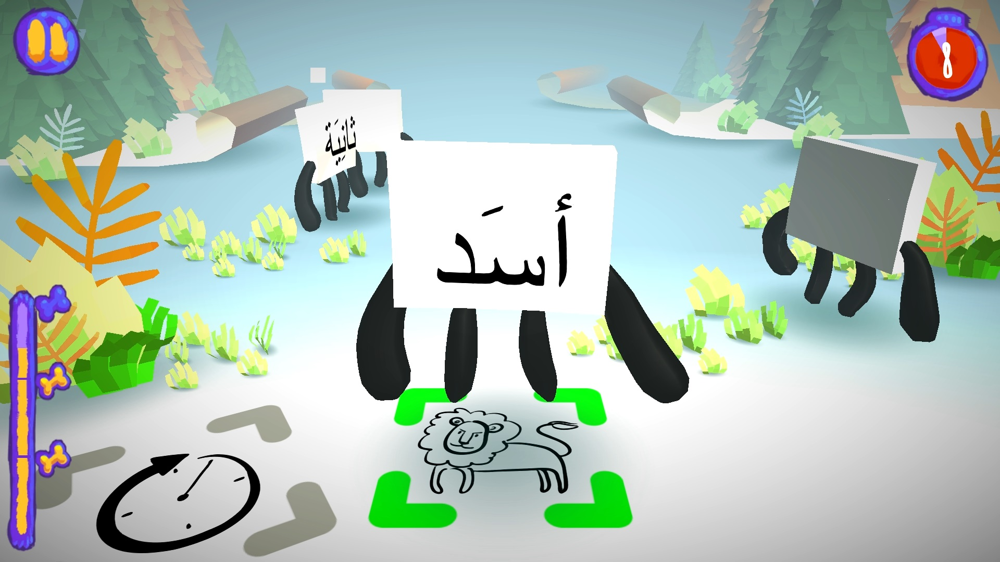
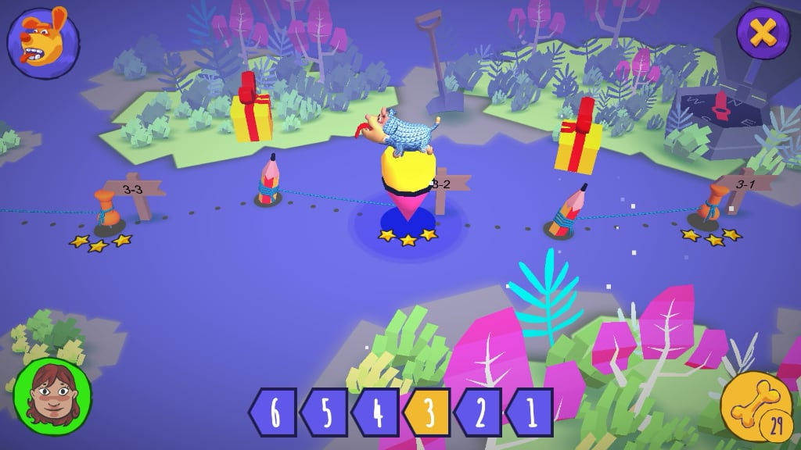
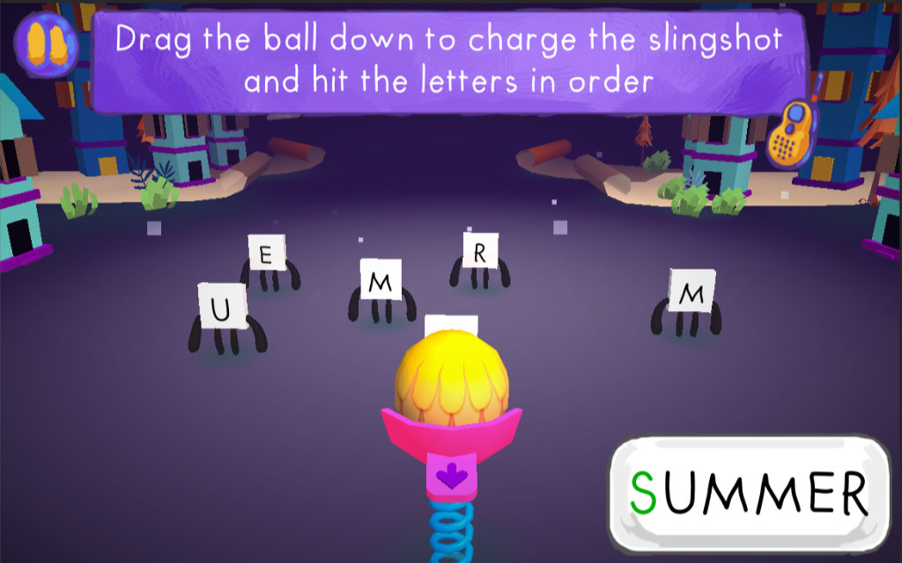
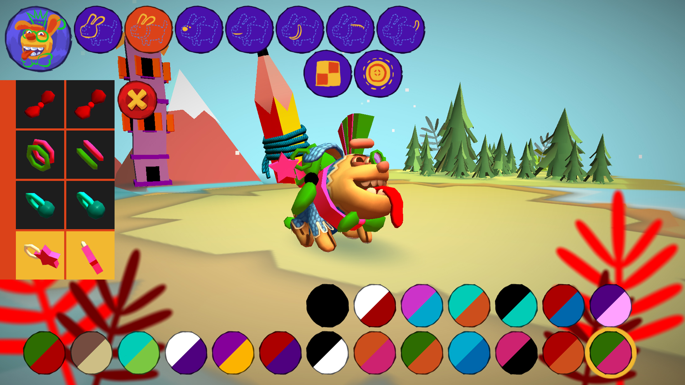

# Antura and the Letters

**Free literacy for all.** Antura and the Letters is an award-winning, open-source game that makes reading and language practice a fun adventure.

[Download the game](/en/download) · [Learn Languages module](../manual/learnlanguage_module.md)

## Learn through play

Children practice letters, words and reading through mini-games on a journey across six worlds. Explore the [language-learning modules](../manual/learnlanguage_module.md) and [how to play](../manual/learnlanguage_how_to_play.md).

## Learn to read and learn a new language

- **Read in your language:** literacy support for Arabic and Persian Dari, with Pashto and Ukrainian listed as in progress.
- **Learn a new language:** courses include English, French, German, Hungarian, Italian, Polish, Romanian and Spanish, from Pre-A1 level.

See the current modules in the [Learn Languages overview](../manual/learnlanguage_module.md#current-learning-modules).

## An award-winning humanitarian project

Created for Syrian refugee children, Antura and the Letters won the international EduApp4Syria competition. It has also received the [UNHCR NGO Innovation Award, Techfugees recognition and other honors](./awards.md). The project grew through the work of a global community of volunteers, universities and NGOs; read its [history](./history.md).

## Free and accessible

The game is free, ad-free and open to community contributions. It runs on PC and mobile and can be played offline after installation. Learn more about the [open-source project](./open-source.md) or [download the game](../download.md).

## See the game

<YouTubeVideo id="HDM7a1i_kIw" title="Antura Trailer" />

