# Design History of Discover Module

This is the story of the cultural exploration module of Learn with Antura, from a workshop with kids to a framework for creating quests.

In short: children play as a cat in 3D worlds, take on short quests of 5 to 15 minutes, meet characters, solve puzzles and collect knowledge cards about the culture of a place. The whole system is open, so teachers and designers can create new quests. See the [introduction](../manual/discover_introduction.md) and the [feature details](../manual/discover_module.md).

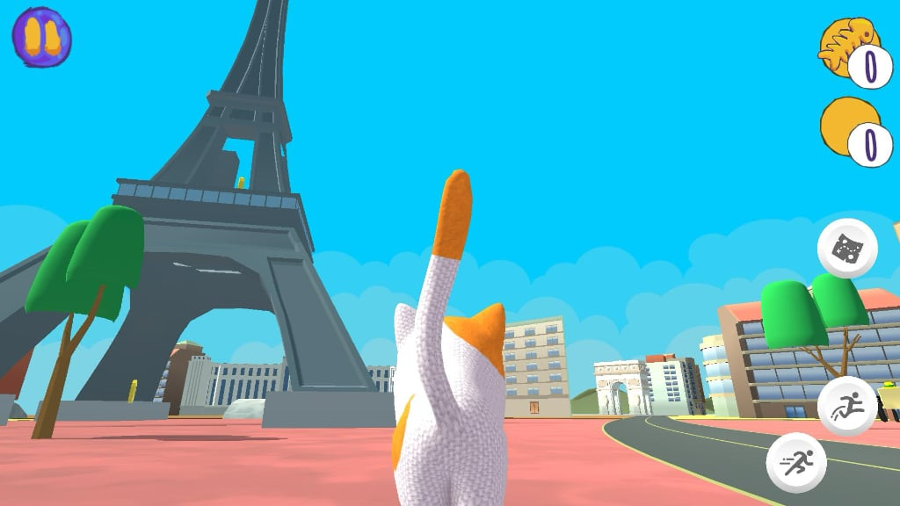

## 1. Starting point

Antura and the Letters was already an open-source educational game for language learning, built as a set of modules. We already had a lot of 3D assets and a new 3D cat model that we wanted to use.

The Erasmus+ plan was to add a **cultural module**, a way to help children, especially those in migration or integration contexts, discover the culture of the place where they live. It was not yet clear what the new module would look like.

## 2. The first workshops with kids

In January 2024, in Angers, we ran the first workshops with about 15 kids from 6 to 10 years old, from Ukraine, Tunisia and Roma communities.

We saw that they loved playing 3D adventures like Roblox. That gave us the idea of **quests** and our first big decision: kids would move freely in a 3D world. We call this the **Roblox mode**, because it is about **interactivity**.

We also decided that teachers would work with the designers from the start.

## 3. Storytelling mode

Moving around is not enough to talk about culture. We needed a way to talk about cultural topics and to create new ways of interacting with them. This is the **storytelling mode**: quests driven by characters and dialogue.

Each quest can have different interaction modes, so it is not always the same game. Quests can be hidden object hunts, collections, physical puzzles, story-driven adventures, cultural quizzes or mini-games.

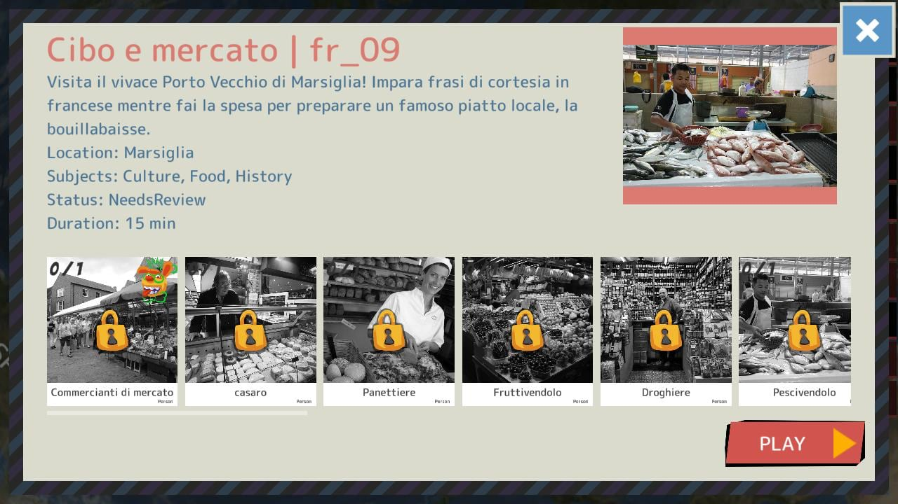
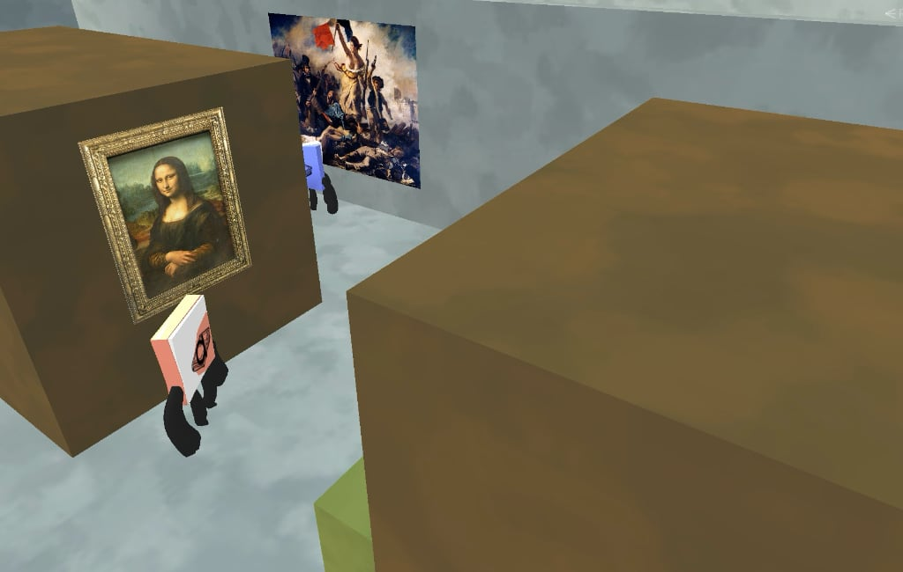

## 4. Writing stories: from Homer to text

At first we tested a visual dialogue tool, Homer. After a first implementation we found that it was too complicated to write, test and improve, and it was hard to translate and keep under version control.

We switched to a **text-based format**, easier to write, translate and version, and it also lets us use AI to check the quality of the texts.
We found the the open source [Yarn Spinner tool](https://www.yarnspinner.dev/) was the perfect tech partner, also because it is agnostic on the platforms and could open the use of the quests on any future game engine we want.

## 5. Cards and the need for a framework

Quests needed a way to leave something to the kid: **knowledge cards**, small pieces of cultural knowledge collected along the way.

We did not have all the game design answers to create the "perfect" didactical quest. So instead of making one big "country tour", we built a **framework**: short quests that can have many variations, and that designers and educators can propose and test.

In spring 2025 the teachers joined the project. We needed a common way to formalize the didactical content they wanted in the quests. Before that we only had generic sheets with topics.

This became the content model:

- **Cards**: "atoms of knowledge" such as places, events, people, objects, concepts and activities, each with a title, a description, images and sounds.
- **Topics**: sets of cards connected by relationships (for example baguette, bread, French food) forming a visible **knowledge graph**.
- **Quests**: short stories that unlock cards and run on one or two topics.

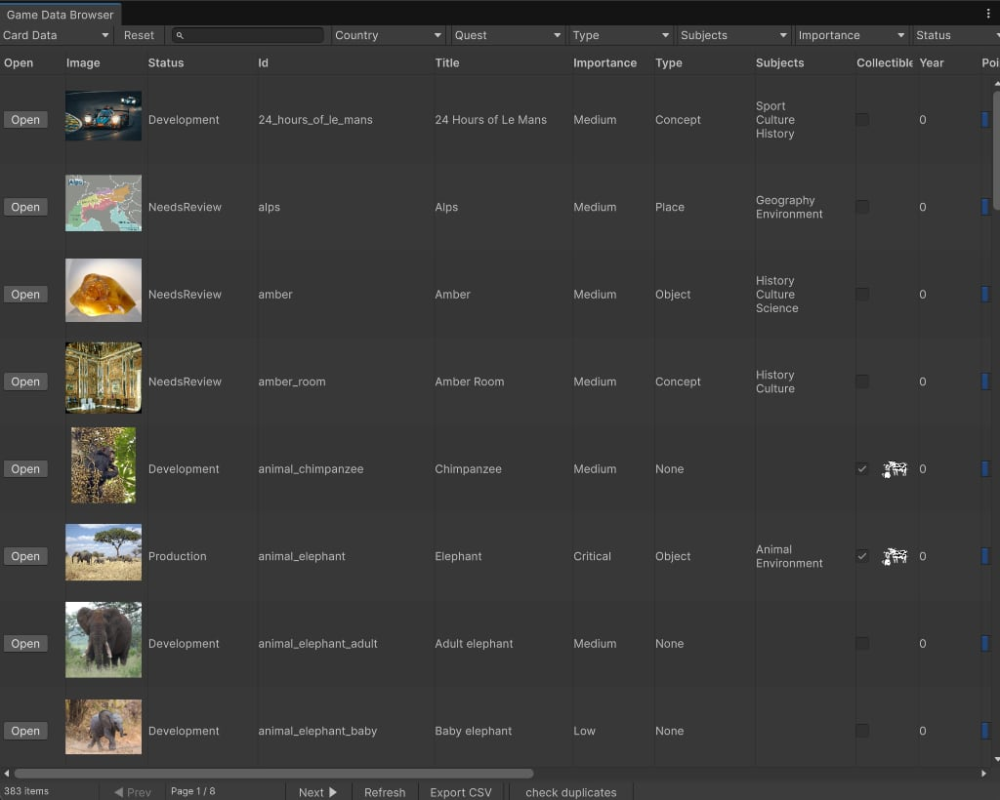
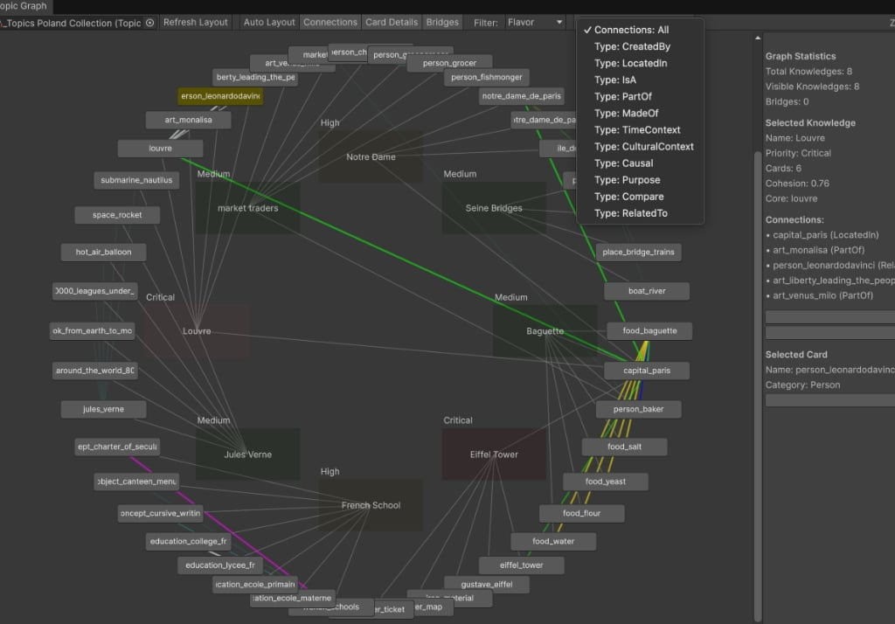

## 6. Activities

In summer 2025 we added **activities**: 2D games that let kids easily play with the cards. They are small and reusable, so we can iterate on them quickly. A new feature of the framework is that an activity can be asked to reinforce a topic and automatically fetch its cards. Examples are order, piano, canvas, money, jigsaw puzzle, memory and quiz. See the [activities overview](../content/activities/index.md).

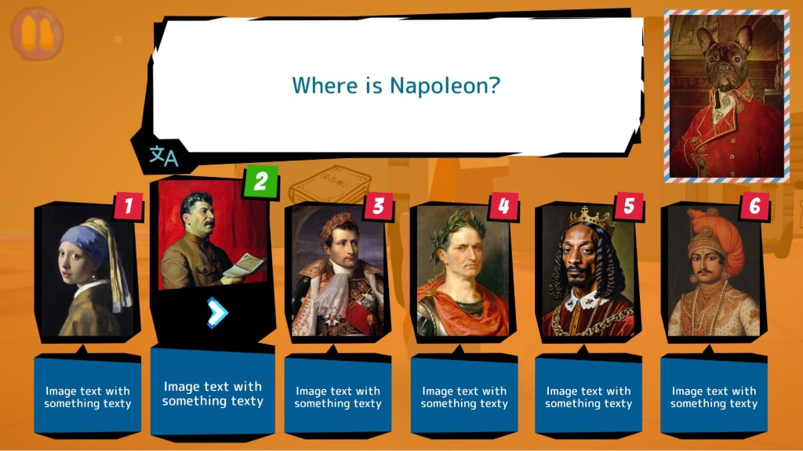

## 7. The open content website

In September 2025 we launched the **open content website**. It gives access to all the didactical content without playing the game, so teachers can study it before and know every line that kids will find in the quests.

We have never seen this feature anywhere else in educational games and we think it is really worth to let other developers know.

Obviously the website is opensource and can be read [here](https://github.com/vgwb/Antura/tree/main/docs)

Today you can browse all [words](../content/words/index.md), [cards](../content/cards/index.md), [topics](../content/topics/index.md) and quests.

As an example of a published quest, see [fr_09](../content/quests/quest/fr_09.md) and its [Yarn script](../content/quests/quest/fr_09-script.md).

### Google Sheets for educators

To let educators correct translations and scripts without any technical tool, the content is also available in **Google Sheets**. Teachers and linguists can review and fix the texts there, and the corrections go back into the game and the website.

### The community forum

To discuss how to use Discover in the classroom, we opened the [Antura community forum](https://antura.discourse.group/), a place where educators and designers share ideas, questions and experiences.

## 8. Pilots

In late 2025 we tested Discover in several classrooms in France and Poland. The reports are available in the documentation.

## 9. Workshops with students creating new quests

Once the framework existed, we could test its strongest idea: letting others become authors. We ran three workshops with game design students in Florence, in May 2024, May 2025 and May 2026, to test and improve the framework, debug it and add features to make it easier to use.

After these workshops we improved the documentation and the starting tutorial, and simplified the work into five steps:

1. Get the content
2. Create an environment
3. Write a story tailored for kids
4. Add interactivity
5. Add new activities

The first new quests were created in France, with new content, and then in Italy, to talk about their local culture.

## 10. Special features for the open source community

From these years of work, four things can be reused by anyone, even outside Antura:

1. **An agnostic quest design and development framework**: quests are written in text, so they do not depend on one game or engine.
2. **A way to put together knowledge topics**: cards connected into a knowledge graph that quests and activities can use.
3. **The open content website, generated from the game**: all the content, readable without playing.
4. **The community website for educators and designers**: the [forum](https://antura.discourse.group/) to share quests and classroom experiences.

## 11. Timeline

| When | What happened |
| --- | --- |
| 2023 | Erasmus+ plan for a cultural module |
| Jan 2024 | First workshops with kids in Angers; quests and Roblox mode born |
| May 2024 | First student workshop in Florence |
| Jan 2025 | First implementation: storytelling mode and quest framework |
| Spring 2025 | Teachers join; didactical content formalized |
| May 2025 | Second student workshop in Florence |
| Summer 2025 | Activities added |
| Sep 2025 | Open content website launched |
| Late 2025 | Pilots in France and Poland |
| May 2026 | Third student workshop in Florence |

## 12. What's next

Discover is a framework, not a single game. We already have several Italian quests in beta. We plan to publish them with detailed game design and educational notes, to invite new people to create their own. The next country is Spain.

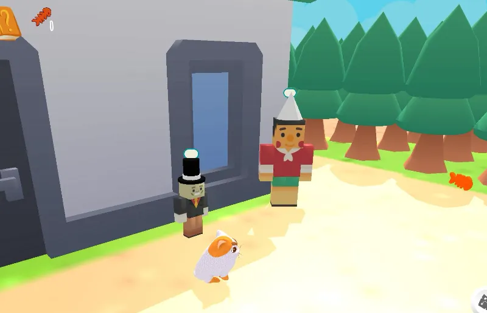
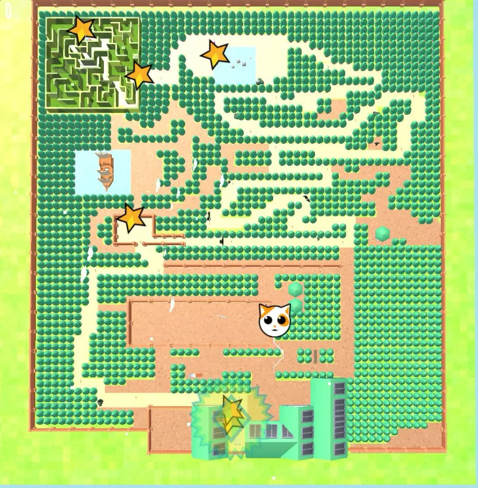
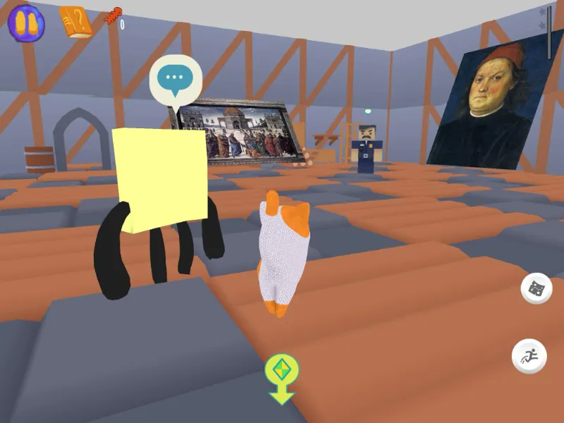
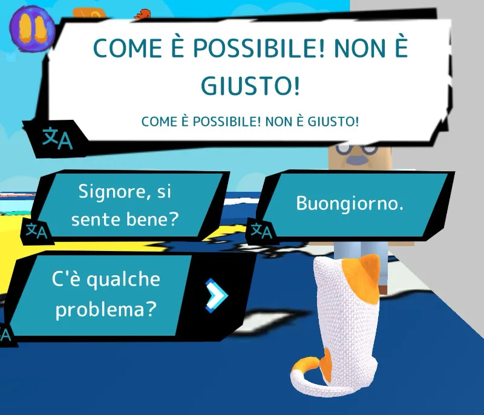
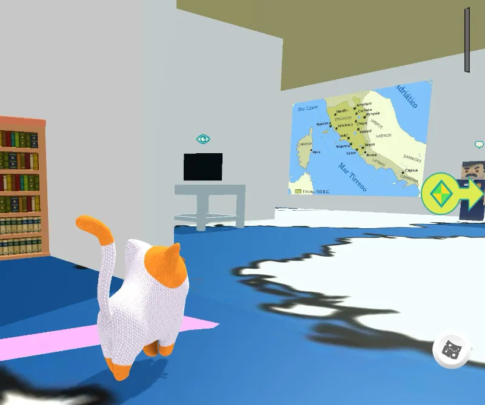
