# Learn with Antura

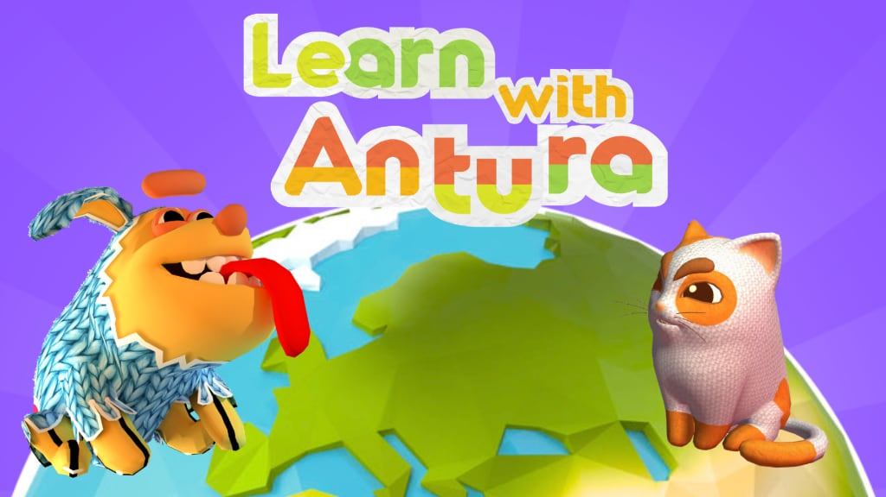

**Play. Discover. Learn.** Learn with Antura is an award-winning, open-source educational game that brings reading, language learning and cultural discovery together through exploration, interaction and stories.

[Download the game](/en/download) · [Support the project](./support-us.md)

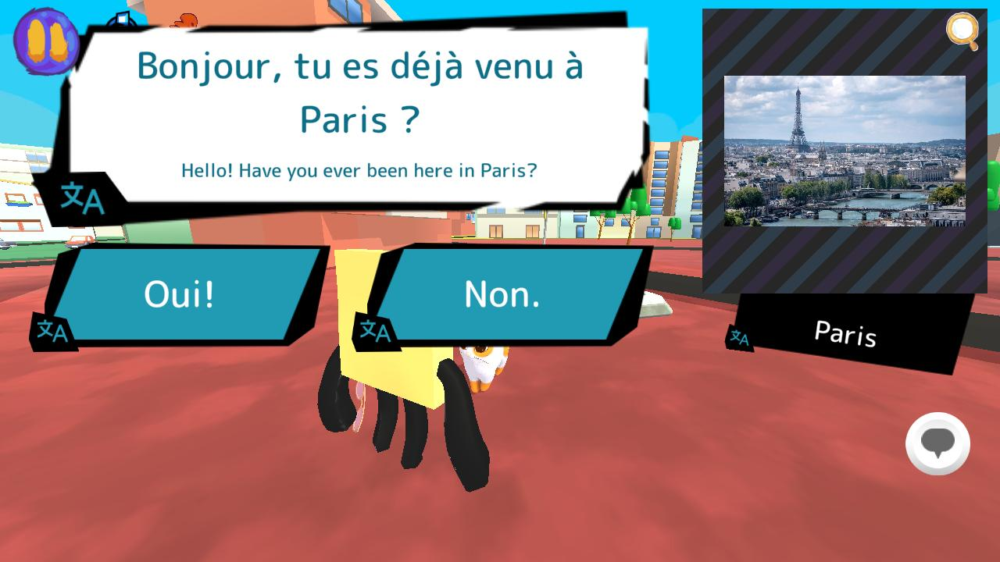

## At a glance

- **Audience:** primarily children aged 6-12, at home or in class
- **Format:** short play sessions, with Discover quests typically lasting 5-15 minutes
- **Learning modes:** language-learning mini-games and cultural exploration quests
- **Platforms:** PC and mobile; playable offline after installation
- **Languages:** play is available in 11 languages
- **Open and modular:** content can be reviewed and adapted without rewriting the core systems

For classroom use, start with the [teacher manual](../manual/index.md) and [classroom guide](../manual/classroom_guide.md).

## Learn and discover

Learn with Antura brings together two complementary modules:

- **Learn Languages:** mini-games teach letters, words and vocabulary. See the [module overview](../manual/learnlanguage_module.md) and [language curriculum](../content/language-curriculum/index.md).
- **Discover Cultures:** short quests invite children to explore places, traditions and everyday life through stories, tasks and knowledge cards. Start with the [Discover introduction](../manual/discover_introduction.md), or read the [feature overview](../manual/discover_module.md) and [how to play](../manual/discover_how_to_play.md).

## The Discover Framework

The Discover Framework separates the game systems from the educational content, so partners can create new learning experiences without rebuilding the game. Its main building blocks are:

- **Worlds and locations:** 3D environments for exploration
- **Quests:** narrative missions with tasks and progression
- **Activities:** reusable mini-games embedded in quests or played from the Book
- **Knowledge cards and topics:** small pieces of content connected into knowledge graphs
- **Characters and dialogue:** guided interactions with multilingual text and audio

See the [quest design guide](../dev/quest-design/index.md) to learn how the framework is used to create content.

## Open, reviewable content

Quests, knowledge cards, dialogue and translations are available in the public [content library](../content/). Educators and partners can review the material, check translations and adapt cultural content without requiring a Unity build.

Explore Discover [quests](../content/quests/index.md), [topics](../content/topics/index.md), [cards](../content/cards/index.md), [words](../content/words/index.md), [activities](../content/activities/index.md) and [locations](../content/locations/index.md), as well as the Learn Languages [mini-games](../content/language-minigames/index.md).

## For educators, creators and partners

Teachers can preview the game content, use classroom activities and lead post-session discussions. Developers and designers can extend the game with new quests and activities, while researchers and schools can pilot and evaluate the learning experience. See the [teacher manual](../manual/index.md), [quest design guide](../dev/quest-design/index.md) and the current [Erasmus+ project](./erasmus.md).

## Open source and recognition

Learn with Antura is free, ad-free and open to community contributions. Its roots are in a humanitarian initiative for children in fragile contexts, and it has received international recognition, including the EduApp4Syria award. Read the [project history](./history.md), [awards and recognition](./awards.md), [impact evaluation](./impact.md), and [open-source overview](./open-source.md).

## See the game

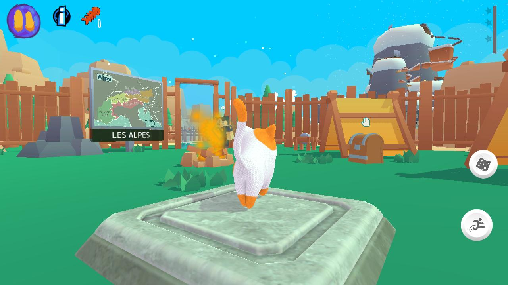
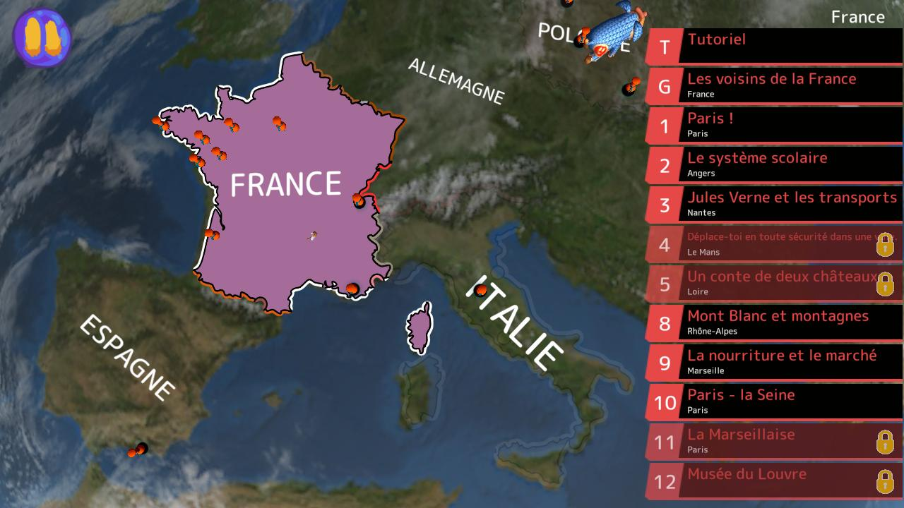
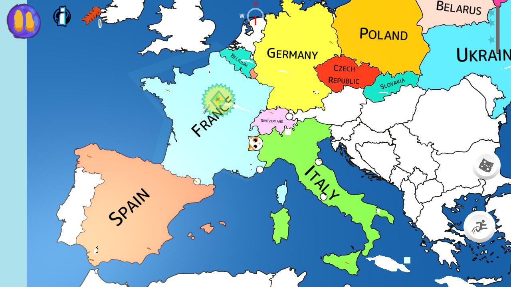

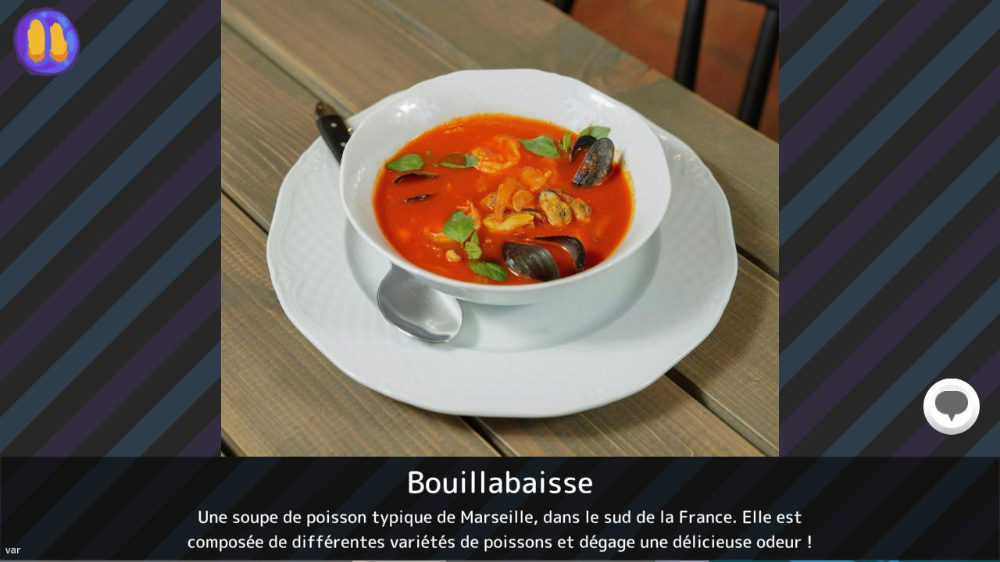
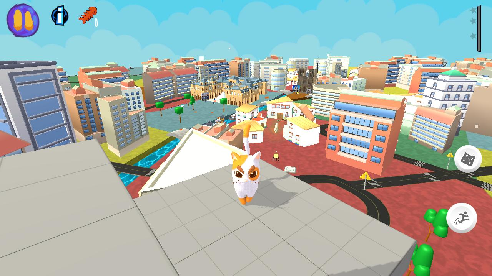
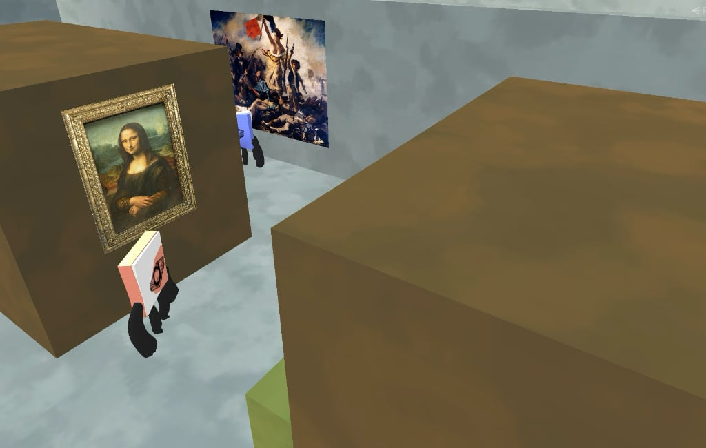
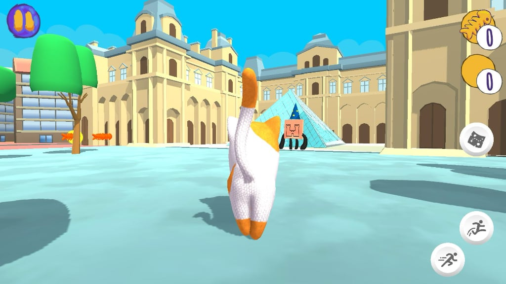
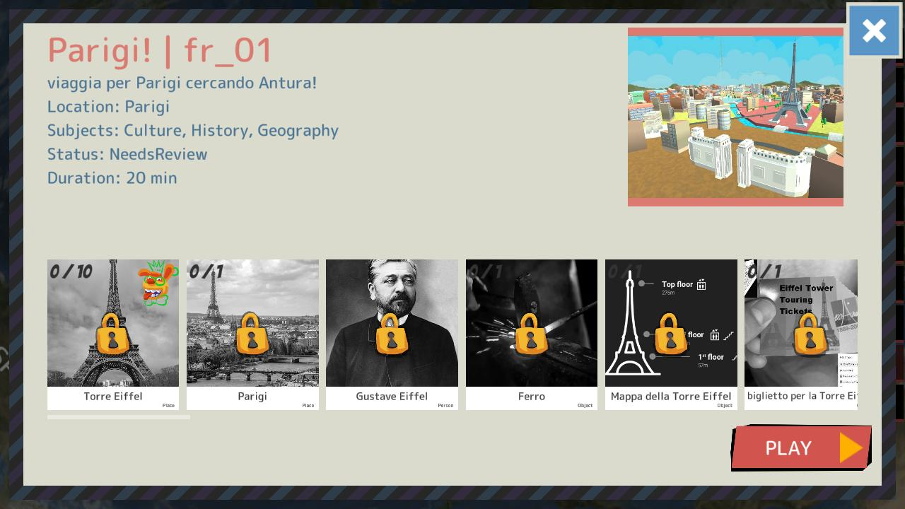
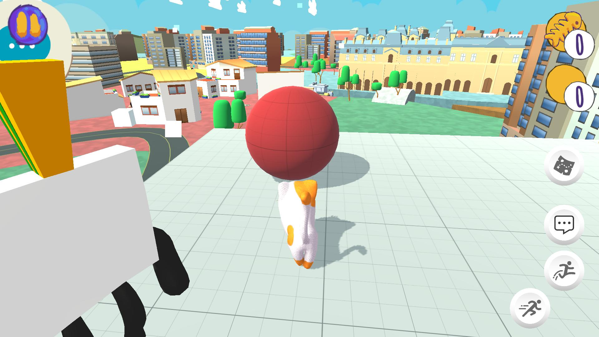
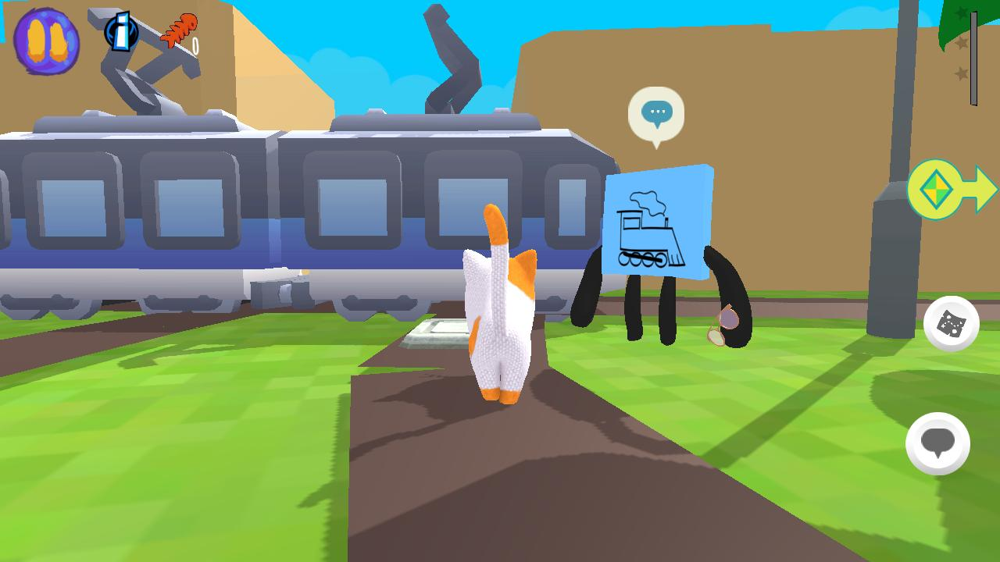
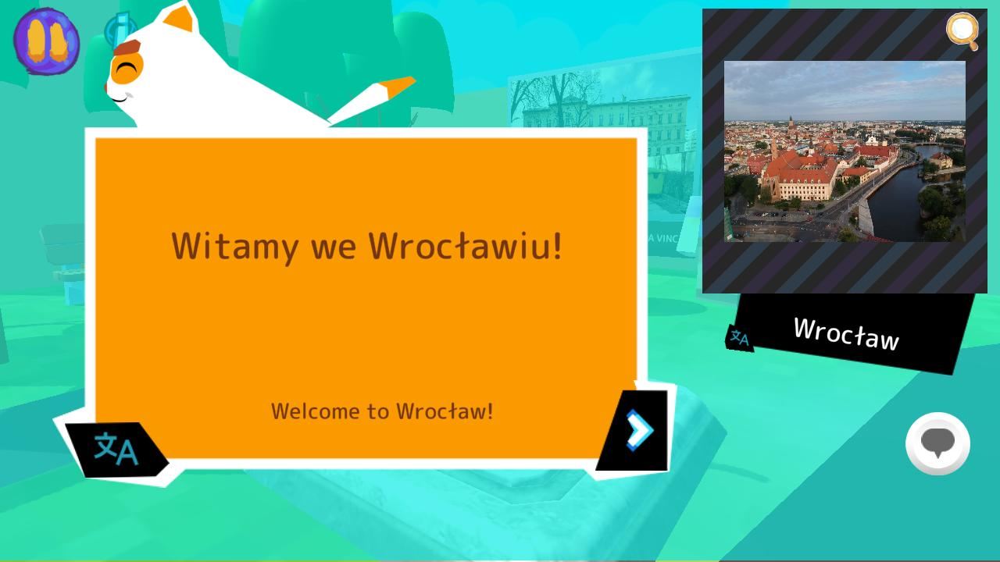
