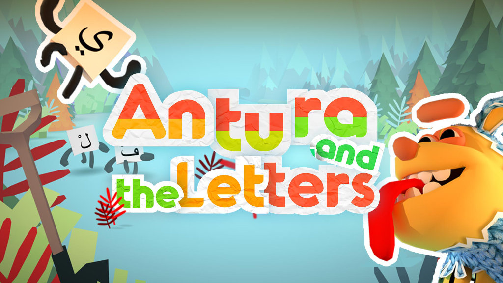
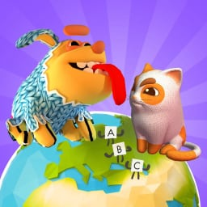

## Antura comes in two editions:

<a class="version-card" href="/en/about/antura-and-the-letters">
  
  

    
🎮 The original awarded version

    <h2>Antura and the Letters</h2>
    
Journey across <strong>6 worlds</strong> to learn the alphabet, 250+ words, and your first phrases through playful minigames. Created for Syrian refugee children and winner of the EduApp4Syria and UNHCR Innovation Award.

    Discover Antura and the Letters →
  

</a>

<a class="version-card" href="/en/about/learn-with-antura">
  
  

    
🌍 The new 2026 edition

    <h2>Learn with Antura</h2>
    
Explore <strong>Discover Cultures</strong> quests with your companion cat, collect knowledge cards, and learn a new language along the way. Built for migrant and refugee children in classrooms and at home, and currently piloted in France and Poland as part of our Erasmus+ project.

    Discover Learn with Antura →
  

</a>

## Explore the docs

<a class="audience-card" href="/en/manual/">
  <h3>📕 Teacher Manual</h3>
  
Find classroom setup advice and practical guidance for using Antura with learners.

</a>
<a class="audience-card" href="/en/content/">
  <h3>📘 Game Content</h3>
  
Browse quests, dialogues, activities, vocabulary, and learning materials from the game.

</a>
<a class="audience-card" href="/en/dev/">
  <h3>📙 Developer Docs</h3>
  
Explore the game architecture and guides for designing and developing quests.

</a>

## Latest news

- **9 November 2026 (upcoming):** [Angers Erasmus+ meeting](/en/news/posts/2026-11-angers)
- **May 2026:** [Fifth Consortium Meeting in Wrocław](/en/news/posts/2026-05-fifth-consortium-meeting-wroclaw)
- **April 2026:** [Teacher capacity-building trainings begin in France and Poland](/en/news/posts/2026-04-capacity-building-trainings)
