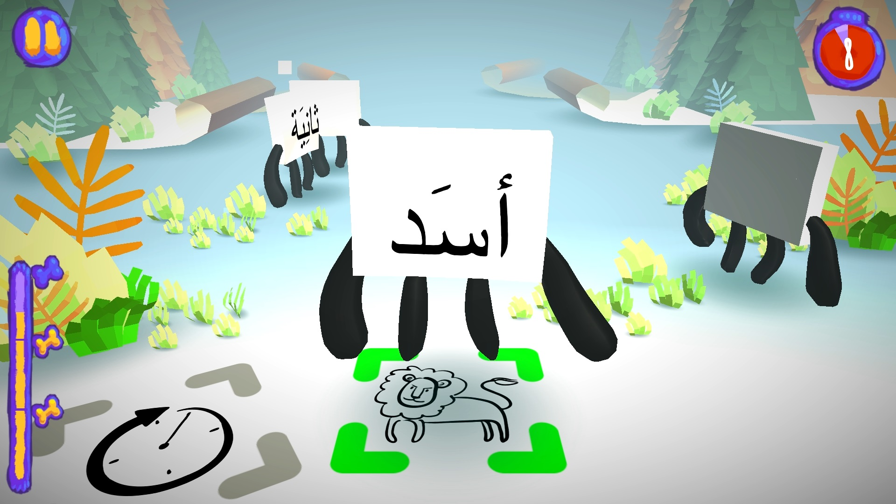
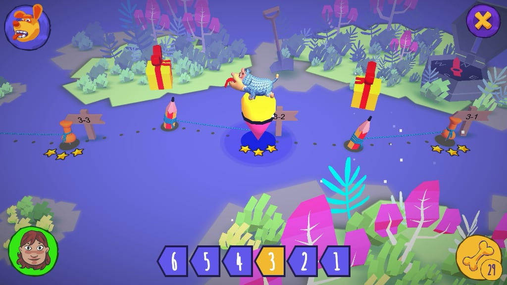
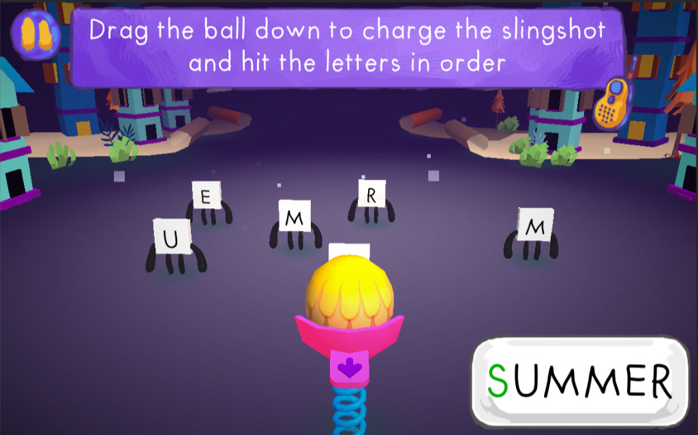
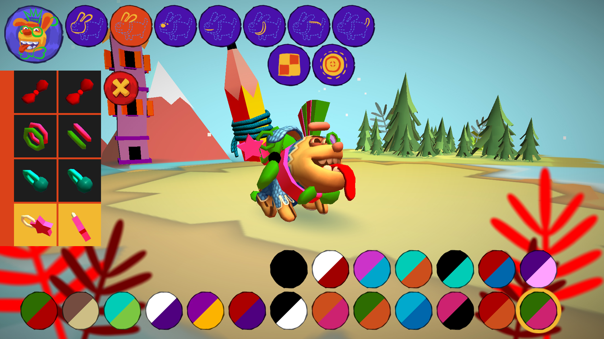

# Antura and the Letters

**L'alphabétisation gratuite pour tous.** Antura and the Letters est un jeu open source primé qui transforme la lecture et la pratique des langues en une aventure amusante.

[Télécharger le jeu](/fr/download) · [Module Learn Languages](../manual/learnlanguage_module.md)

## Apprendre en jouant

Les enfants s'exercent aux lettres, aux mots et à la lecture grâce à des mini-jeux au fil d'un voyage à travers six mondes. Découvrez les [modules d'apprentissage des langues](../manual/learnlanguage_module.md) et [comment jouer](../manual/learnlanguage_how_to_play.md).

## Apprendre à lire et une nouvelle langue

- **Lire dans sa langue :** soutien à l'alphabétisation en arabe et en dari persan ; le pachto et l'ukrainien sont en cours de préparation.
- **Apprendre une nouvelle langue :** cours d'anglais, de français, d'allemand, de hongrois, d'italien, de polonais, de roumain et d'espagnol, à partir du niveau pré-A1.

Consultez les modules actuels dans la [présentation de Learn Languages](../manual/learnlanguage_module.md#current-learning-modules).

## Un projet humanitaire primé

Créé pour les enfants réfugiés syriens, le jeu a remporté le concours international EduApp4Syria. Il a également reçu le [prix UNHCR NGO Innovation Award, une distinction de Techfugees et d'autres récompenses](./awards.md). Le projet s'est développé grâce à une communauté internationale de bénévoles, d'universités et d'ONG ; découvrez son [histoire](./history.md).

## Gratuit et accessible

Le jeu est gratuit, sans publicité et ouvert aux contributions de la communauté. Il fonctionne sur PC et mobile et peut être joué hors ligne après installation. Découvrez le [projet open source](./open-source.md) ou [téléchargez le jeu](../download.md).

## Découvrir le jeu

<YouTubeVideo id="HDM7a1i_kIw" title="Bande-annonce d'Antura" />

