# Learn with Antura

**Jouer. Découvrir. Apprendre.** Learn with Antura est un jeu éducatif open source primé qui réunit la lecture, l'apprentissage des langues et la découverte culturelle par l'exploration, l'interaction et les récits.

[Télécharger le jeu](/fr/download) · [Soutenir le projet](./support-us.md)

## En bref

- **Public :** principalement les enfants de 6 à 12 ans, à la maison ou en classe
- **Format :** courtes sessions de jeu ; les quêtes Discover durent généralement de 5 à 15 minutes
- **Modes d'apprentissage :** mini-jeux linguistiques et quêtes d'exploration culturelle
- **Plateformes :** PC et mobile ; jeu hors ligne après installation
- **Langues :** le jeu est disponible en 11 langues
- **Ouvert et modulaire :** les contenus peuvent être consultés et adaptés sans réécrire les systèmes centraux

Pour une utilisation en classe, consultez le [manuel de l'enseignant](../manual/index.md) et le [guide de la classe](../manual/classroom_guide.md).

## Apprendre et découvrir

Learn with Antura réunit deux modules complémentaires :

- **Learn Languages :** des mini-jeux pour apprendre les lettres, les mots et le vocabulaire. Consultez la [présentation du module](../manual/learnlanguage_module.md) et le [programme linguistique](../content/language-curriculum/index.md).
- **Discover Cultures :** de courtes quêtes invitent les enfants à découvrir des lieux, des traditions et la vie quotidienne à travers des récits, des activités et des cartes de connaissances. Consultez l'[introduction](../manual/discover_introduction.md), la [présentation des fonctionnalités](../manual/discover_module.md) et les [règles du jeu](../manual/discover_how_to_play.md).

## Le Discover Framework

Le Discover Framework sépare les systèmes du jeu des contenus pédagogiques. Les partenaires peuvent ainsi créer de nouvelles expériences d'apprentissage sans reconstruire le jeu. Ses principaux éléments sont :

- **Mondes et lieux :** des environnements 3D à explorer
- **Quêtes :** des missions narratives avec des activités et une progression
- **Activités :** des mini-jeux réutilisables dans les quêtes ou accessibles depuis le Livre
- **Cartes de connaissances et sujets :** des contenus reliés dans des graphes de connaissances
- **Personnages et dialogues :** des interactions guidées avec des textes et des audios multilingues

Consultez le [guide de conception des quêtes](/en/dev/quest-design/) pour découvrir comment créer des contenus avec ce framework.

## Des contenus ouverts et consultables

Les quêtes, cartes de connaissances, dialogues et traductions sont disponibles dans la [bibliothèque de contenus](../content/). Les enseignants et partenaires peuvent consulter les contenus, vérifier les traductions et adapter les éléments culturels sans devoir créer une version du jeu dans Unity.

Explorez les [quêtes](../content/quests/index.md), [sujets](../content/topics/index.md), [cartes](../content/cards/index.md), [mots](../content/words/index.md), [activités](../content/activities/index.md), [lieux](../content/locations/index.md) et [mini-jeux linguistiques](../content/language-minigames/index.md).

## Pour les enseignants, créateurs et partenaires

Les enseignants peuvent découvrir les contenus, utiliser les activités de classe et animer des échanges après les sessions de jeu. Les développeurs et concepteurs peuvent créer des quêtes et activités ; les chercheurs et les écoles peuvent tester et évaluer l'expérience d'apprentissage. Consultez le [manuel de l'enseignant](../manual/index.md), le [guide de conception des quêtes](/en/dev/quest-design/) et le [projet Erasmus+](./erasmus.md).

## Open source et distinctions

Learn with Antura est gratuit, sans publicité et ouvert aux contributions de la communauté. Le projet est issu d'une initiative humanitaire destinée aux enfants en situation de vulnérabilité et a reçu une reconnaissance internationale, notamment le prix EduApp4Syria. Découvrez l'[histoire du projet](./history.md), les [prix et distinctions](./awards.md), l'[évaluation de l'impact](./impact.md) et la présentation [open source](./open-source.md).

## Découvrir le jeu

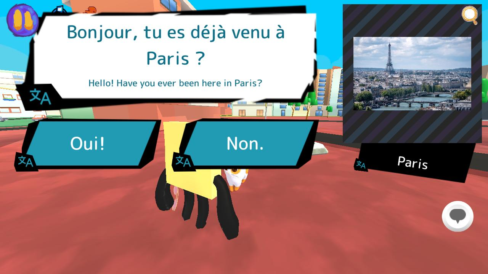
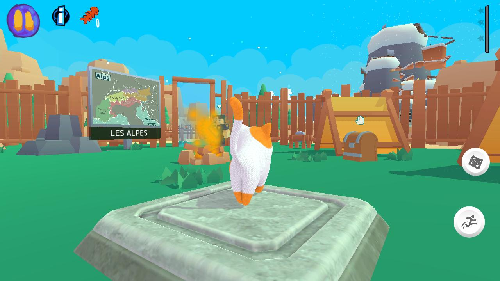
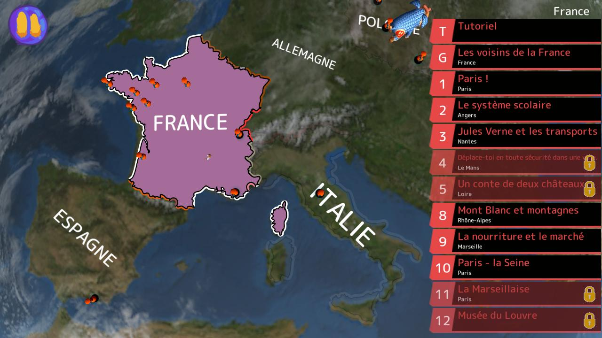
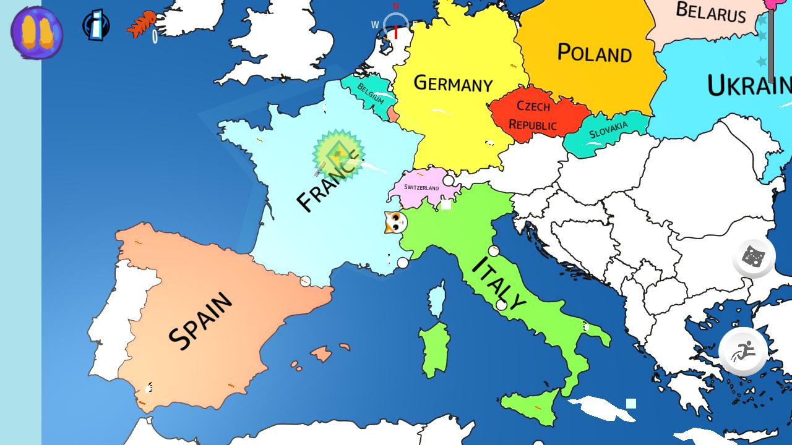

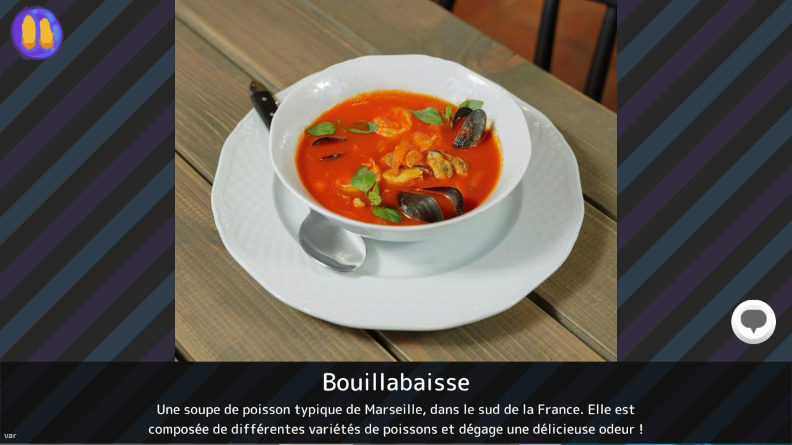
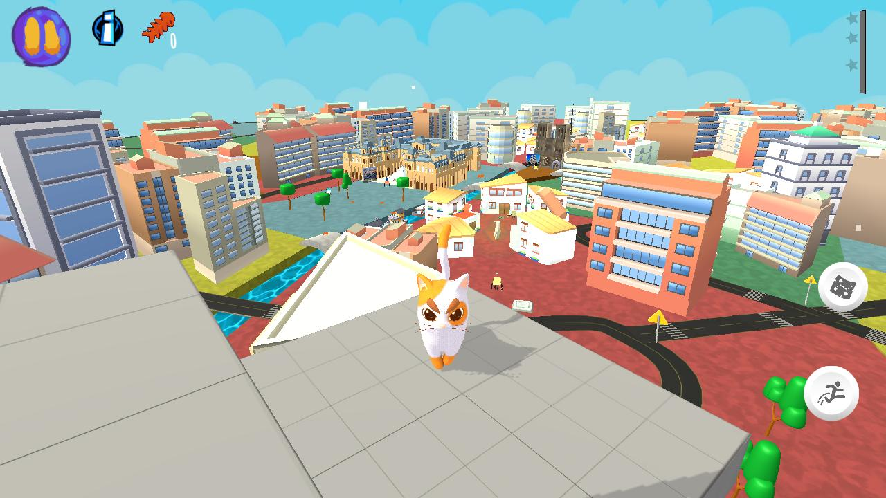
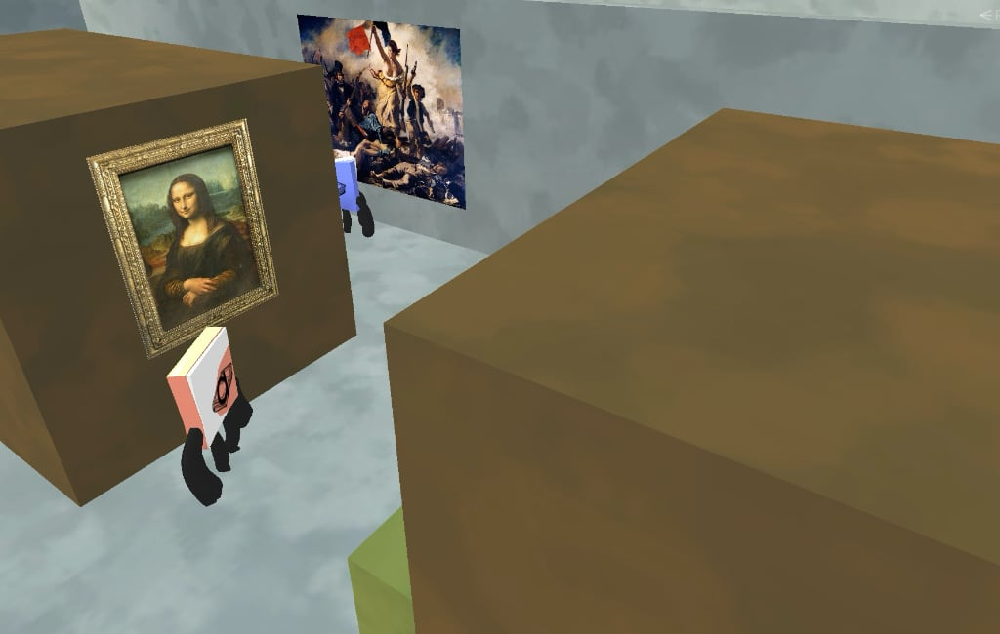
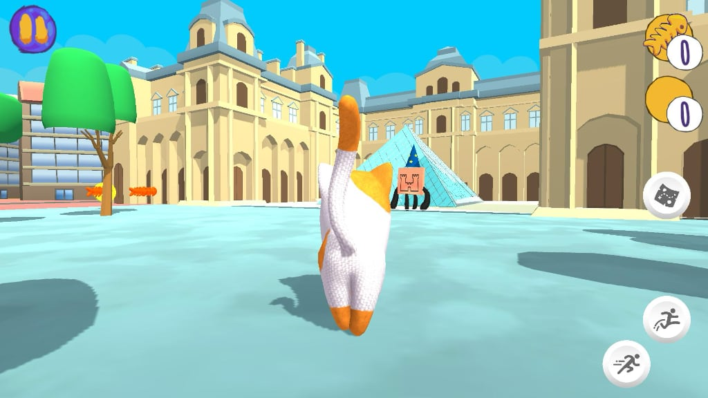
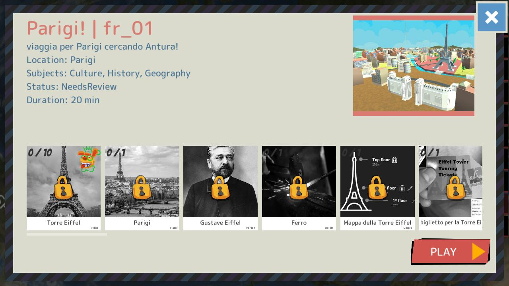
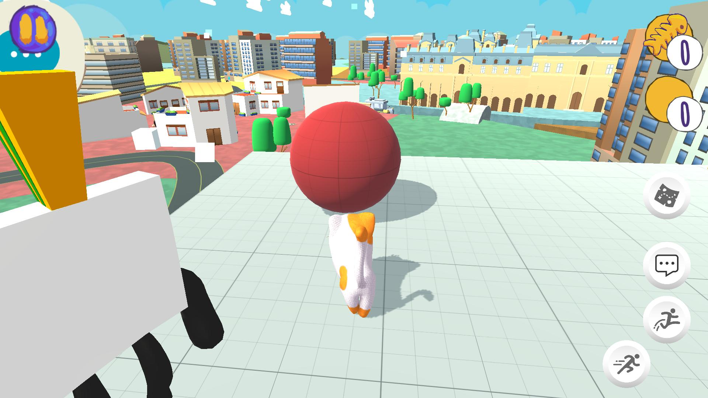
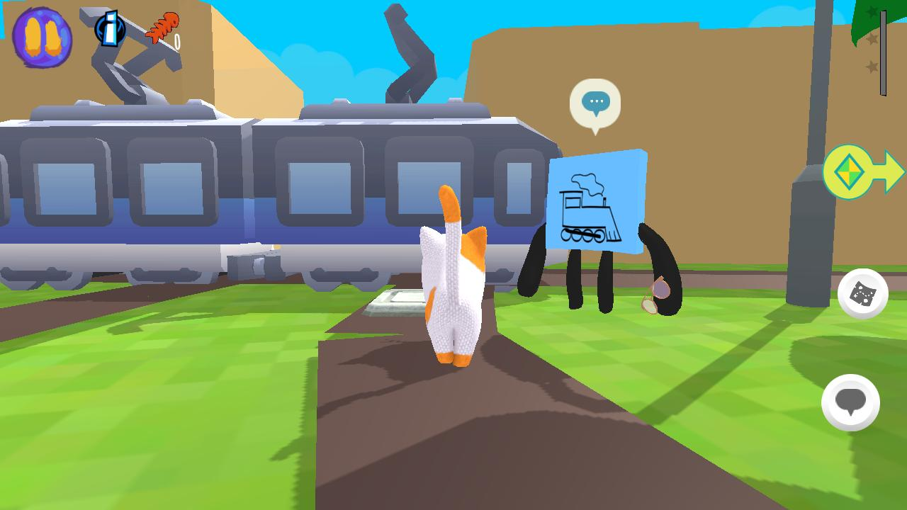
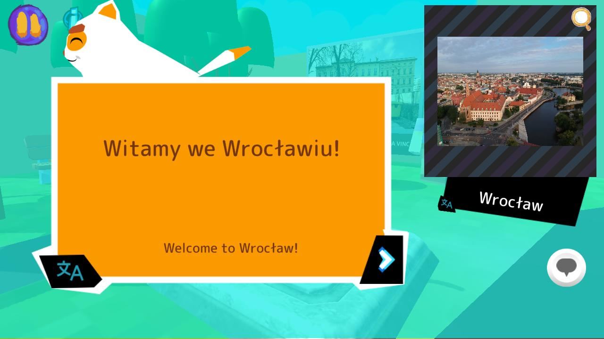
