# Le système scolaire (fr_02)
> [!note] Educators & Designers: help improving this quest!
> **Comments and feedback**: [discuss in the Forum](https://github.com/vgwb/Antura/discussions/629)  
> **Improve script translations**: [comment the Google Sheet](https://docs.google.com/spreadsheets/d/1FPFOy8CHor5ArSg57xMuPAG7WM27-ecDOiU-OmtHgjw/edit?gid=1873232287#gid=1873232287)  
> **Improve Cards translations**: [comment the Google Sheet](https://docs.google.com/spreadsheets/d/1M3uOeqkbE4uyDs5us5vO-nAFT8Aq0LGBxjjT_CSScWw/edit?gid=415931977#gid=415931977)  
> **Improve the script**: [propose an edit here](https://github.com/vgwb/Antura/blob/main/Assets/_discover/_quests/FR_02%20Angers%20School/FR_02%20Angers%20School%20-%20Yarn%20Script.yarn)  

- Version: 1.00
- Status: Production
- Location: France - Angers

- Difficulty: Normal
- Duration (min): 20
- Description: Découvre l'école en France. Visite une école, découvre les différents lieux de l'école (la cour de récréation, la cantine, la salle de classe....). Apprends le nom des différentes écoles et des classes (maternelle, école élémentaire, collège et lycée). Et pour être prêt, prépare ton cartable !

## Game Design Notes

The cat goes to different places until he finds his school. Then he visits the school and finds his class.

### Content
School system : the cats goes a lycée (16-18 ans), to a collège (11-15 ans), to a école maternelle (3-5 ans) and finally goes to an école primaire (6-10 ans), that corresponds to his age, called Jules Verne

A typical day at school

- Morning childcare = garderie du matin
- arrival at the school gate = le portail
- work in class with different subjects/matières : maths, reading & writing
- morning playtime (récréation) on the playground (la cour) 
- lunch at the canteen (la cantine) or at home (à la maison)
- school work with different subjects/matières : PE = EPS (éducation physique et - sportive),  hist/geog = histoire/géographie,  science = sciences, arts= art
- evening childcare = garderie du soir / homework support = aide aux devoirs

School levels with level names and age (CP–6 ans / CE1-7 ans / CE2-8 ans /CM1-9 ans / CM2–10 ans).

### Knowledge content
The French School System: Kids learn the names, age groups, and order of the main schools:

- École Maternelle (3-5 years old)
- École Primaire (6-10 years old) - 5 years total.
- Collège (11-15 years old)
- Lycée (16-18 years old)

**The Baccalauréat**: Kids learn that the Lycée prepares you for a final diploma called le Baccalauréat, which is needed for university.

**Classroom Life**: Kids learn that French students learn to write in cursive, have playtime (la récréation) in the morning and afternoon, and study things like geometry.

**Cultural Values**: Introduction to the principles of French public schools via the national motto and the Charter of Secularism.

## Quest Script
[See the full script here](./fr_02-script.md)

## Topics
### French School {#frenchschool}
[Open topic page](../../topics/index.md#frenchschool)  

- Importance: High  
- Country: France  
- Target age: Ages6to10  
- Subjects: Education

#### Core Card - Les écoles en France
La scolarité se déroule en 4 grandes étapes. L'école maternelle pour les enfants de 3 à 5 ans. L'école élémentaire de 6 à 10 ans. Il y a 5 classes : CP, CE1, CE2, CM1 et CM2. Le collège de 11 à 14 ans. Il y a 4 classes : 6ème, 5ème, 4ème et 3ème. Le lycée de 15 à 18 ans. Il y a 3 classes : 2nde, 1ère et terminale.

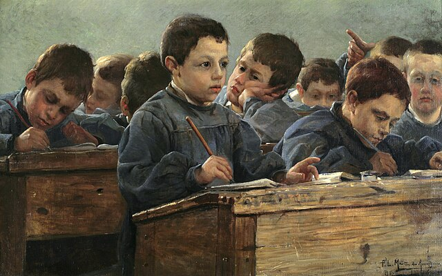{ width="200" }
- Type: Concept
- Subjects: Education, Civics, Culture

#### Connection (PartOf) - L’école maternelle
C'est une école pour les enfants de 3 à 5 ans. Les enfants apprennent en explorant et en jouant.

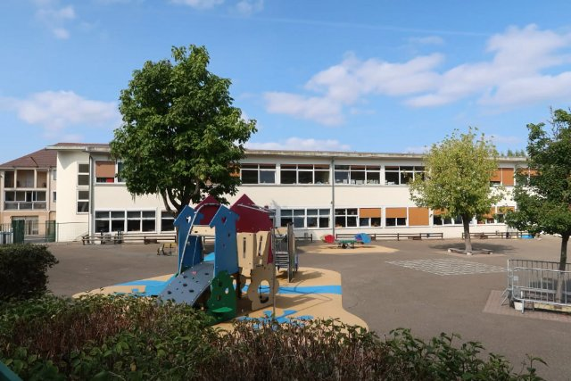{ width="200" }
- Type: Concept
- Subjects: Education, Culture
- Year: 1975

#### Connection (PartOf) - École élémentaire
C'est une école pour les élèves de 6 à 10 ans. Les enfants apprennent à lire, écrire et compter.

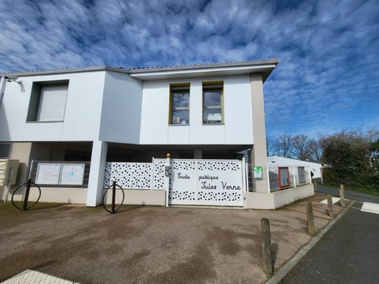{ width="200" }
- Type: Concept
- Subjects: Education, Culture
- Year: 1975

#### Connection (PartOf) - Le lycée
C’est une école pour les adolescents de 14 à 18 ans. Les élèves ont différents professeurs et matières: mathématiques, anglais, sciences, sport, histoire… Ils préparent un examen final qui s’appelle le baccalauréat.

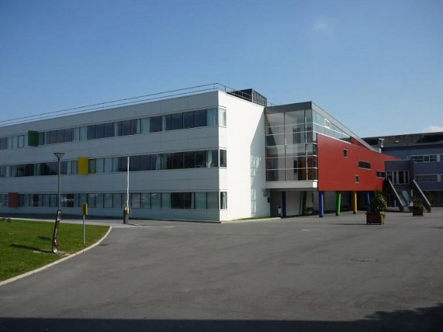{ width="200" }
- Rationale: The Lycée system shows kids the path to higher education in France
- Type: Concept
- Subjects: Education, Culture
- Year: 1975

#### Connection (PartOf) - Le collège
C'est une école pour les élèves de 11 à 14 ans. Les élèves ont différents professeurs et matières: mathématiques, anglais, sciences, sport, histoire…

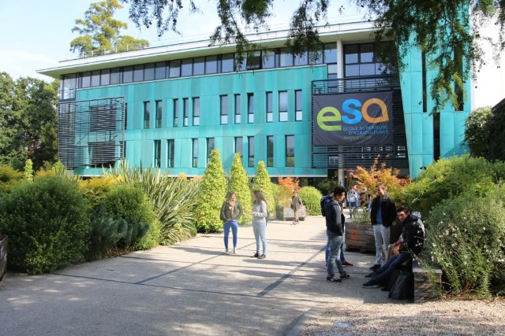{ width="200" }
- Rationale: Understanding the French school system helps kids compare education across countries
- Type: Concept
- Subjects: Education, Culture
- Year: 1975

#### Connection (Purpose) - Menu de la cantine
Une liste des aliments autorisés à la cantine. Elle vous aide à choisir vos repas !

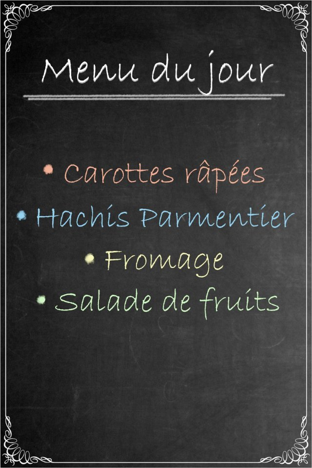{ width="200" }
- Type: Object
- Subjects: Community, Culture

### Elementary Math {#elementary-maths}
[Open topic page](../../topics/index.md#elementary-maths)  

Numbers and shapes for everyday life: counting, adding and subtracting, simple fractions, measuring, telling time, and using money.

- Importance: Medium  
- Country: International  
- Target age: Ages6to10  
- Subjects: Math

#### Core Card - Mathématiques élémentaires
Chiffres et formes de la vie quotidienne : compter, additionner et soustraire, fractions simples, mesurer, lire l'heure et utiliser l'argent.

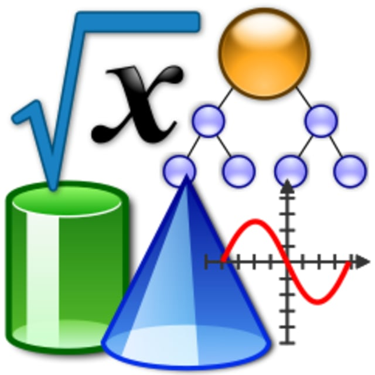{ width="200" }
- Type: None

#### Connection (PartOf): curriculum element - Doubler
Une ligne droite reliant un point à un autre. Les lignes peuvent être longues ou courtes.

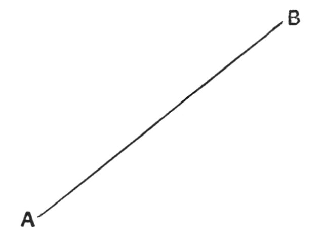{ width="200" }
- Type: Concept
- Subjects: Math

#### Connection (PartOf): curriculum element - Triangle
Une forme à trois côtés droits et trois coins. Les triangles ressemblent à des parts de pizza !

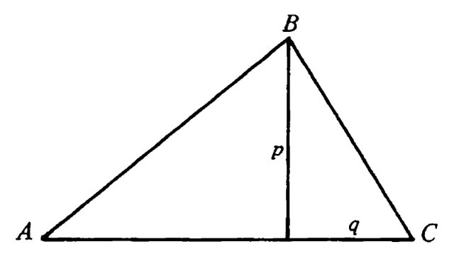{ width="200" }
- Type: Concept
- Subjects: Math

#### Connection (Purpose): tool used for math - Compas
Un outil qui permet de tracer des cercles parfaits. Il possède deux branches, comme des ciseaux.

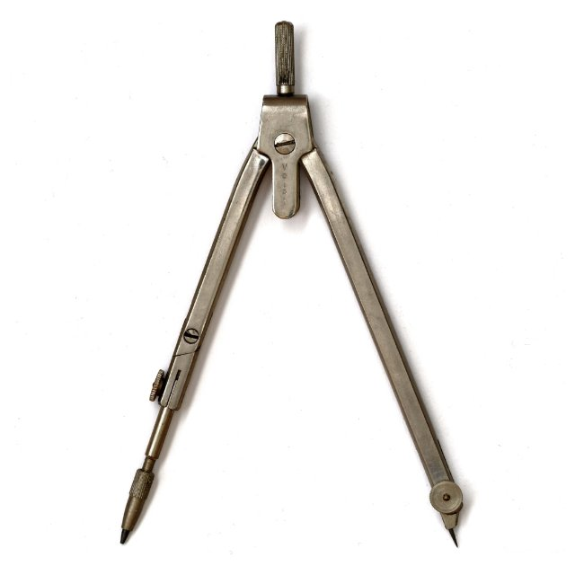{ width="200" }
- Type: Object
- Subjects: Math

#### Connection (Purpose): tool used for math - la règle
C'est un outil utilisé pour mesurer et tracer des lignes.

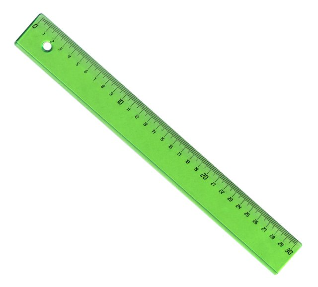{ width="200" }
- Type: Object
- Subjects: Math

#### Connection (Purpose): tool used for math - Carré
Un outil en forme de triangle utilisé pour dessiner des lignes droites et des angles droits en mathématiques.

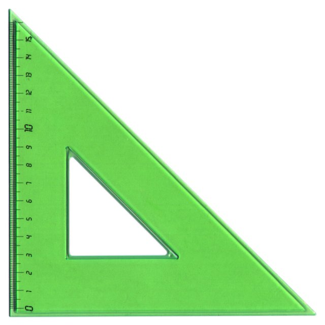{ width="200" }
- Type: Object
- Subjects: Math

#### Connection (PartOf): Previous core card - Cercle
Une forme ronde sans coins. Les cercles ressemblent à des roues, des boules et des pièces de monnaie !

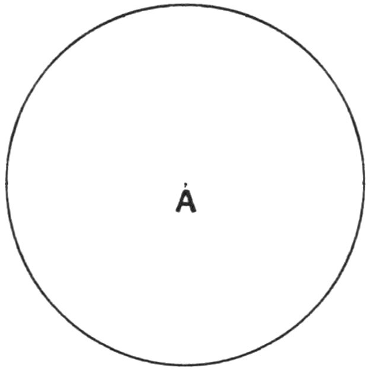{ width="200" }
- Type: Concept
- Subjects: Math

## Additional Cards
#### Le cartable
Dans ton cartable, tu transportes ton matériel d'école. Tu ranges ta trousse, tes cahiers, tes crayons, tes livres. 

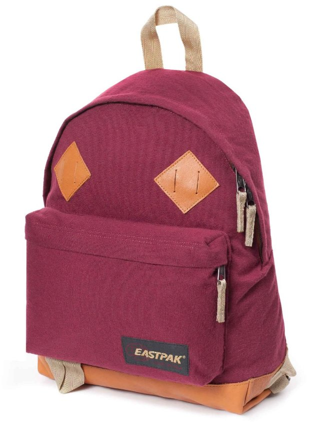{ width="200" }
- Type: Object
- Subjects: Science

#### la salle de classe
Une salle à l'école où les élèves s'assoient et apprennent de nouvelles choses de leur professeur.

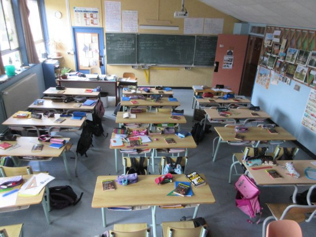{ width="200" }
- Type: Place
- Subjects: Education, Community

## Words
- water
## Activities
- [Match](../../activities/index.md#Match)
- [Order](../../activities/index.md#Order)

## Tasks
- [Interact] TASK_SCHOOL
- [Collect] TASK_BACKPACK
- [Interact] TASK_CLASSROOM
## Credits
- Anne (France) (content)
- Lucie Paillat (France) (content, design)
- [Stefano Cecere](https://stefanocecere.com) (Italy) (development)
- Valeria Passarella (Italy) (design)
