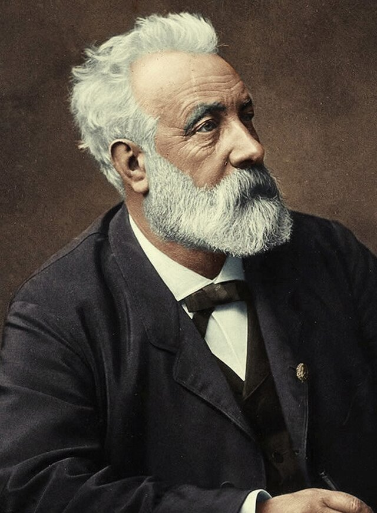
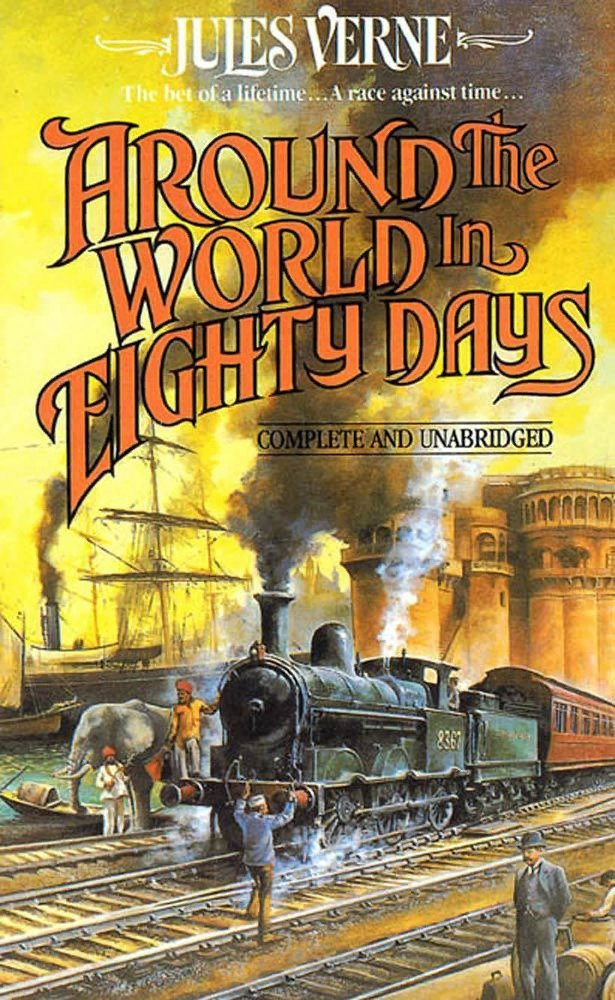
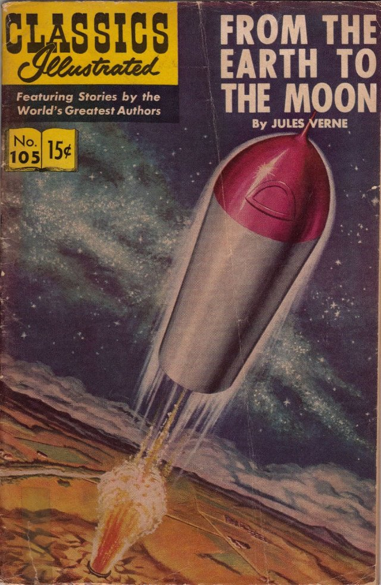
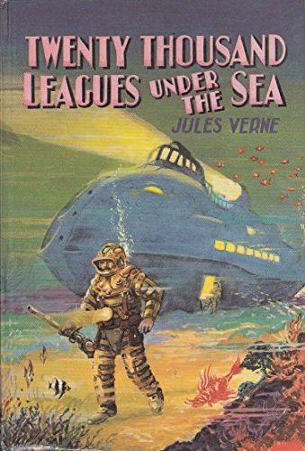
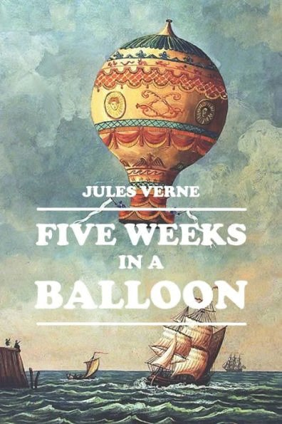
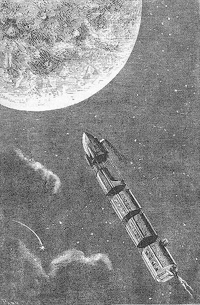
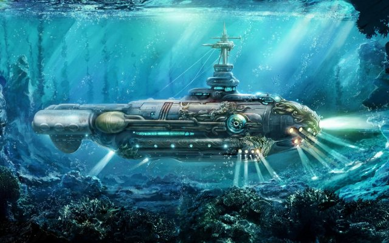
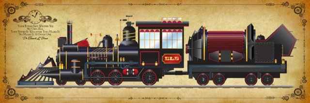
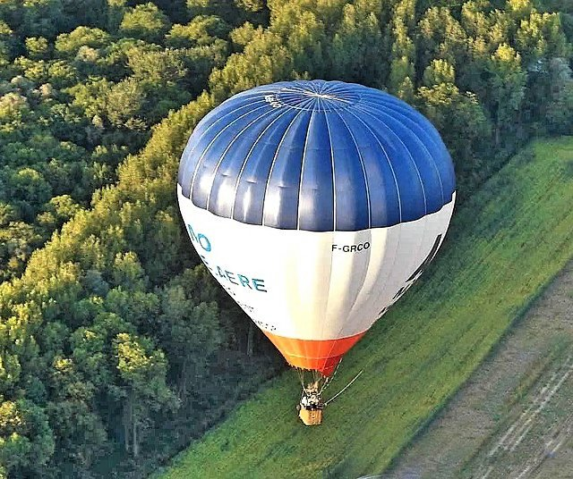

# Jules Verne et les transports (fr_03)
> [!note] Educators & Designers: help improving this quest!
> **Comments and feedback**: [discuss in the Forum](https://github.com/vgwb/Antura/discussions/630)  
> **Improve script translations**: [comment the Google Sheet](https://docs.google.com/spreadsheets/d/1FPFOy8CHor5ArSg57xMuPAG7WM27-ecDOiU-OmtHgjw/edit?gid=336647638#gid=336647638)  
> **Improve Cards translations**: [comment the Google Sheet](https://docs.google.com/spreadsheets/d/1M3uOeqkbE4uyDs5us5vO-nAFT8Aq0LGBxjjT_CSScWw/edit?gid=415931977#gid=415931977)  
> **Improve the script**: [propose an edit here](https://github.com/vgwb/Antura/blob/main/Assets/_discover/_quests/FR_03%20Nantes%20Verne/FR_03%20Nantes%20Verne%20-%20Yarn%20Script.yarn)  

- Version: 1.00
- Status: Production
- Location: France - Nantes

- Difficulty: Normal
- Duration (min): 15
- Description: Découvre les transports de Jules Verne - le sous-marin, la fusée, le ballon, et le train - et apprends des choses sur lui, ses livres et les mots du voyage.

## Game Design Notes

**Core Subject:** Literature, Vocabulary (Vehicles/Travel), and Civic Responsibility.

### Player Objectives

**Civic Duty:** The player arrives to find the museum in disarray. They must first help the staff by cleaning the sidewalk and tidying up the museum hall to make it ready for visitors.

**Literary Exploration:** The Museum Guide tasks the player with finding four missing exhibits corresponding to Verne's famous novels: a Submarine, a Hot Air Balloon, a Rocket, and a Steam Train.

**Restoration & Learning:** Upon finding each object, the player repairs it (via a jigsaw puzzle) and learns facts about the vehicle and the book it comes from (e.g., linking the Nautilus to 20,000 Leagues Under the Sea).

**Final Assessment:** The quest concludes with a matching activity where the player must correctly pair each book with its specific vehicle.

### Educational Content

**Cultural Figure:** Introduces Jules Verne as a famous writer born in Nantes who imagined future technologies.

**Vocabulary:** Focuses on travel and vehicle words (Submarine, Rocket, Balloon, Train, Steam, Earth, Moon).

**Reading Comprehension:** Players read simple descriptions of the books to understand the function of each vehicle

## Quest Script
[See the full script here](./fr_03-script.md)

## Topics
### Jules Verne {#jules_verne}
[Open topic page](../../topics/index.md#jules_verne)  

- Importance: Medium  
- Country: France  
- Target age: Ages6to10

#### Core Card - Jules Verne
Jules Verne est né en 1828, il y a presque 200 ans. Il est mort en 1905. C'est un écrivain français qui a écrit beaucoup de livres. Il a imaginé des moyens de transport extraordinaires avant qu'ils existent vraiment ! Il a écrit sur les sous-marins, les fusées et les voyages autour du monde.

{ width="200" }
- Rationale: Jules Verne shows kids how imagination and science can work together
- Type: Person
- Subjects: Literature, Science, History
- Year: 1828

#### Connection (RelatedTo) - Le tour du monde en 80 jours
C'est un livre écrit par Jules Verne. Il parle d'un très beau et très rapide voyage autour du monde en train, en bateau et en ballon !

{ width="200" }
- Type: Object
- Subjects: Literature
- Year: 1873

#### Connection (RelatedTo) - De la Terre à la Lune
C'est un livre écrit par Jules Verne. Il raconte un voyage vers la Lune dans un engin spatial lancé par un grand canon. À l'époque, les fusées spatiales n'existaient pas encore !

{ width="200" }
- Type: Object
- Subjects: Literature, Space, Science
- Year: 1865

#### Connection (RelatedTo) - 20000 lieues sous les mers
C'est un livre écrit par Jules Verne. Il parle d'un voyage dans le sous-marin qui s'appelle le Nautilus et des grands animaux qui vivent sous la mer.

{ width="200" }
- Type: Object
- Subjects: Literature
- Year: 1871

#### Connection (RelatedTo) - 5 semaines en ballon
C'est un livre de Jules Verne qui raconte un voyage en ballon au-dessus de l'Afrique, plein d'aventures et de découvertes !

{ width="200" }
- Type: Object
- Subjects: Literature
- Year: 1863

#### Connection (RelatedTo) - Fusée
Une fusée monte dans le ciel jusqu'à l'espace.

{ width="200" }
- Type: Object
- Subjects: Science

#### Connection (RelatedTo) - Sous-marin (Le Nautilus)
C'est le sous-marin du livre de Jules Verne. On peut explorer la mer et observer les animaux à bord.

{ width="200" }
- Type: Object
- Subjects: Literature, Science

#### Connection (RelatedTo) - le train
Les trains transportent des personnes et des marchandises rapidement dans tout le pays.

{ width="200" }
- Type: Object
- Subjects: Transportation

#### Connection (RelatedTo) - Montgolfière
Un ballon volant à l'air chaud. Le premier à voler en France.

{ width="200" }
- Type: Object
- Subjects: Transportation

## Words
## Activities
- [JigsawPuzzle](../../activities/index.md#JigsawPuzzle)
- [JigsawPuzzle](../../activities/index.md#JigsawPuzzle)
- [JigsawPuzzle](../../activities/index.md#JigsawPuzzle)
- [JigsawPuzzle](../../activities/index.md#JigsawPuzzle)
- [JigsawPuzzle](../../activities/index.md#JigsawPuzzle)
- [Match](../../activities/index.md#Match)

## Tasks
- [Collect] clean_sidewalk
- [Collect] clean_museum
- [Interact] find_submarine
- [Interact] find_balloon
- [Interact] find_rocket
- [Interact] find_train
- [Interact] back_to_museum_guide
## Credits
- Anne (France) (content)
- Lucie Paillat (France) (content, design)
- [Stefano Cecere](https://stefanocecere.com) (Italy) (content, design, development)
