# Le marché de Marseille (fr_09)
> [!note] Educators & Designers: help improving this quest!
> **Comments and feedback**: [discuss in the Forum](https://github.com/vgwb/Antura/discussions/633)  
> **Improve script translations**: [comment the Google Sheet](https://docs.google.com/spreadsheets/d/1FPFOy8CHor5ArSg57xMuPAG7WM27-ecDOiU-OmtHgjw/edit?gid=1243903291#gid=1243903291)  
> **Improve Cards translations**: [comment the Google Sheet](https://docs.google.com/spreadsheets/d/1M3uOeqkbE4uyDs5us5vO-nAFT8Aq0LGBxjjT_CSScWw/edit?gid=415931977#gid=415931977)  
> **Improve the script**: [propose an edit here](https://github.com/vgwb/Antura/blob/main/Assets/_discover/_quests/FR_09%20Food%20&%20Market/FR_09%20Food%20&%20Market%20-%20Yarn%20Script.yarn)  

- Version: 1.00
- Status: Production
- Location: France - Marseille

- Difficulty: Normal
- Duration (min): 15
- Kind:
  - Seek
  - Puzzles
- Description: Visite le port de la ville de Marseille. Tu vas découvrir le marché, la nourriture et ses commerçants. Tu vas acheter les ingrédients pour préparer une soupe de poissons: la bouillabaise. 

## Game Design Notes

**Core Subject:** Food, Commerce, and Social Etiquette.

**Player Objectives:**

1. **Culinary Mission:** The player meets a Chef who wants to prepare a traditional **Bouillabaisse** (fish stew) but lacks the ingredients.
2. **Market Exploration:** The player must visit four different vendors (Baker, Fishmonger, Cheesemonger, Greengrocer) to find specific items like **fish, bread, tomatoes, and olive oil**.
3. **Social Interaction:** To succeed, the player must use polite greetings ("Bonjour", "Merci") and select the correct items from each vendor's list.
4. **Financial Literacy:** The player pays for items using a mini-game that simulates counting money (Euros).
5. **Final Preparation:** After collecting all 9 ingredients, the player returns to the Chef to match the ingredients to their source (e.g., Fish comes from the Fishmonger) and "cook" the final dish.

**Educational Content:**

- **Cultural Dish:** Introduces _Bouillabaisse_ as a famous specialty of Marseille.
- **Vocabulary:** Focuses on food items (_Fish, Crab, Bread, Milk, Oil, Tomato, Lemon_) and professions (_Baker, Grocer, Fishmonger_).
- **Social Skills:** Reinforces the importance of politeness (greeting before asking) and basic commerce (exchanging money for goods).

## Quest Script
[See the full script here](./fr_09-script.md)

## Topics
### market traders {#marketers}
[Open topic page](../../topics/index.md#marketers)  

People who sell food and goods at market stalls—like fishmongers, cheesemongers, and fruit sellers. They weigh, wrap, and call out today’s prices.

- Importance: Medium  
- Country: France  
- Target age: Ages6to10

#### Core Card - les commerçants du marché
Les commerçants ou marchands vendent des produits alimentaires et autres marchandises sur les étals des marchés. On peut trouver le poissonnier, les fromager, l'épicier, le marchands de fruits et légumes. Tu peux acheter des produits frais. 

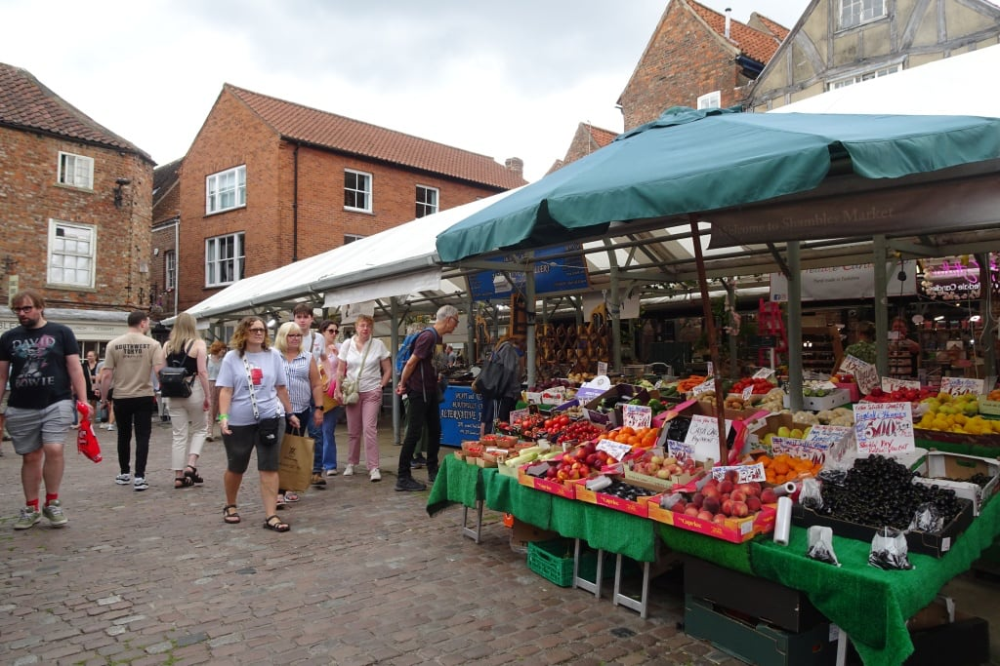{ width="200" }
- Type: Person
- Subjects: Money, Community

#### Connection (RelatedTo) - le fromager
Le fromager vend des produits à base de lait: des yaourts, du fromage...

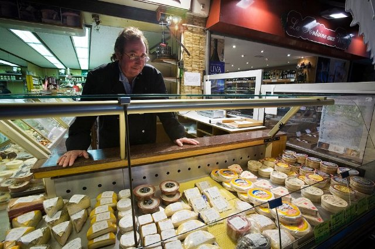{ width="200" }
- Type: Person
- Subjects: History, Culture

#### Connection (RelatedTo) - le boulanger
Le boulanger fait du pain, des gâteaux et des pâtisseries.

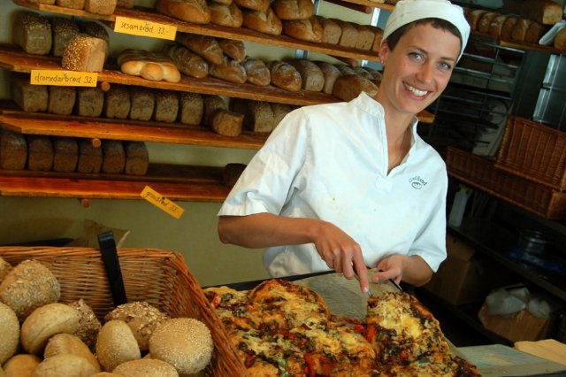{ width="200" }
- Type: Person
- Subjects: History, Culture

#### Connection (RelatedTo) - Le marchand de fruits et légumes
Ce marchand vend des fruits et légumes frais.

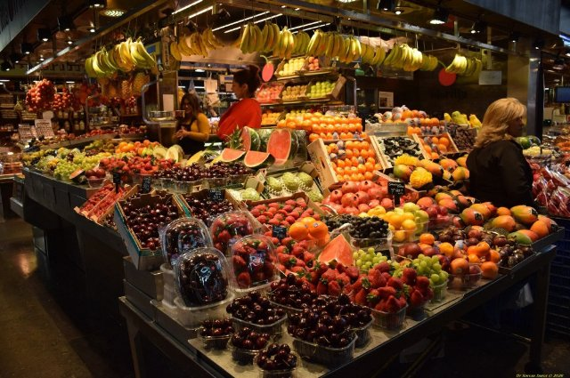{ width="200" }
- Type: Person
- Subjects: History, Culture

#### Connection (RelatedTo) - l'épicier
L'épicier vend différents ingrédients comme le sel, le poivre, l'huile...

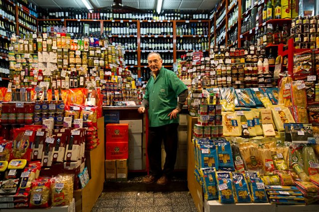{ width="200" }
- Type: Person
- Subjects: History, Culture

#### Connection (RelatedTo): Previous core card - le poissonnier
Le poissonnier vend du poisson frais et des fruits de mer.

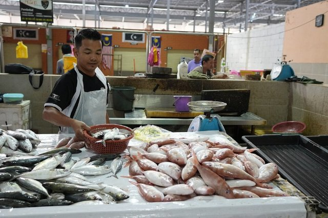{ width="200" }
- Type: Person
- Subjects: History, Culture

### Bouillabaisse {#bouillabaisse}
[Open topic page](../../topics/index.md#bouillabaisse)  

- Importance: Low  
- Country: France  
- Target age: Ages6to10

#### Core Card - La bouillabaisse
C'est une soupe de poisson de Marseille, dans le sud de la France.  Elle sent bon !

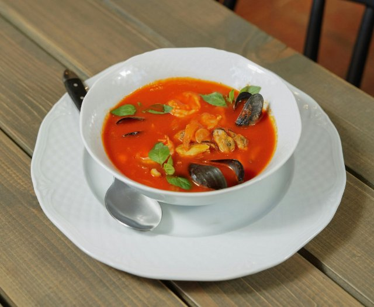{ width="200" }
- Type: Object
- Subjects: Food, Culture
- Year: 1700

#### Connection (MadeOf) - le pain
A yummy food made from flour and water. You can make sandwiches with bread!

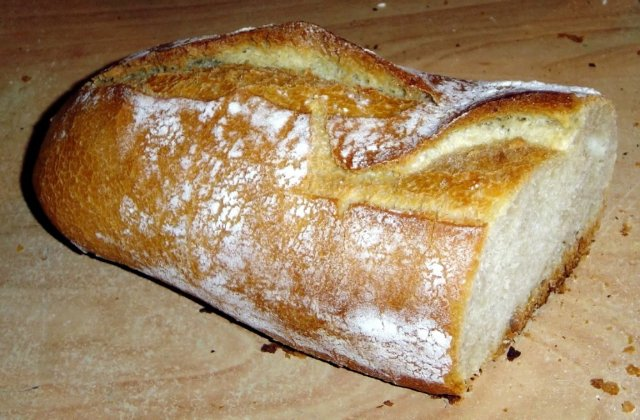{ width="200" }
- Type: Object
- Subjects: Food, Culture

#### Connection (MadeOf) - le poisson
An animal that lives and swims in water. Fish have fins and gills to breathe underwater.

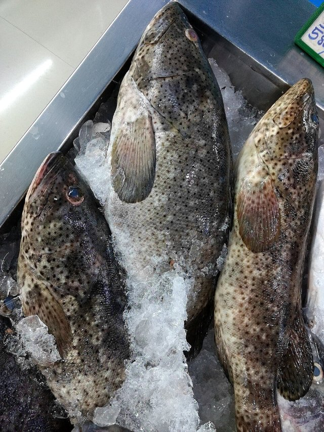{ width="200" }
- Type: Object
- Subjects: Food, Culture

#### Connection (MadeOf) - le crabe
A sea animal with big claws and a hard shell. Crabs walk sideways on the beach!

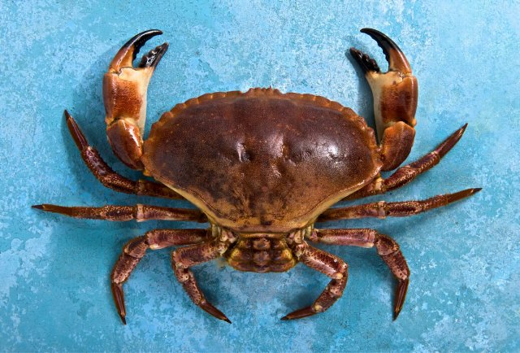{ width="200" }
- Type: Object
- Subjects: Food, Culture

#### Connection (MadeOf) - le lait
A white drink that comes from cows. Milk helps your bones and teeth grow strong!

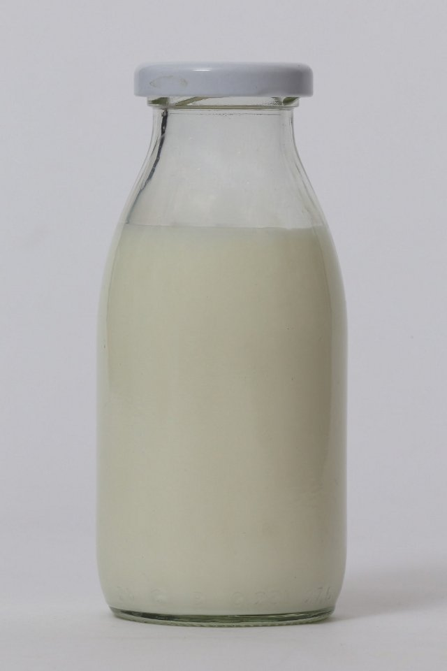{ width="200" }
- Type: Object
- Subjects: Food, Culture

#### Connection (MadeOf) - l'orange
C'est un fruit de couleur orange.

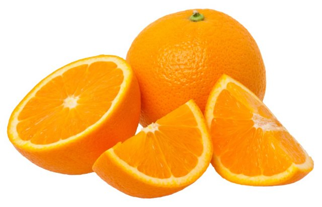{ width="200" }
- Type: Object
- Subjects: Food, Culture

#### Connection (MadeOf) - la tomate
No translation found for 'food_tomato.desc' in Cards

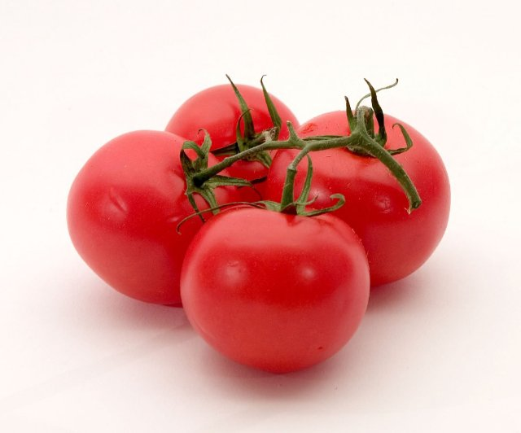{ width="200" }
- Type: Object
- Subjects: Food, Culture

#### Connection (MadeOf) - le citron
C'est un fruit jaune.

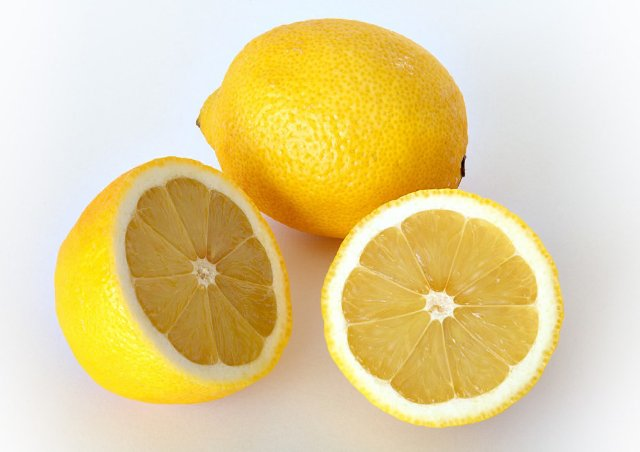{ width="200" }
- Type: Object
- Subjects: Food, Culture

#### Connection (MadeOf) - l'huile d'olive
C'est une huile fabriquée à partir d'olives. On l'utilise pour cuisiner.

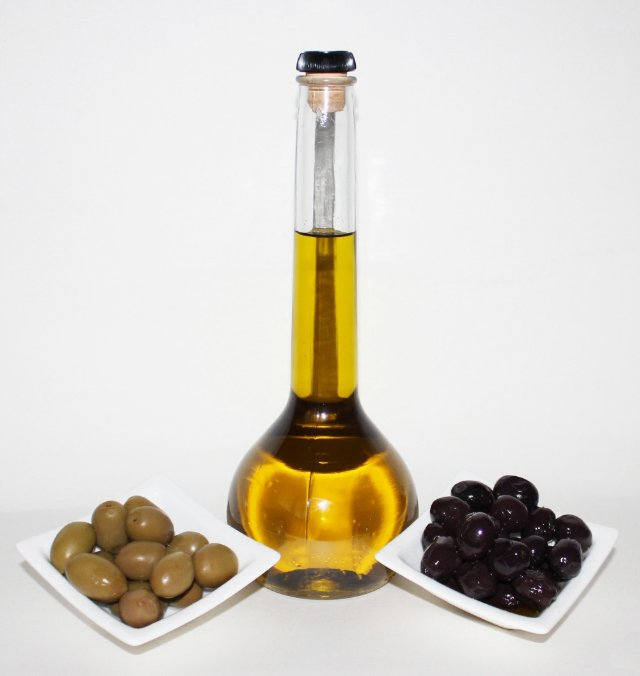{ width="200" }
- Type: Object
- Subjects: Food, Culture

#### Connection (MadeOf) - Le poivre et le sel
Le poivre et le sel sont des épices. Les épices donnent du goût aux aliments.

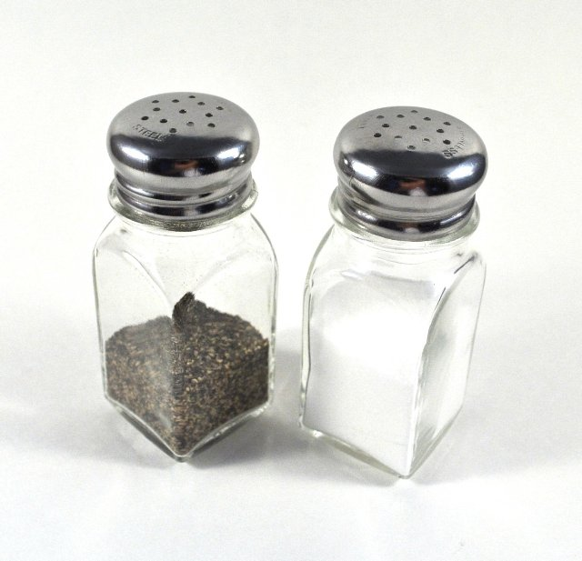{ width="200" }
- Type: Object
- Subjects: Food, Culture

## Additional Cards
#### Les pirates
Les pirates voyageaient sur des bateaux en mer. Ils s'attaquaient à des navires pour récupérer des objets de valeur ou de l'argent. 

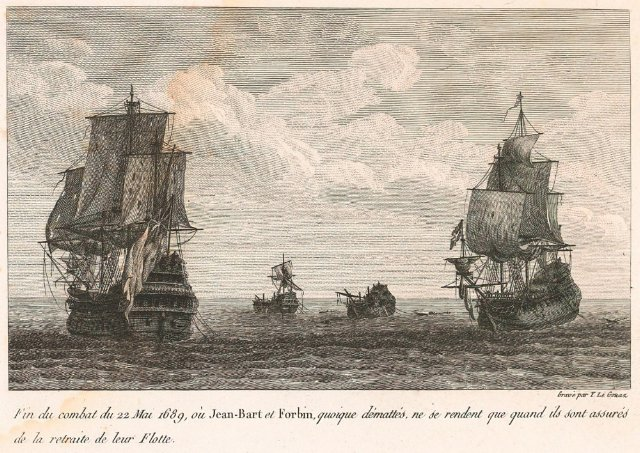{ width="200" }
- Rationale: Pirates capture kids' imagination while teaching about maritime history and French naval power
- Type: Concept
- Subjects: History, Culture, Transportation
- Year: 1600

#### La monnaie euro
L'euro est la monnaie utilisée dans de nombreux pays d'Europe. Avec des pièces et des billets en euros tu peux payer.

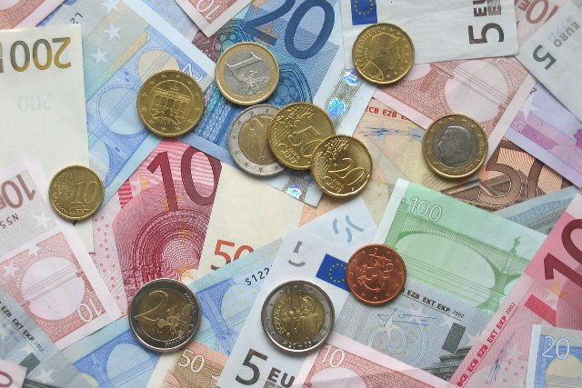{ width="200" }
- Type: Concept
- Subjects: Money, Geography

## Words
## Activities
- [MoneyCount](../../activities/index.md#MoneyCount)
- [MoneyCount](../../activities/index.md#MoneyCount)
- [MoneyCount](../../activities/index.md#MoneyCount)
- [MoneyCount](../../activities/index.md#MoneyCount)
- [MoneyCount](../../activities/index.md#MoneyCount)
- [Match](../../activities/index.md#Match)
- [JigsawPuzzle](../../activities/index.md#JigsawPuzzle)
- [MoneyCount](../../activities/index.md#MoneyCount)
- [MoneyCount](../../activities/index.md#MoneyCount)
- [MoneyCount](../../activities/index.md#MoneyCount)
- [MoneyCount](../../activities/index.md#MoneyCount)
- [MoneyCount](../../activities/index.md#MoneyCount)

## Tasks
- [Collect] COLLECT_THE_INGREDIENTS
- [Interact] go_back_chef
## Credits
- Anne (France) (content)
- Lucie Paillat (France) (content, design)
- [Stefano Cecere](https://stefanocecere.com) (Italy) (content, design, development)
- Valeria Passarella (Italy) (design)
