# Paris - La Seine (fr_10)
> [!note] Educators & Designers: help improving this quest!
> **Comments and feedback**: [discuss in the Forum](https://github.com/vgwb/Antura/discussions/634)  
> **Improve script translations**: [comment the Google Sheet](https://docs.google.com/spreadsheets/d/1FPFOy8CHor5ArSg57xMuPAG7WM27-ecDOiU-OmtHgjw/edit?gid=754141150#gid=754141150)  
> **Improve Cards translations**: [comment the Google Sheet](https://docs.google.com/spreadsheets/d/1M3uOeqkbE4uyDs5us5vO-nAFT8Aq0LGBxjjT_CSScWw/edit?gid=415931977#gid=415931977)  
> **Improve the script**: [propose an edit here](https://github.com/vgwb/Antura/blob/main/Assets/_discover/_quests/FR_10%20Paris%20Seine/FR_10%20Paris%20Seine%20-%20Yarn%20Script.yarn)  

- Version: 1.00
- Status: Production
- Location: France - Paris

- Difficulty: Normal
- Duration (min): 10
- Kind:
  - Orientation
  - Journey
- Description: Découvre la capitale de la France Paris. Tu vas découvrir le fleuve qui passe à Paris: La Seine.

## Teachers Resources

### Video

<iframe width="560" height="315" src="https://www.youtube.com/embed/RGOFuzdol9Q?si=rGWg53DhcCsMiMdi" title="YouTube video player" frameborder="0" allow="accelerometer; autoplay; clipboard-write; encrypted-media; gyroscope; picture-in-picture; web-share" referrerpolicy="strict-origin-when-cross-origin" allowfullscreen></iframe>

👉🏼 [Seine River Cruise in Paris, France](https://www.youtube.com/watch?v=RGOFuzdol9Q)

### Map

👉🏼 [Seine Map](https://en.wikipedia.org/wiki/Seine#/map/0)

### Activities

## Quest Script
[See the full script here](./fr_10-script.md)

## Topics
### Seine {#seine}
[Open topic page](../../topics/index.md#seine)  

- Importance: Medium  
- Country: France  
- Target age: Ages6to10  
- Subjects: Geography, Transportation, Civics

#### Core Card - La Seine
C'est le fleuve qui passe à Paris. La Seine mesure 777 km. Elle se jette dans la Manche.

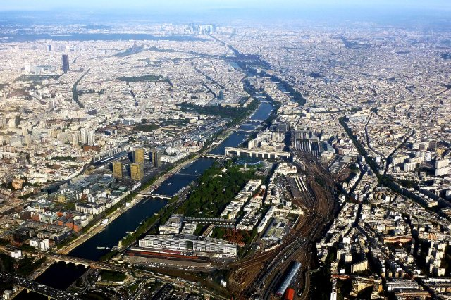{ width="200" }
- Type: Place
- Subjects: Geography

#### Connection (LocatedIn) - Paris
C'est la capitale de la France.  La tour Eiffel est à Paris !

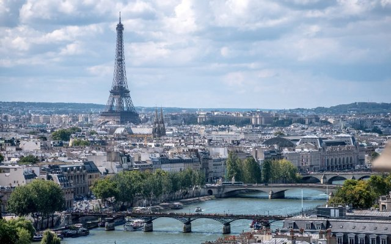{ width="200" }
- Type: Place
- Subjects: Geography, Culture

#### Connection (RelatedTo) - La carte de la Seine
 La Seine mesure 777 km. Elle se jette dans La Manche..

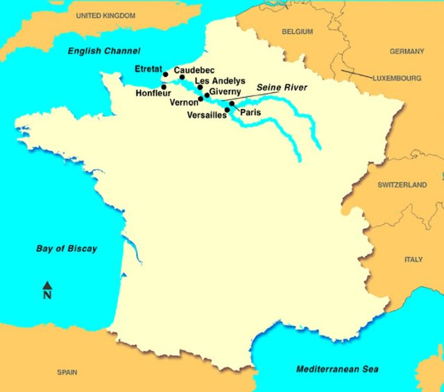{ width="200" }
- Type: Object
- Subjects: Geography, Environment

#### Connection (LocatedIn) - La carte de la Seine à Paris
La Seine est le fleuve. La Seine traverse Paris.

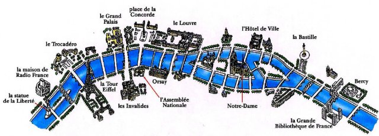{ width="200" }
- Type: Object
- Subjects: Science

#### Connection (RelatedTo) - le pont pour voitures
A road that goes over water so cars can drive across rivers and lakes.

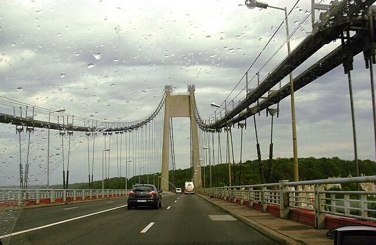{ width="200" }
- Type: Place
- Subjects: Geography, Environment

#### Connection (RelatedTo) - la passerelle
Une passerelle est un petit pont. Sur les passerelles, des piétons, vélos et parfois des tramways, bus ou trains peuvent passer.

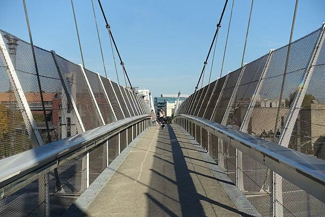{ width="200" }
- Type: Place
- Subjects: Geography, Environment

#### Connection (RelatedTo): Auto from quest fr_10 - le pont pour trains
A special bridge built strong enough for heavy trains to cross over water.

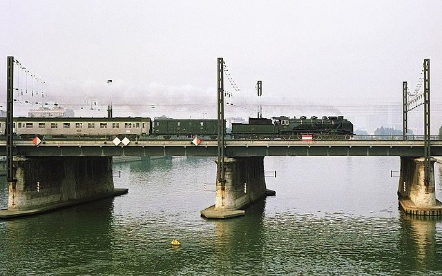{ width="200" }
- Type: Place
- Subjects: Geography, Environment

#### Connection (RelatedTo) - Le Pont Alexandre III
C’est un pont célèbre à Paris. Il a de belles decorations dorées.

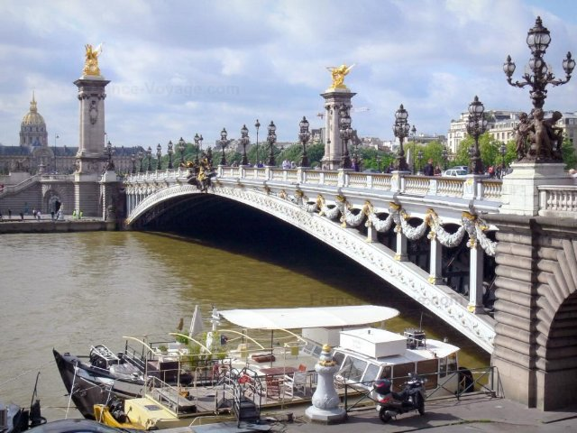{ width="200" }
- Type: Place
- Subjects: Geography, Environment

#### Connection (RelatedTo) - Un bateau sur un fleuve
Un bateau qui navigue sur les rivières. Les rivières sont comme des routes sur d'eau !

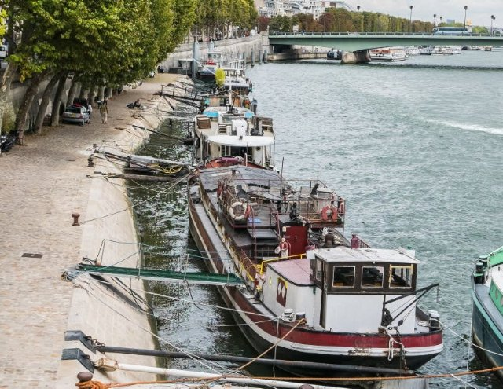{ width="200" }
- Type: Place
- Subjects: Geography, Environment

#### Connection (RelatedTo) - Un bateau pour marchandises
Un grand bateau qui transporte des boîtes, de la nourriture et d’autres choses.

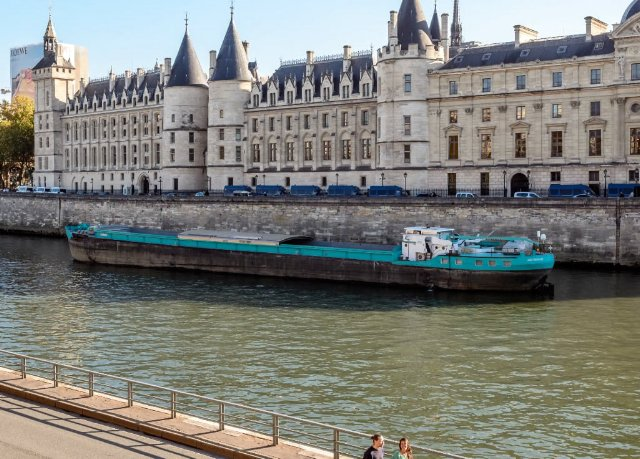{ width="200" }
- Type: Place
- Subjects: Geography, Environment

#### Connection (RelatedTo) - Un bateau habitable
C'est un bateau où on habite comme dans une maison.

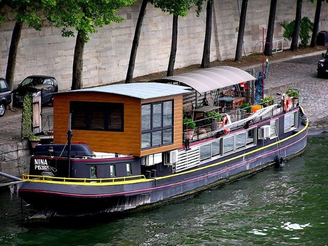{ width="200" }
- Type: Place
- Subjects: Geography, Environment

#### Connection (RelatedTo) - Un bateau pour les gens
Un bateau qui transporte les gens.

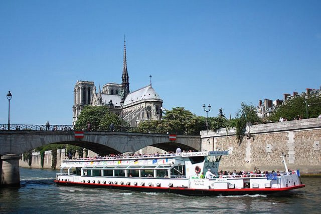{ width="200" }
- Type: Place
- Subjects: Geography, Environment

#### Connection (RelatedTo) - Un bateau sur la Seine
Un bateau qui est sur la Seine à Paris. Depuis l'eau, tu peux voir la Tour Eiffel et d'autres très beaux monuments !

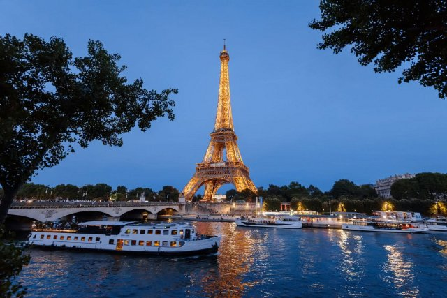{ width="200" }
- Rationale: Boat tours help kids see Paris from a different perspective and understand river transportation
- Type: Concept
- Subjects: Transportation, Geography, Culture
- Year: 1900

#### Connection (LocatedIn) - Île-de-France
Région de France où se trouve Paris, la capitale. De nombreuses personnes y vivent !

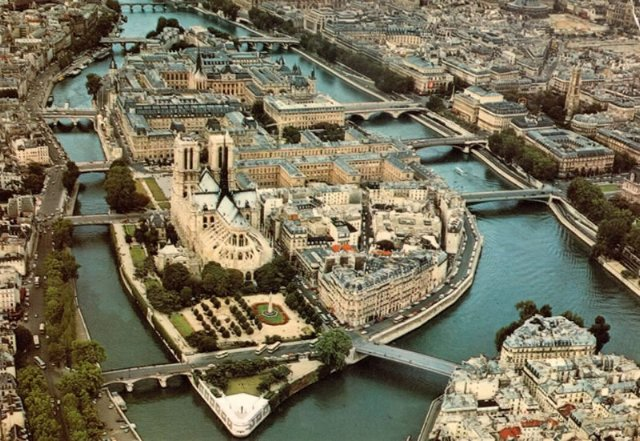{ width="200" }
- Type: Place
- Subjects: Geography, Environment

## Words
## Activities
- [CleanCanvas](../../activities/index.md#CleanCanvas)
- [CleanCanvas](../../activities/index.md#CleanCanvas)
- [JigsawPuzzle](../../activities/index.md#JigsawPuzzle)
- [JigsawPuzzle](../../activities/index.md#JigsawPuzzle)
- [Match](../../activities/index.md#Match)
- [Memory](../../activities/index.md#Memory)
- [Memory](../../activities/index.md#Memory)

## Tasks
- [Collect] collect_cards
- [Collect] find_photos
- [Interact] go_back
## Credits
- Anne (France) (content)
- Lucie Paillat (France) (content, design)
- [Stefano Cecere](https://stefanocecere.com) (Italy) (content, design, development)
