# Topics

Total found: **35**

> [!note] NOTE: connections type can be:
> **Created By** (agent (person/org) who made/discovered/commissioned)  
> **Located In**       (where it is/was)  
> **Is A**             (type/category relation (Baguette is a Bread))  
> **Part Of**         (whole/part relation (Crust is part of Baguette))  
> **Made Of**          (physical composition)  
> **Time Context**     (period/event/date)  
> **Cultural Context** (origin/tradition/symbolism)  
> **Causal**           (clear cause→effect)  
> **Purpose**          (used for…)  
> **Compare**          (compare/Kind similar/contrast/analogy)  
> **Related To**     (whatever else, last choice...)  

## International

### Antura's world {#antura-world}
- Importance: Medium  
- Target Age: Ages6to10
- Core card:
    - **[Antura](../cards/index.md#antura)**
    C'est le personnage principal de ce jeu vidéo.

    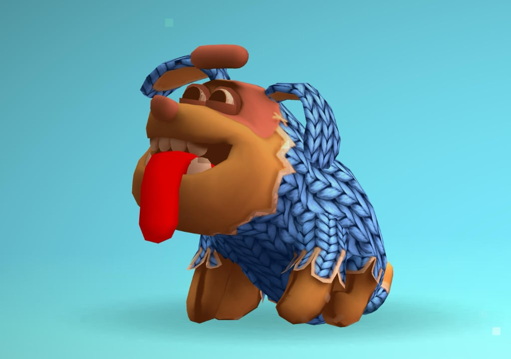{ width="200" }

- Connected cards:
    - **[Cookies](../cards/index.md#antura_cookies)** (RelatedTo)
    De belles récompenses à collectionner en jouant ! Utilisez-les pour obtenir de nouveaux objets et des surprises.

    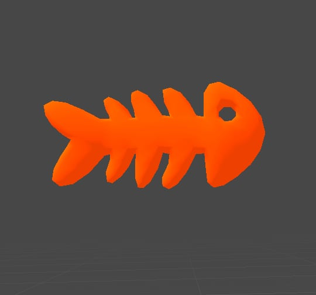{ width="200" }

    - **[Un portail](../cards/index.md#antura_portal)** (RelatedTo)
    Avec la porte magique tu peux aller vers de nouveaux lieux. Entre et découvre où elle te mène !

    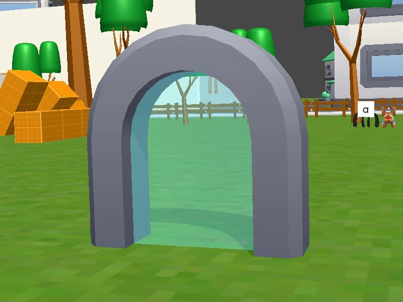{ width="200" }

    - **[Les cartes](../cards/index.md#antura_cards)** (RelatedTo)
    Chaque carte a quelque chose de spécial à apprendre. Trouve-les toutes et lis-les !

    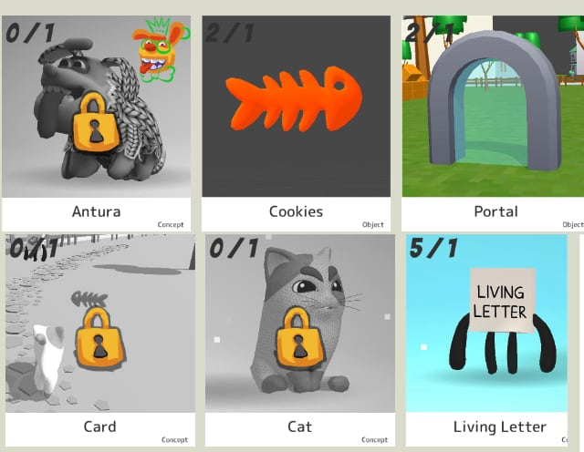{ width="200" }

    - **[Le chat](../cards/index.md#antura_cat)** (RelatedTo)
    C'est le meilleur ami et compagnon de voyage d'Antura. Il est curieux, intelligent et toujours prêt à aider !

    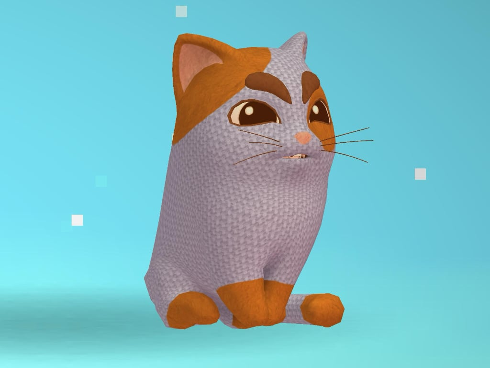{ width="200" }

    - **[La lettre vivante](../cards/index.md#antura_livingletter)** (RelatedTo)
    Une gentille lettre qui aime parler et jouer ! Parle-lui pour apprendre de nouveaux mots.

    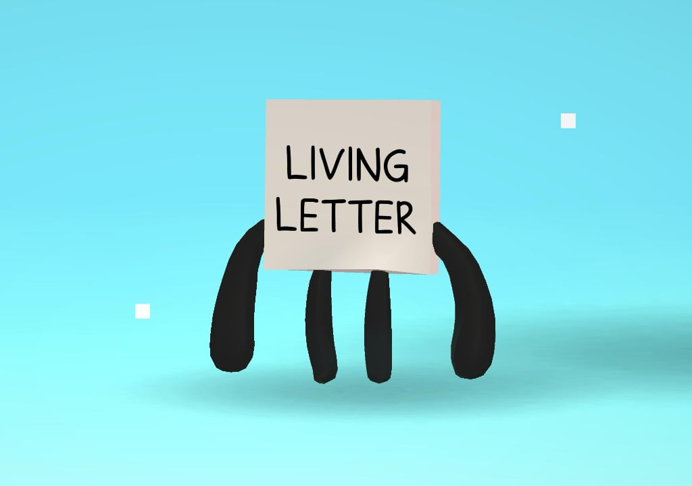{ width="200" }

    - **[En blocs](../cards/index.md#antura_blocky_character)** (RelatedTo)
    Ces drôles de personnages vivent dans ce monde. Parle-leur à tous… ils ont des histoires à raconter !

    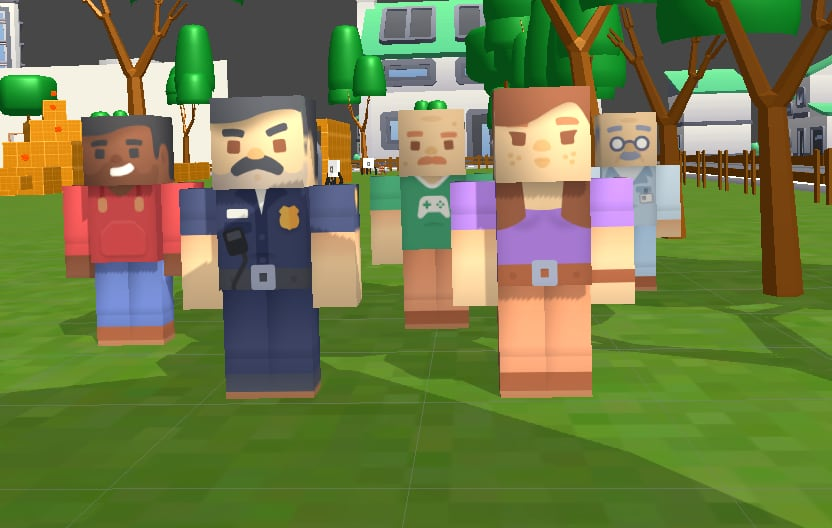{ width="200" }

    - **[Un portail](../cards/index.md#antura_portal)** (RelatedTo)
    Avec la porte magique tu peux aller vers de nouveaux lieux. Entre et découvre où elle te mène !

    { width="200" }

    - **[Le danger](../cards/index.md#antura_malus)** (RelatedTo)
    À éviter absolument ! Sois prudent et protége-toi.

    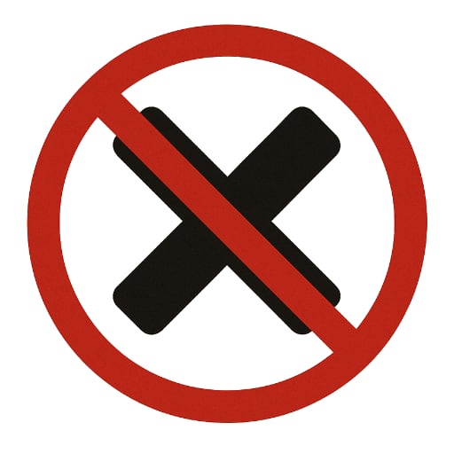{ width="200" }

- Quests: [Tutoriel (tutorial)](../quests/quest/tutorial.md)

---

### Elementary Math {#elementary-maths}
- Description: Numbers and shapes for everyday life: counting, adding and subtracting, simple fractions, measuring, telling time, and using money.  
- Importance: Medium  
- Subjects: Math  
- Target Age: Ages6to10
- Core card:
    - **[Mathématiques élémentaires](../cards/index.md#elementary_maths)**
    Chiffres et formes de la vie quotidienne : compter, additionner et soustraire, fractions simples, mesurer, lire l'heure et utiliser l'argent.

    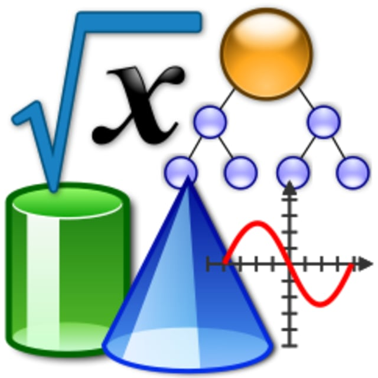{ width="200" }

- Connected cards:
    - **[Doubler](../cards/index.md#fr_figure_line)** (PartOf)
    Une ligne droite reliant un point à un autre. Les lignes peuvent être longues ou courtes.

    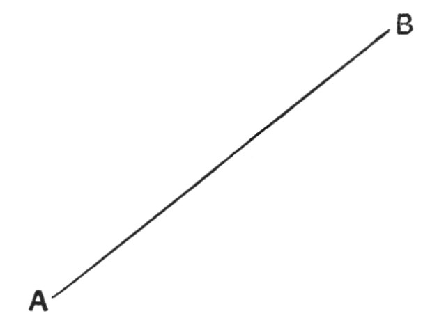{ width="200" }

    - **[Triangle](../cards/index.md#fr_figure_triangle)** (PartOf)
    Une forme à trois côtés droits et trois coins. Les triangles ressemblent à des parts de pizza !

    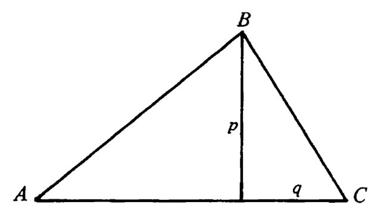{ width="200" }

    - **[Compas](../cards/index.md#math_compass)** (Purpose)
    Un outil qui permet de tracer des cercles parfaits. Il possède deux branches, comme des ciseaux.

    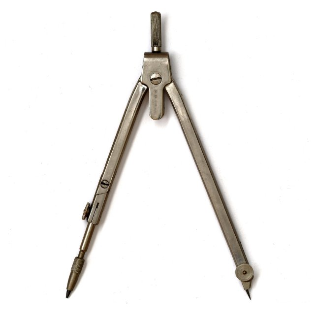{ width="200" }

    - **[la règle](../cards/index.md#math_ruler)** (Purpose)
    C'est un outil utilisé pour mesurer et tracer des lignes.

    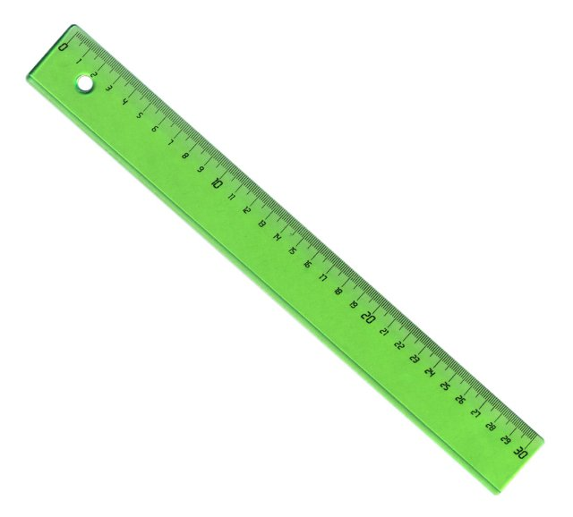{ width="200" }

    - **[Carré](../cards/index.md#math_setsquare)** (Purpose)
    Un outil en forme de triangle utilisé pour dessiner des lignes droites et des angles droits en mathématiques.

    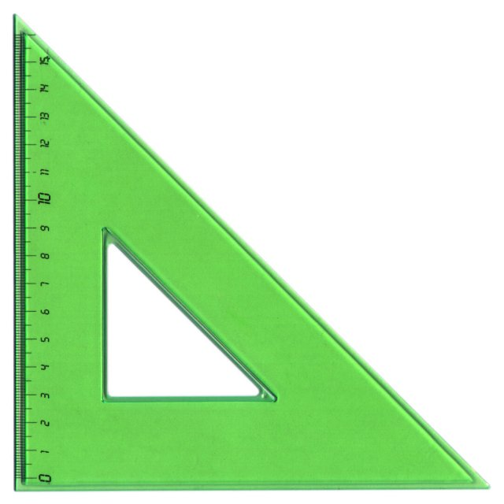{ width="200" }

    - **[Cercle](../cards/index.md#fr_figure_circle)** (PartOf)
    Une forme ronde sans coins. Les cercles ressemblent à des roues, des boules et des pièces de monnaie !

    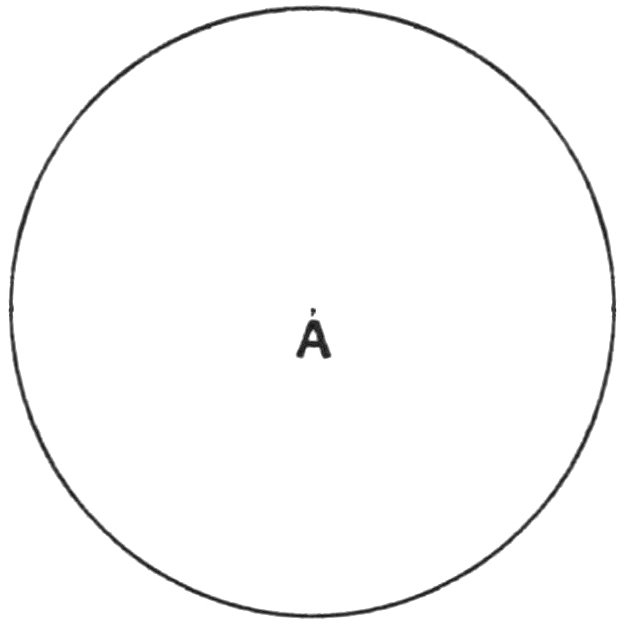{ width="200" }

- Quests: [Le système scolaire (fr_02)](../quests/quest/fr_02.md)

Credits:
  - Valeria Passarella (Italy)
  - [Stefano Cecere](https://stefanocecere.com) (Italy)

---

### Fisherman {#fisherman}
- Importance: Medium  
- Target Age: Ages6to10
- Core card:
    - **[Pêcheur](../cards/index.md#fisherman)**
    Une personne qui attrape du poisson en mer.

    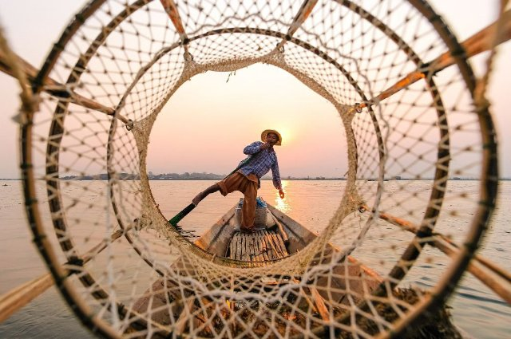{ width="200" }

- Connected cards:
    - **[le port](../cards/index.md#port)** (LocatedIn)
    Sur le port, les bateaux arrivent, se stationnent, déchargent des marchandises ou chargent des marchandises. 

    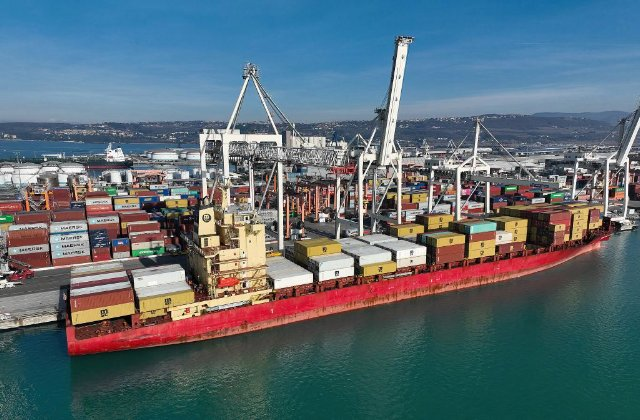{ width="200" }

    - **[Flots](../cards/index.md#waves)** (RelatedTo)
    Eau en mouvement sur la mer.

    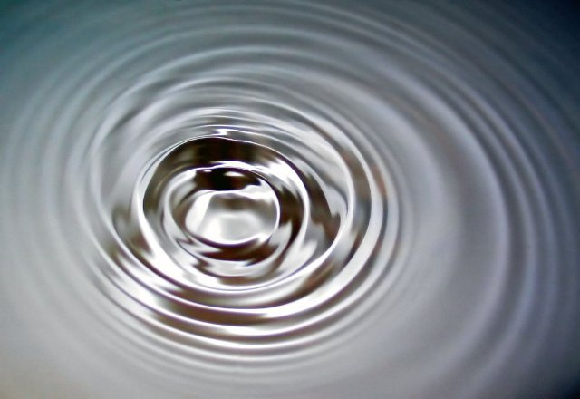{ width="200" }

    - **[Navigation](../cards/index.md#navigation)** (RelatedTo)
    Trouver son chemin en mer à l'aide de lumières, de cartes et d'outils.

    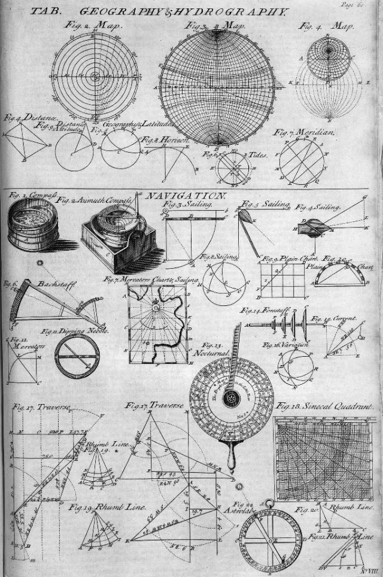{ width="200" }

    - **[Filet de pêche](../cards/index.md#fishing_net)** (Purpose)
    Un filet utilisé pour attraper du poisson.

    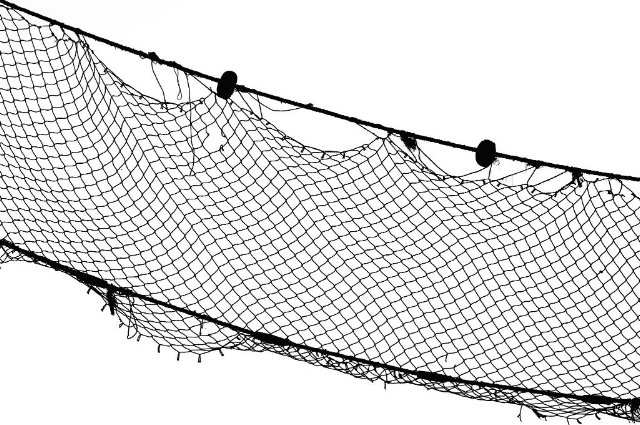{ width="200" }

    - **[le bateau de marchandises](../cards/index.md#ship)** (RelatedTo)
     C’est un bateau qui transporte des objets, du sable, de la nourriture… On l’appelle aussi bateau cargo.

    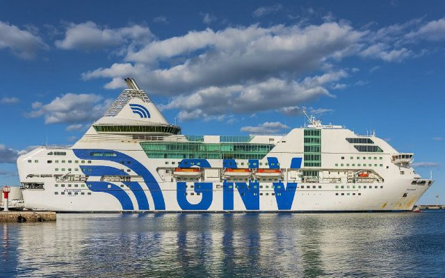{ width="200" }

---

### Flags of Europe {#flags_euroe}
- Importance: Medium  
- Target Age: Ages6to10
- Core card:
    - **[Carte de l'Europe](../cards/index.md#concept_europe_map)**
    Une carte montrant tous les pays d'Europe. Tu peux voir où se trouvent la France, la Pologne, l'Allemagne et d'autres pays.

    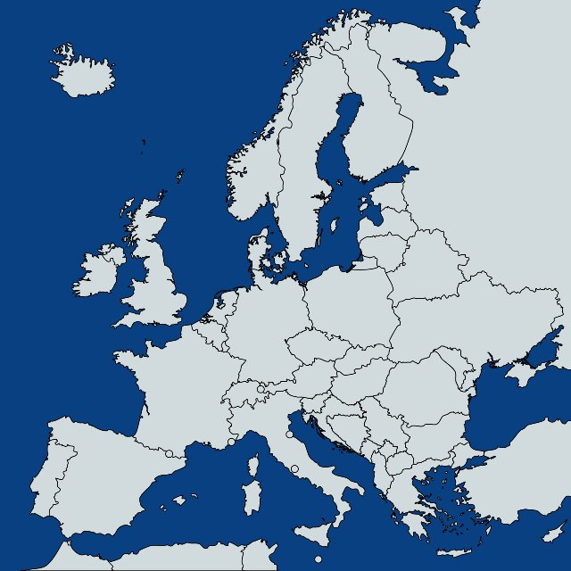{ width="200" }

- Connected cards:
    - **[Drapeau de l'Allemagne](../cards/index.md#flag_germany)** (CulturalContext)
    Le drapeau allemand comporte trois bandes horizontales : noire, rouge et jaune. L'Allemagne est célèbre pour ses voitures, ses châteaux et ses contes de fées !

    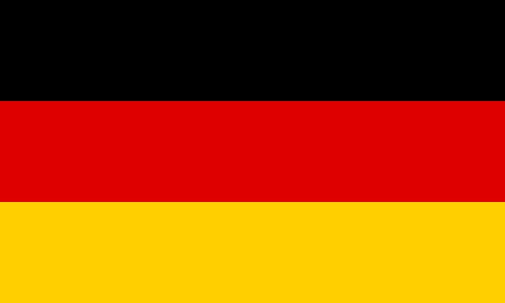{ width="200" }

    - **[Le drapeau de l'Italie](../cards/index.md#flag_italy)** (CulturalContext)
    Le drapeau italien a 3 lignes verticales: verte, blanche et rouge, comme le basilic, la mozzarella et la tomate sur la pizza.

    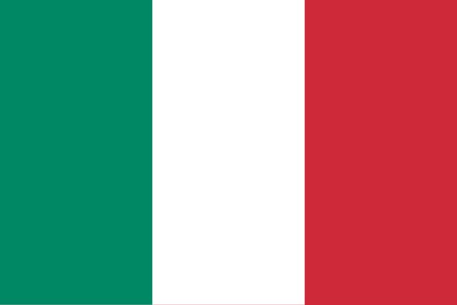{ width="200" }

    - **[Le drapeau du Luxembourg](../cards/index.md#flag_luxembourg)** (CulturalContext)
    Le drapeau du Luxembourg a des lignes rouges, blanches et bleu clair. Le Luxembourg est un tout petit pays qui parle trois 3 langues!

    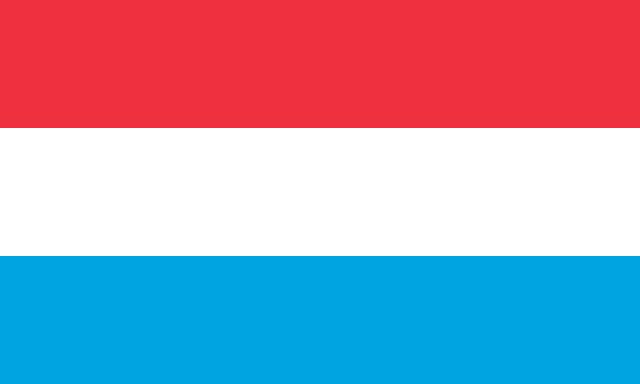{ width="200" }

    - **[Drapeau de Monaco](../cards/index.md#flag_monaco)** (CulturalContext)
    Le drapeau de Monaco est composé de bandes horizontales rouges et blanches. Monaco est une petite ville, mais célèbre pour ses voitures de luxe et ses palais royaux en bord de mer !

    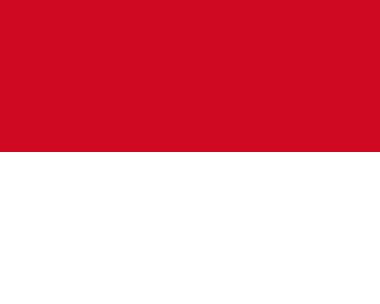{ width="200" }

    - **[Drapeau de la Belgique](../cards/index.md#flag_belgium)** (CulturalContext)
    Le drapeau belge comporte trois bandes verticales : noire, jaune et rouge. La Belgique est célèbre pour son chocolat et ses gaufres !

    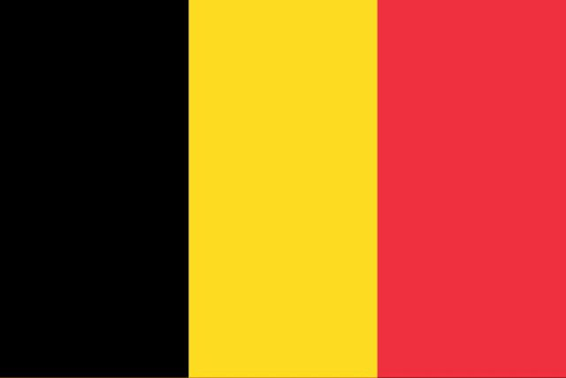{ width="200" }

    - **[Drapeau de l'Espagne](../cards/index.md#flag_spain)** (CulturalContext)
    Le drapeau espagnol est orné de bandes horizontales rouges et jaunes. Ces couleurs évoquent le soleil et les poivrons ! L'Espagne a inventé le flamenco.

    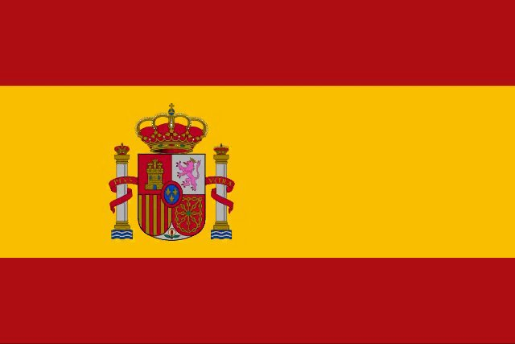{ width="200" }

    - **[Drapeau de la Suisse](../cards/index.md#flag_switzerland)** (CulturalContext)
    Le drapeau suisse est rouge avec une croix blanche au milieu. On dirait une trousse de premiers secours ! La Suisse est célèbre pour ses montagnes et son fromage.

    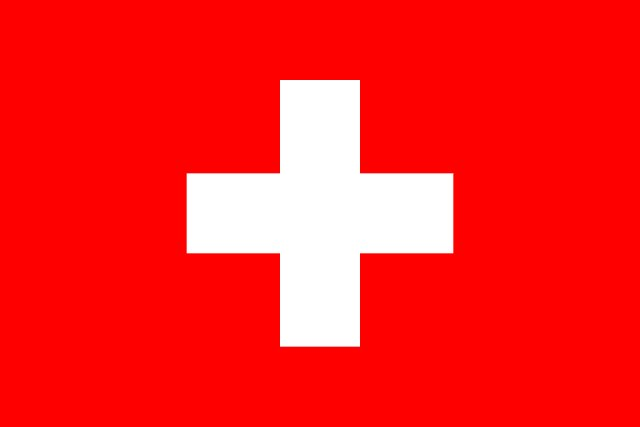{ width="200" }

    - **[Le drapeau de la France](../cards/index.md#flag_france)** (CulturalContext)
    Le drapeau français comporte 3 couleurs verticales: le bleu, le blanc, et le rouge.

    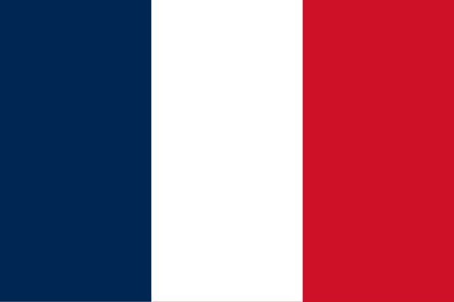{ width="200" }

    - **[Drapeau de la République tchèque](../cards/index.md#flag_czech_republic)** (CulturalContext)
    Le drapeau est composé de bandes blanches et rouges avec un triangle bleu. La République tchèque est célèbre pour son magnifique château de Prague et sa cristallerie.

    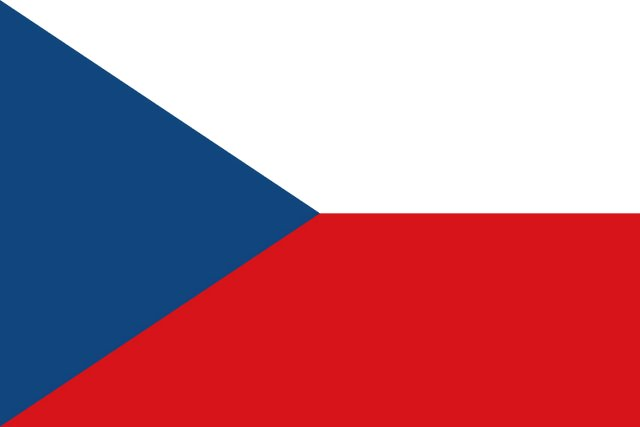{ width="200" }

    - **[Drapeau de la Slovaquie](../cards/index.md#flag_slovakia)** (CulturalContext)
    Un drapeau aux couleurs blanche, bleue et rouge. Il représente la Slovaquie.

    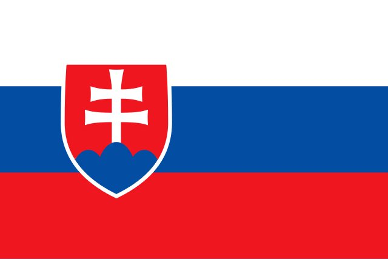{ width="200" }

    - **[Drapeau de l'Ukraine](../cards/index.md#flag_ukraine)** (CulturalContext)
    Un drapeau bleu et jaune, comme le ciel et le soleil. Il représente l'Ukraine.

    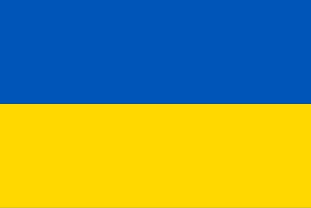{ width="200" }

- Quests: [Les voisins de la Pologne (pl_00)](../quests/quest/pl_00.md)

---

### mountain activities {#mountain_activities}
- Importance: Medium  
- Target Age: Ages6to10
- Core card:
    - **[Montagne](../cards/index.md#mountain)**
    Les piliers de la terre

    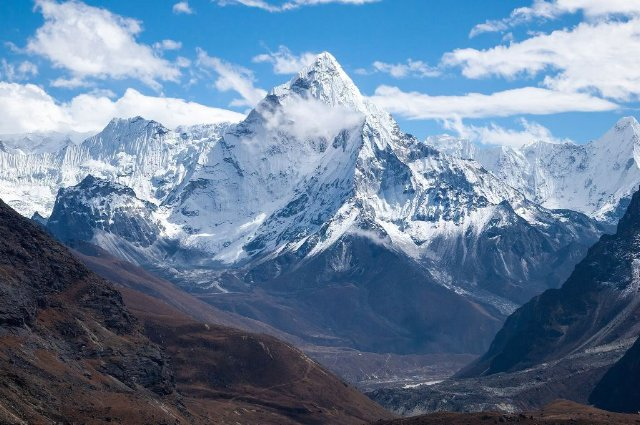{ width="200" }

- Connected cards:
    - **[Guide de montagne](../cards/index.md#mountain_guide)** (RelatedTo)
    Une personne qui aide les gens à grimper en toute sécurité.

    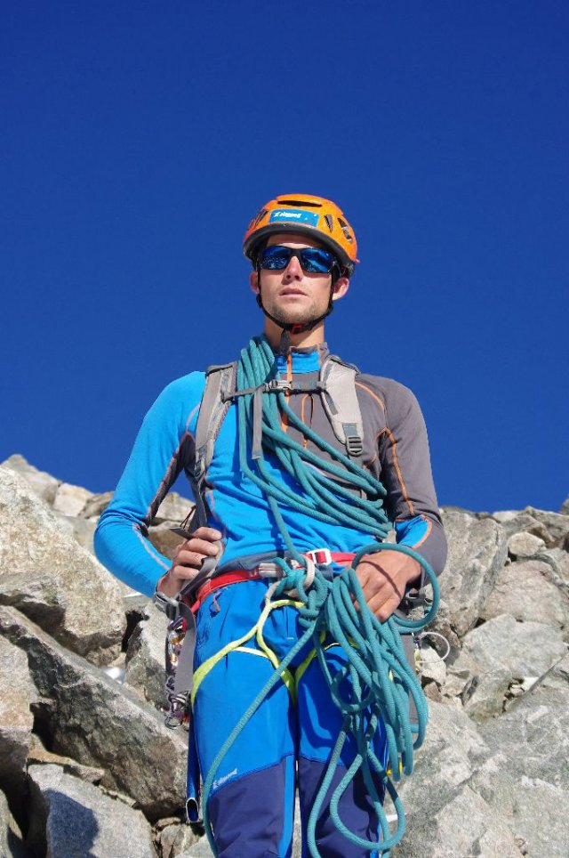{ width="200" }

    - **[Randonnée](../cards/index.md#hiking)** (RelatedTo)
    Promenade sur les sentiers en pleine nature.

    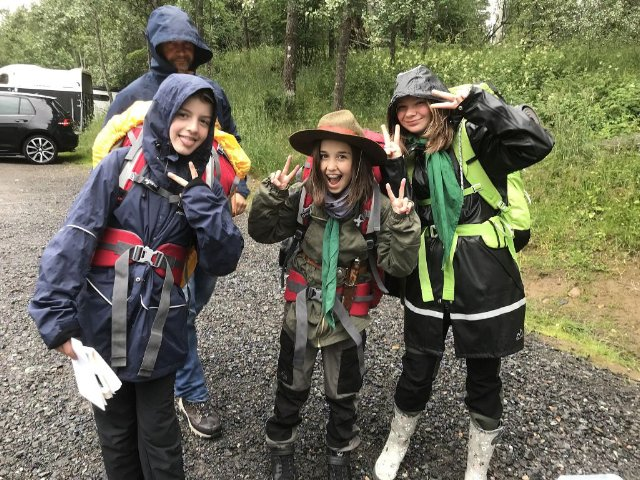{ width="200" }

    - **[Escalade](../cards/index.md#climbing)** (RelatedTo)
    Escalader des rochers ou de la glace avec un équipement spécial.

    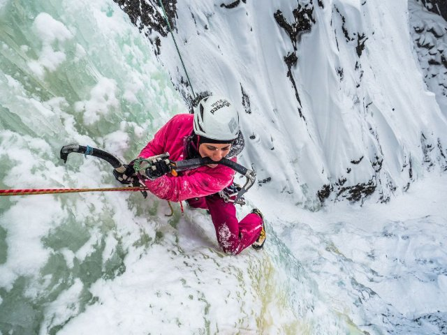{ width="200" }

    - **[Ski](../cards/index.md#skiing)** (RelatedTo)
    Glisser sur la neige avec des skis.

    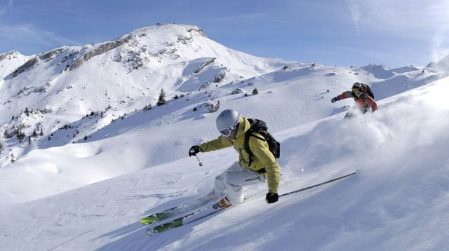{ width="200" }

- Quests: [Mont Blanc et montagnes (fr_08)](../quests/quest/fr_08.md)

---

### mountain tools {#mountain_tools}
- Description: what we need to stay safe in the mountain  
- Importance: Medium  
- Target Age: Ages6to10
- Core card:
    - **[Montagne](../cards/index.md#mountain)**
    Les piliers de la terre

    { width="200" }

- Connected cards:
    - **[Gants](../cards/index.md#gloves)** (RelatedTo)
    Des couvertures chaudes pour vos mains.

    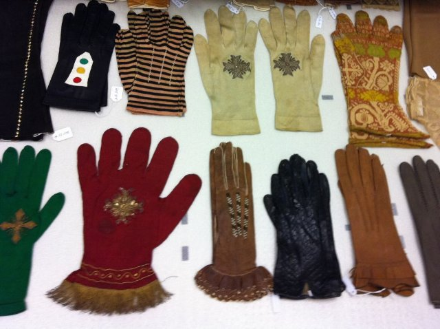{ width="200" }

    - **[Chapeau](../cards/index.md#hat)** (RelatedTo)
    Un bonnet chaud pour votre tête.

    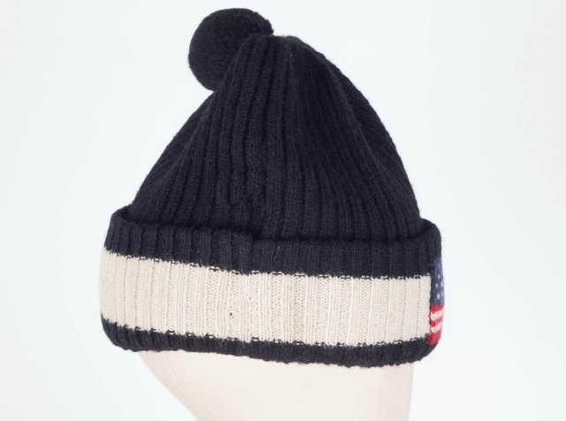{ width="200" }

    - **[Un sac à dos](../cards/index.md#backpack)** (RelatedTo)
    No translation found for 'backpack.desc' in Cards

    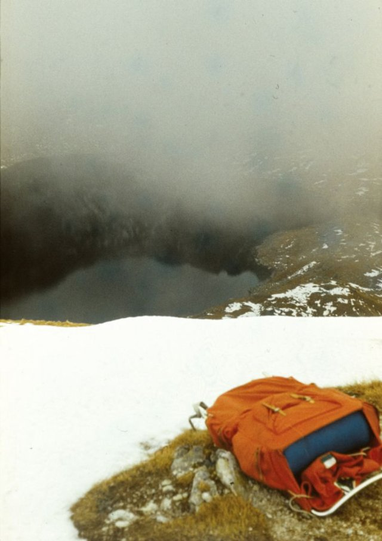{ width="200" }

    - **[Corde](../cards/index.md#rope)** (RelatedTo)
    Une ligne solide utilisée pour la sécurité lors de l'escalade.

    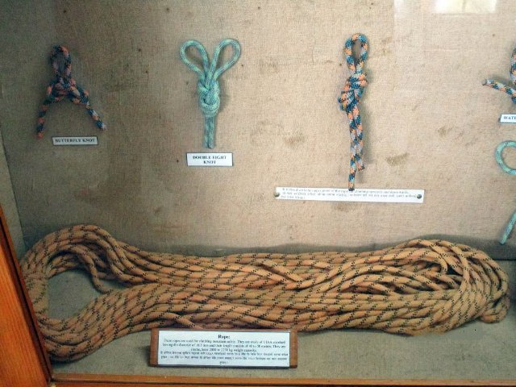{ width="200" }

    - **[Crampons](../cards/index.md#crampons)** (RelatedTo)
    Poignées métalliques pointues que vous attachez aux bottes pour la glace.

    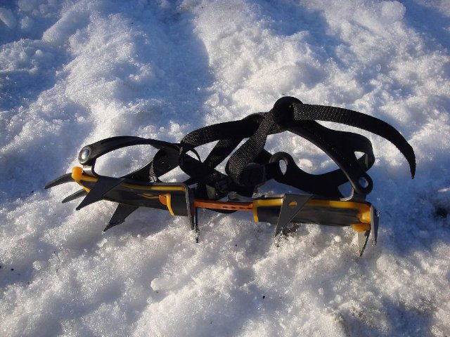{ width="200" }

    - **[Foulard](../cards/index.md#scarf)** (RelatedTo)
    Un tissu chaud que vous portez autour du cou.

    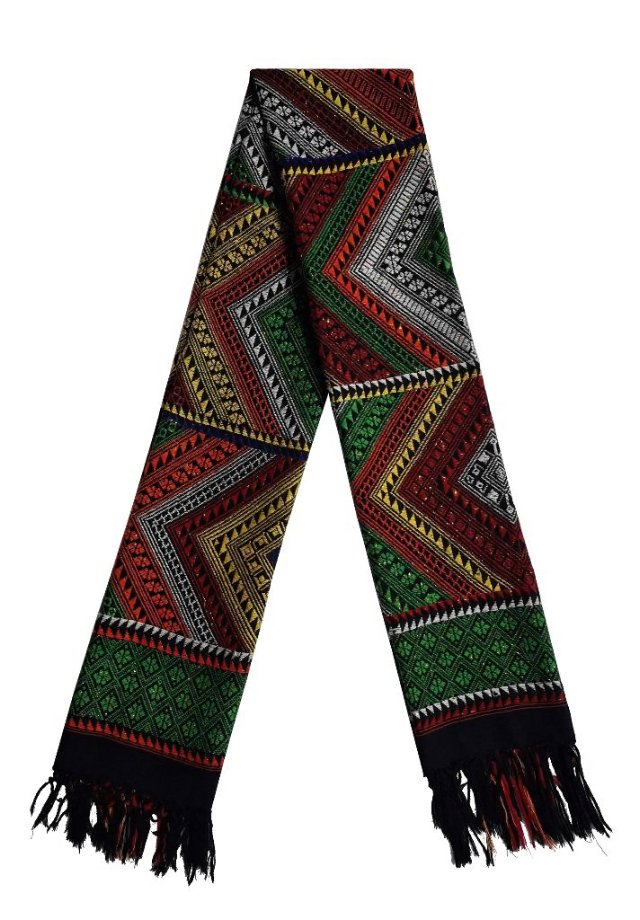{ width="200" }

    - **[Lunettes de soleil](../cards/index.md#sunglasses)** (RelatedTo)
    Des lunettes qui protègent vos yeux de la lumière vive.

    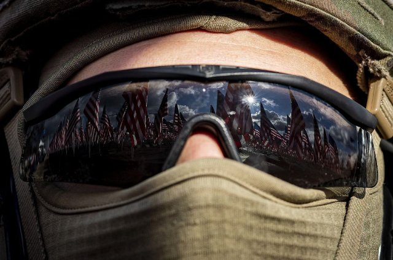{ width="200" }

    - **[Manteau](../cards/index.md#coat)** (RelatedTo)
    Une veste chaude pour le temps froid.

    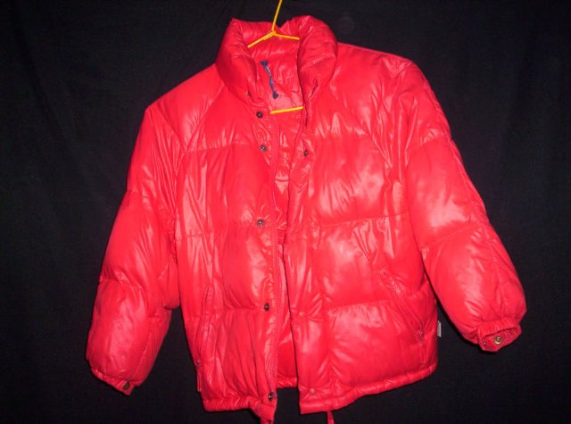{ width="200" }

- Quests: [Mont Blanc et montagnes (fr_08)](../quests/quest/fr_08.md)

---

### Musical Notes {#musical_notes}
- Importance: Medium  
- Target Age: Ages6to10
- Core card:
    - **[Gamme musicale](../cards/index.md#musical_scale)**
    Les sept notes jouées dans l'ordre

    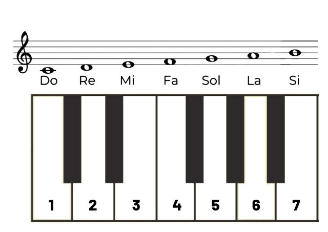{ width="200" }

- Connected cards:
    - **[Piano](../cards/index.md#piano)** (RelatedTo)
    Un instrument à clavier utilisé pour jouer des mélodies et des accords.

    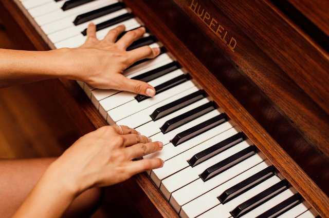{ width="200" }

    - **[Do](../cards/index.md#note_do)** (RelatedTo)
    Une note de musique.

    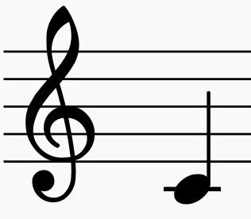{ width="200" }

    - **[Ré](../cards/index.md#note_re)** (RelatedTo)
    Une note de musique.

    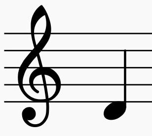{ width="200" }

    - **[Mi](../cards/index.md#note_mi)** (RelatedTo)
    Une note de musique.

    { width="200" }

    - **[Fa](../cards/index.md#note_fa)** (RelatedTo)
    Une note de musique.

    { width="200" }

    - **[Sol](../cards/index.md#note_sol)** (RelatedTo)
    Une note de musique.

    { width="200" }

    - **[La](../cards/index.md#note_la)** (RelatedTo)
    Une note de musique.

    { width="200" }

    - **[Si](../cards/index.md#note_si)** (RelatedTo)
    Une note de musique.

    { width="200" }

    - **[Partition musicale](../cards/index.md#musical_score)** (RelatedTo)
    Les notes écrites et les paroles d'une chanson.

    { width="200" }

- Quests: [Le grand sauvetage des nains de Wrocław (pl_02)](../quests/quest/pl_02.md)

---

### Solar System {#solar_system}
- Importance: High  
- Subjects: Science  
- Target Age: Ages6to10
- Core card:
    - **[Système solaire](../cards/index.md#solar_system)**
    Le Soleil et les huit planètes qui tournent autour de lui.

    { width="200" }

- Connected cards:
    - **[Mercure](../cards/index.md#mercury)** (RelatedTo)
    La planète la plus proche du Soleil ; petite et très rapide.

    { width="200" }

    - **[Mars](../cards/index.md#mars)** (RelatedTo)
    La planète rouge avec de la poussière et de grands volcans.

    { width="200" }

    - **[Jupiter](../cards/index.md#jupiter)** (RelatedTo)
    La plus grande planète, célèbre pour la Grande Tache Rouge.

    { width="200" }

    - **[Neptune](../cards/index.md#neptune)** (RelatedTo)
    Le dieu de la mer des vieilles histoires.

    { width="200" }

    - **[Vénus](../cards/index.md#venus)** (RelatedTo)
    Une planète très chaude recouverte de nuages ​​épais.

    { width="200" }

    - **[Modèle héliocentrique](../cards/index.md#heliocentric_model)** (RelatedTo)
    L'idée que le Soleil est au centre et que les planètes tournent autour de lui.

    { width="200" }

    - **[L'astronomie](../cards/index.md#astronomy)** (RelatedTo)
    C'est la science qui étudie le Soleil, la Lune, les étoiles et les planètes.

    { width="200" }

    - **[Saturne](../cards/index.md#saturn)** (RelatedTo)
    Une planète géante avec des anneaux brillants et de nombreuses lunes.

    { width="200" }

    - **[Planétarium](../cards/index.md#planetarium)** (RelatedTo)
    Un endroit où vous pouvez voir le ciel et les étoiles à l'intérieur.

    { width="200" }

    - **[Terre](../cards/index.md#earth)** (RelatedTo)
    Notre planète avec terre, air et eau.

    { width="200" }

    - **[Uranus](../cards/index.md#uranus)** (RelatedTo)
    Une planète bleu-vert qui tourne sur le côté.

    { width="200" }

---

### Stree safety {#street-safety}
- Importance: Medium  
- Target Age: Ages6to10
- Core card:
    - **[Sécurité routière](../cards/index.md#street_safety)**
    Des règles qui assurent la sécurité de tous sur la route.

- Connected cards:
    - **[Casque (sécurité routière)](../cards/index.md#helmet_street_safety)** (RelatedTo)
    Un casque pour protéger votre tête lorsque vous roulez.

    { width="200" }

    - **[Panneau STOP](../cards/index.md#stop_sign)** (RelatedTo)
    Un panneau rouge qui signifie que vous devez arrêter votre véhicule.

    { width="200" }

    - **[Le passage piéton](../cards/index.md#zebra_crossing)** (RelatedTo)
    Un passage piéton est indiqué par des bandes blanches sur la route. Il indique un endroit pour traverser la route en toute sécurité.là où les gens traversent la rue.

    { width="200" }

    - **[Feux de signalisation](../cards/index.md#traffic_lights)** (RelatedTo)
    Des lampadaires qui vous indiquent quand vous devez vous ARRÊTER ou PARTIR.

    { width="200" }

    - **[Panneau DANGER](../cards/index.md#danger_sign)** (RelatedTo)
    Un panneau qui annonce un danger. Il faut faire très attention.

    { width="200" }

---

### Telescope {#telescope}
- Importance: Medium  
- Subjects: Science  
- Target Age: Ages6to10
- Core card:
    - **[Télescope](../cards/index.md#telescope)**
    Un outil qui nous aide à voir des choses lointaines dans le ciel.

    { width="200" }

- Connected cards:
    - **[Nicolas Copernic](../cards/index.md#nicolaus_copernicus)** (RelatedTo)
    Un brillant scientifique polonais a découvert que la Terre tourne autour du Soleil, et non l'inverse ! Cela a révolutionné notre compréhension de l'espace.

    { width="200" }

    - **[Oculaire](../cards/index.md#eyepiece)** (RelatedTo)
    La petite lentille à travers laquelle vous regardez sur un télescope.

    { width="200" }

    - **[Lentille](../cards/index.md#lens)** (RelatedTo)
    Un morceau de verre ou de plastique transparent qui courbe la lumière.

    { width="200" }

    - **[Planétarium](../cards/index.md#planetarium)** (RelatedTo)
    Un endroit où vous pouvez voir le ciel et les étoiles à l'intérieur.

    { width="200" }

---

### Zoo Animals {#zoo}
- Importance: Medium  
- Subjects: Animal  
- Target Age: Ages6to10
- Core card:
    - **[Animaux du zoo](../cards/index.md#zoo_animals)**
    Carte créée automatiquement pour le thème « Animaux du zoo ».

    { width="200" }

- Connected cards:
    - **[une girafe](../cards/index.md#animal_giraffe)** (RelatedTo)
    C'est un animal très grand avec un long cou. Les girafes sont plus hautes que les arbres ! Elles mangent des feuilles.

    { width="200" }

    - **[Un lion](../cards/index.md#animal_lion)** (RelatedTo)
    On dit que c'est le roi des animaux. Il vit en groupe.

    { width="200" }

    - **[Un singe](../cards/index.md#animal_monkey)** (RelatedTo)
    C'est un animal intelligent qui aime aller dans les arbres et jouer. Certains singes vivent en grandes familles.

    { width="200" }

    - **[Un manchot](../cards/index.md#animal_penguin)** (RelatedTo)
    C'est un oiseau qui ne peut pas voler mais qui nage très bien. Il vit dans les régions froides.

    { width="200" }

    - **[L'éléphant](../cards/index.md#animal_elephant)** (RelatedTo)
    C'est un gros animal avec une trompe. Les éléphants sont les plus grands animaux terrestres. Ils ont de grandes oreilles et adorent souffler de l'eau !

    { width="200" }

    - **[Le chimpanzé](../cards/index.md#animal_chimpanzee)** (RelatedTo)
    C'est un singe intelligent et joueur. Il adore grimper aux arbres.

    { width="200" }

- Quests: [Le zoo (pl_04)](../quests/quest/pl_04.md)

## France

### Baguette {#baguette}
- Description: the french bread famous all around the world!  
- Importance: Medium  
- Subjects: Food  
- Target Age: Ages3to5
- Core card:
    - **[la baguette française](../cards/index.md#food_baguette)**
    Un pain long et croustillant, l'aliment le plus célèbre en France. Les Français achètent des baguettes fraîches tous les jours à la boulangerie !

    { width="200" }

- Connected cards:
    - **[Paris](../cards/index.md#capital_paris)** (LocatedIn)
    C'est la capitale de la France.  La tour Eiffel est à Paris !

    { width="200" }

    - **[le boulanger](../cards/index.md#person_baker)** (CreatedBy)
    Le boulanger fait du pain, des gâteaux et des pâtisseries.

    { width="200" }

    - **[Le sel](../cards/index.md#food_salt)** (MadeOf)
    C'est une épice qui donne du goût aux liments..

    { width="200" }

    - **[la levure](../cards/index.md#food_yeast)** (MadeOf)
    La levure est une poudre qui permet de faire du pain et des gâteaux.

    { width="200" }

    - **[la farine](../cards/index.md#food_flour)** (MadeOf)
    La farine est utilisée principalement pour faire du pain.

    { width="200" }

    - **[l'eau](../cards/index.md#food_water)** (MadeOf)
    Water is essential for all life

    { width="200" }

- Quests: [Paris ! (fr_01)](../quests/quest/fr_01.md)

---

### Bouillabaisse {#bouillabaisse}
- Importance: Low  
- Target Age: Ages6to10
- Core card:
    - **[La bouillabaisse](../cards/index.md#bouillabaisse)**
    C'est une soupe de poisson de Marseille, dans le sud de la France.  Elle sent bon !

    { width="200" }

- Connected cards:
    - **[le pain](../cards/index.md#food_bread)** (MadeOf)
    A yummy food made from flour and water. You can make sandwiches with bread!

    { width="200" }

    - **[le poisson](../cards/index.md#food_fish)** (MadeOf)
    An animal that lives and swims in water. Fish have fins and gills to breathe underwater.

    { width="200" }

    - **[le crabe](../cards/index.md#food_crab)** (MadeOf)
    A sea animal with big claws and a hard shell. Crabs walk sideways on the beach!

    { width="200" }

    - **[le lait](../cards/index.md#food_milk)** (MadeOf)
    A white drink that comes from cows. Milk helps your bones and teeth grow strong!

    { width="200" }

    - **[l'orange](../cards/index.md#food_orange)** (MadeOf)
    C'est un fruit de couleur orange.

    { width="200" }

    - **[la tomate](../cards/index.md#food_tomato)** (MadeOf)
    No translation found for 'food_tomato.desc' in Cards

    { width="200" }

    - **[le citron](../cards/index.md#food_lemon)** (MadeOf)
    C'est un fruit jaune.

    { width="200" }

    - **[l'huile d'olive](../cards/index.md#food_olive_oil)** (MadeOf)
    C'est une huile fabriquée à partir d'olives. On l'utilise pour cuisiner.

    { width="200" }

    - **[Le poivre et le sel](../cards/index.md#food_pepper_salt)** (MadeOf)
    Le poivre et le sel sont des épices. Les épices donnent du goût aux aliments.

    { width="200" }

- Quests: [Le marché de Marseille (fr_09)](../quests/quest/fr_09.md)

Credits:
  - Valeria Passarella (Italy)

---

### Countries around France {#france_countries_around}
- Importance: Medium  
- Target Age: Ages6to10
- Core card:
    - **[France](../cards/index.md#country_france)**
    La France est un pays d’Europe. Sa capitale est Paris.

    { width="200" }

- Connected cards:
    - **[Espagne](../cards/index.md#country_spain)** (RelatedTo)
    Un pays d'Europe dont la capitale est Madrid. L'Espagne a inventé le flamenco.

    { width="200" }

    - **[Drapeau de l'Espagne](../cards/index.md#flag_spain)** (CulturalContext)
    Le drapeau espagnol est orné de bandes horizontales rouges et jaunes. Ces couleurs évoquent le soleil et les poivrons ! L'Espagne a inventé le flamenco.

    { width="200" }

    - **[Luxembourg](../cards/index.md#country_luxembourg)** (RelatedTo)
    Un pays d'Europe dont la capitale est la ville de Luxembourg.

    { width="200" }

    - **[Italie](../cards/index.md#country_italy)** (RelatedTo)
    Un pays d'Europe dont la capitale est Rome.

    { width="200" }

    - **[Le drapeau de l'Italie](../cards/index.md#flag_italy)** (CulturalContext)
    Le drapeau italien a 3 lignes verticales: verte, blanche et rouge, comme le basilic, la mozzarella et la tomate sur la pizza.

    { width="200" }

    - **[Le drapeau du Luxembourg](../cards/index.md#flag_luxembourg)** (CulturalContext)
    Le drapeau du Luxembourg a des lignes rouges, blanches et bleu clair. Le Luxembourg est un tout petit pays qui parle trois 3 langues!

    { width="200" }

    - **[La ville de Luxembourg](../cards/index.md#capital_luxembourg_city)** (RelatedTo)
    La capitale du Luxembourg s’appelle aussi Luxembourg.

    { width="200" }

    - **[Belgique](../cards/index.md#country_belgium)** (RelatedTo)
    Un pays d'Europe. Sa capitale est Bruxelles.

    { width="200" }

    - **[Drapeau de la Belgique](../cards/index.md#flag_belgium)** (CulturalContext)
    Le drapeau belge comporte trois bandes verticales : noire, jaune et rouge. La Belgique est célèbre pour son chocolat et ses gaufres !

    { width="200" }

    - **[Suisse](../cards/index.md#country_switzerland)** (RelatedTo)
    Un pays d'Europe dont la capitale est Berne. La Suisse est connu pour ses montagnes et son fromage.

    { width="200" }

    - **[Drapeau de la Suisse](../cards/index.md#flag_switzerland)** (CulturalContext)
    Le drapeau suisse est rouge avec une croix blanche au milieu. On dirait une trousse de premiers secours ! La Suisse est célèbre pour ses montagnes et son fromage.

    { width="200" }

    - **[Bern](../cards/index.md#capital_bern)** (RelatedTo)
    C'est la capitale de la Suisse.

    { width="200" }

    - **[Allemagne](../cards/index.md#country_germany)** (RelatedTo)
    Un pays d'Europe. Sa capitale est Berlin.

    { width="200" }

    - **[Drapeau de l'Allemagne](../cards/index.md#flag_germany)** (CulturalContext)
    Le drapeau allemand comporte trois bandes horizontales : noire, rouge et jaune. L'Allemagne est célèbre pour ses voitures, ses châteaux et ses contes de fées !

    { width="200" }

    - **[Berlin](../cards/index.md#capital_berlin)** (RelatedTo)
    C'est la capitale de l'Allemagne.

    { width="200" }

    - **[Rome](../cards/index.md#capital_rome)** (RelatedTo)
    C'est la capitale de l'Italie.

    { width="200" }

    - **[Bruxelles](../cards/index.md#capital_brussels)** (RelatedTo)
    C'est la capitale de la Belgique.

    { width="200" }

    - **[Madrid](../cards/index.md#capital_madrid)** (RelatedTo)
    C'est la capitale de l'Espagne.

    { width="200" }

    - **[Drapeau d'Andorre](../cards/index.md#flag_andorra)** (RelatedTo)
    Le drapeau d'Andorre est composé de bandes bleues, jaunes et rouges, avec un blason au centre. Andorre est un petit pays situé entre la France et l'Espagne.

    { width="200" }

    - **[Drapeau de Monaco](../cards/index.md#flag_monaco)** (RelatedTo)
    Le drapeau de Monaco est composé de bandes horizontales rouges et blanches. Monaco est une petite ville, mais célèbre pour ses voitures de luxe et ses palais royaux en bord de mer !

    { width="200" }

- Quests: [Les voisins de la France (fr_00)](../quests/quest/fr_00.md)

---

### Eiffel Tower {#eiffel-tower}
- Description: What we need to know about the iconic Paris landmark  
- Importance: Critical  
- Subjects: History  
- Target Age: Ages3to5
- Core card:
    - **[La Tour Eiffel](../cards/index.md#eiffel_tower)**
    C'est le symbole de Paris. Construite en fer, elle mesure 300 mètres de haut. En haut, on peut admirer toute la ville de Paris.

    { width="200" }

- Connected cards:
    - **[Paris](../cards/index.md#capital_paris)** (LocatedIn)
    C'est la capitale de la France.  La tour Eiffel est à Paris !

    { width="200" }

    - **[Gustave Eiffel](../cards/index.md#gustave_eiffel)** (CreatedBy)
    L'homme qui a construit la tour Eiffel ! C'était un ingénieur passionné de construction en fer et il a créé la tour la plus célèbre du monde.

    { width="200" }

    - **[Fer](../cards/index.md#iron_material)** (MadeOf)
    Un outil chauffant utilisé pour lisser et aplatir les vêtements froissés. Attention, les fers à repasser sont très chauds !

    { width="200" }

    - **[La carte de la Tour Eiffel](../cards/index.md#eiffel_tower_map)** (RelatedTo)
    Cette carte indique où se trouve la célèbre tour de Paris, appelée la Tour Eiffel.

    { width="200" }

    - **[Le billet pour la Tour Eiffel.](../cards/index.md#eiffel_tower_ticket)** (RelatedTo)
    Ce billet permet de visiter la célèbre tour de Paris, la Tour Eiffel.

    { width="200" }

- Quests: [Paris ! (fr_01)](../quests/quest/fr_01.md)

---

### France country {#france-country}
- Importance: Critical  
- Target Age: Ages6to10
- Core card:
    - **[France](../cards/index.md#country_france)**
    La France est un pays d’Europe. Sa capitale est Paris.

    { width="200" }

- Connected cards:
    - **[Le drapeau de la France](../cards/index.md#flag_france)** (CulturalContext)
    Le drapeau français comporte 3 couleurs verticales: le bleu, le blanc, et le rouge.

    { width="200" }

    - **[Paris](../cards/index.md#capital_paris)** (RelatedTo)
    C'est la capitale de la France.  La tour Eiffel est à Paris !

    { width="200" }

- Quests: [Les voisins de la France (fr_00)](../quests/quest/fr_00.md)

---

### French School {#frenchschool}
- Importance: High  
- Subjects: Education  
- Target Age: Ages6to10
- Core card:
    - **[Les écoles en France](../cards/index.md#french_schools)**
    La scolarité se déroule en 4 grandes étapes. L'école maternelle pour les enfants de 3 à 5 ans. L'école élémentaire de 6 à 10 ans. Il y a 5 classes : CP, CE1, CE2, CM1 et CM2. Le collège de 11 à 14 ans. Il y a 4 classes : 6ème, 5ème, 4ème et 3ème. Le lycée de 15 à 18 ans. Il y a 3 classes : 2nde, 1ère et terminale.

    { width="200" }

- Connected cards:
    - **[L’école maternelle](../cards/index.md#education_ecole_maternelle_fr)** (PartOf)
    C'est une école pour les enfants de 3 à 5 ans. Les enfants apprennent en explorant et en jouant.

    { width="200" }

    - **[École élémentaire](../cards/index.md#education_ecole_primaire_fr)** (PartOf)
    C'est une école pour les élèves de 6 à 10 ans. Les enfants apprennent à lire, écrire et compter.

    { width="200" }

    - **[Le lycée](../cards/index.md#education_lycee_fr)** (PartOf)
    C’est une école pour les adolescents de 14 à 18 ans. Les élèves ont différents professeurs et matières: mathématiques, anglais, sciences, sport, histoire… Ils préparent un examen final qui s’appelle le baccalauréat.

    { width="200" }

    - **[Le collège](../cards/index.md#education_college_fr)** (PartOf)
    C'est une école pour les élèves de 11 à 14 ans. Les élèves ont différents professeurs et matières: mathématiques, anglais, sciences, sport, histoire…

    { width="200" }

    - **[Menu de la cantine](../cards/index.md#object_canteen_menu)** (Purpose)
    Une liste des aliments autorisés à la cantine. Elle vous aide à choisir vos repas !

    { width="200" }

- Quests: [Le système scolaire (fr_02)](../quests/quest/fr_02.md)

---

### Jules Verne {#jules_verne}
- Importance: Medium  
- Target Age: Ages6to10
- Core card:
    - **[Jules Verne](../cards/index.md#jules_verne)**
    Jules Verne est né en 1828, il y a presque 200 ans. Il est mort en 1905. C'est un écrivain français qui a écrit beaucoup de livres. Il a imaginé des moyens de transport extraordinaires avant qu'ils existent vraiment ! Il a écrit sur les sous-marins, les fusées et les voyages autour du monde.

    { width="200" }

- Connected cards:
    - **[Le tour du monde en 80 jours](../cards/index.md#book_around_the_world_80_days)** (RelatedTo)
    C'est un livre écrit par Jules Verne. Il parle d'un très beau et très rapide voyage autour du monde en train, en bateau et en ballon !

    { width="200" }

    - **[De la Terre à la Lune](../cards/index.md#book_from_earth_to_moon)** (RelatedTo)
    C'est un livre écrit par Jules Verne. Il raconte un voyage vers la Lune dans un engin spatial lancé par un grand canon. À l'époque, les fusées spatiales n'existaient pas encore !

    { width="200" }

    - **[20000 lieues sous les mers](../cards/index.md#book_20000_leagues_under_the_sea)** (RelatedTo)
    C'est un livre écrit par Jules Verne. Il parle d'un voyage dans le sous-marin qui s'appelle le Nautilus et des grands animaux qui vivent sous la mer.

    { width="200" }

    - **[5 semaines en ballon](../cards/index.md#book_five_weeks_in_a_balloon)** (RelatedTo)
    C'est un livre de Jules Verne qui raconte un voyage en ballon au-dessus de l'Afrique, plein d'aventures et de découvertes !

    { width="200" }

    - **[Fusée](../cards/index.md#space_rocket)** (RelatedTo)
    Une fusée monte dans le ciel jusqu'à l'espace.

    { width="200" }

    - **[Sous-marin (Le Nautilus)](../cards/index.md#submarine_nautilus)** (RelatedTo)
    C'est le sous-marin du livre de Jules Verne. On peut explorer la mer et observer les animaux à bord.

    { width="200" }

    - **[le train](../cards/index.md#train)** (RelatedTo)
    Les trains transportent des personnes et des marchandises rapidement dans tout le pays.

    { width="200" }

    - **[Montgolfière](../cards/index.md#hot_air_balloon)** (RelatedTo)
    Un ballon volant à l'air chaud. Le premier à voler en France.

    { width="200" }

- Quests: [Jules Verne et les transports (fr_03)](../quests/quest/fr_03.md)

Credits:
  - Lucie Paillat (France)

---

### Louvre {#louvre}
- Importance: Critical  
- Subjects: Art  
- Target Age: Ages6to10
- Core card:
    - **[Louvre](../cards/index.md#louvre)**
    Un immense musée rempli d'œuvres d'art. C'est là que vit la Joconde.

    { width="200" }

- Connected cards:
    - **[Paris](../cards/index.md#capital_paris)** (LocatedIn)
    C'est la capitale de la France.  La tour Eiffel est à Paris !

    { width="200" }

    - **[La Joconde](../cards/index.md#art_monalisa)** (PartOf)
    Le tableau le plus connu du monde ! Une femme au sourire mystérieux, peinte par Léonard de Vinci. Elle semble vous suivre du regard.

    { width="200" }

    - **[Léonard de Vinci](../cards/index.md#person_leonardodavinci)** (RelatedTo)
    Un artiste et scientifique italien exceptionnel. Il a peint la Joconde et inventé les machines volantes des siècles avant les avions !

    { width="200" }

    - **[La liberté guidant le peuple](../cards/index.md#art_liberty_leading_the_people)** (PartOf)
    Un tableau très connu sur la liberté et le courage. Il représente une femme courageuse, la liberté, qui tient le drapeau français.

    { width="200" }

    - **[La Vénus de Milo](../cards/index.md#art_venus_milo)** (PartOf)
    C'est une très belle statue de femme. Elle n'a pas de bras.

    { width="200" }

---

### market traders {#marketers}
- Description: People who sell food and goods at market stalls—like fishmongers, cheesemongers, and fruit sellers. They weigh, wrap, and call out today’s prices.  
- Importance: Medium  
- Target Age: Ages6to10
- Core card:
    - **[les commerçants du marché](../cards/index.md#market_traders)**
    Les commerçants ou marchands vendent des produits alimentaires et autres marchandises sur les étals des marchés. On peut trouver le poissonnier, les fromager, l'épicier, le marchands de fruits et légumes. Tu peux acheter des produits frais. 

    { width="200" }

- Connected cards:
    - **[le fromager](../cards/index.md#person_cheesemonger)** (RelatedTo)
    Le fromager vend des produits à base de lait: des yaourts, du fromage...

    { width="200" }

    - **[le boulanger](../cards/index.md#person_baker)** (RelatedTo)
    Le boulanger fait du pain, des gâteaux et des pâtisseries.

    { width="200" }

    - **[Le marchand de fruits et légumes](../cards/index.md#person_greengrocer)** (RelatedTo)
    Ce marchand vend des fruits et légumes frais.

    { width="200" }

    - **[l'épicier](../cards/index.md#person_grocer)** (RelatedTo)
    L'épicier vend différents ingrédients comme le sel, le poivre, l'huile...

    { width="200" }

    - **[le poissonnier](../cards/index.md#person_fishmonger)** (RelatedTo)
    Le poissonnier vend du poisson frais et des fruits de mer.

    { width="200" }

- Quests: [Le marché de Marseille (fr_09)](../quests/quest/fr_09.md)

---

### marseillaise music {#marseillaise_music}
- Importance: High  
- Target Age: Ages6to10
- Core card:
    - **[La Marseillaise](../cards/index.md#marseillaise_music)**
    L'hymne national français. On le chante lors des grands événements et des compétitions sportives.

    { width="200" }

- Connected cards:
    - **[Révolution française](../cards/index.md#french_revolution)** (RelatedTo)
    Une époque dans les années 1790 où la France a changé de gouvernement.

    { width="200" }

    - **[Le jour de la gloire](../cards/index.md#marseillaise_3)** (RelatedTo)
    Paroles de la première ligne de l’hymne.

    { width="200" }

    - **[Allons enfants](../cards/index.md#marseillaise_1)** (RelatedTo)
    Les premiers mots de la première ligne de l’hymne.

    { width="200" }

    - **[De la patrie](../cards/index.md#marseillaise_2)** (RelatedTo)
    Paroles de la première ligne de l’hymne.

    { width="200" }

    - **[Est arrivé](../cards/index.md#marseillaise_4)** (RelatedTo)
    Paroles de la première ligne de l’hymne.

    { width="200" }

---

### mont blanc {#mont_blanc}
- Importance: Medium  
- Target Age: Ages6to10
- Core card:
    - **[Mont Blanc](../cards/index.md#place_mont_blanc)**
    La plus haute montagne d'Europe occidentale. Recouverte de neige toute l'année.

    { width="200" }

- Connected cards:
    - **[Guide de montagne](../cards/index.md#mountain_guide)** (RelatedTo)
    Une personne qui aide les gens à grimper en toute sécurité.

    { width="200" }

    - **[Vent](../cards/index.md#wind)** (RelatedTo)
    Un air en mouvement qui peut sembler fort en montagne.

    { width="200" }

    - **[Sommet](../cards/index.md#summit)** (RelatedTo)
    Le sommet d'une montagne.

    { width="200" }

    - **[Les Alpes](../cards/index.md#alps)** (RelatedTo)
    Une haute chaîne de montagnes en Europe.

    { width="200" }

    - **[Montagne](../cards/index.md#mountain)** (RelatedTo)
    Les piliers de la terre

    { width="200" }

    - **[Neige](../cards/index.md#snow)** (RelatedTo)
    Eau gelée qui tombe par temps froid.

    { width="200" }

    - **[Glace](../cards/index.md#ice)** (RelatedTo)
    Eau gelée qui peut être très glissante.

    { width="200" }

    - **[France](../cards/index.md#country_france)** (LocatedIn)
    La France est un pays d’Europe. Sa capitale est Paris.

    { width="200" }

    - **[Italie](../cards/index.md#country_italy)** (LocatedIn)
    Un pays d'Europe dont la capitale est Rome.

    { width="200" }

    - **[Suisse](../cards/index.md#country_switzerland)** (LocatedIn)
    Un pays d'Europe dont la capitale est Berne. La Suisse est connu pour ses montagnes et son fromage.

    { width="200" }

- Quests: [Mont Blanc et montagnes (fr_08)](../quests/quest/fr_08.md)

---

### Notre Dame {#notredame}
- Importance: High  
- Subjects: Culture  
- Target Age: Ages6to10
- Core card:
    - **[Notre-Dame de Paris](../cards/index.md#notre_dame_de_paris)**
    Une magnifique cathédrale parisienne. Ses vitraux colorés racontent des histoires.

    { width="200" }

- Connected cards:
    - **[Paris](../cards/index.md#capital_paris)** (LocatedIn)
    C'est la capitale de la France.  La tour Eiffel est à Paris !

    { width="200" }

    - **[Incendie de Notre-Dame](../cards/index.md#notre_dame_de_paris_fire)** (TimeContext)
    En 2019, un important incendie a endommagé la magnifique cathédrale Notre-Dame de Paris. De nombreuses personnes se sont mobilisées pour sauver cet important édifice.

    { width="200" }

    - **[Île-de-France](../cards/index.md#ile_de_france)** (LocatedIn)
    Région de France où se trouve Paris, la capitale. De nombreuses personnes y vivent !

    { width="200" }

- Quests: [Paris ! (fr_01)](../quests/quest/fr_01.md)

---

### Seine {#seine}
- Importance: Medium  
- Subjects: Geography, Transportation, Civics  
- Target Age: Ages6to10
- Core card:
    - **[La Seine](../cards/index.md#seine)**
    C'est le fleuve qui passe à Paris. La Seine mesure 777 km. Elle se jette dans la Manche.

    { width="200" }

- Connected cards:
    - **[Paris](../cards/index.md#capital_paris)** (LocatedIn)
    C'est la capitale de la France.  La tour Eiffel est à Paris !

    { width="200" }

    - **[La carte de la Seine](../cards/index.md#seine_map)** (RelatedTo)
     La Seine mesure 777 km. Elle se jette dans La Manche..

    { width="200" }

    - **[La carte de la Seine à Paris](../cards/index.md#seine_map_in_paris)** (LocatedIn)
    La Seine est le fleuve. La Seine traverse Paris.

    { width="200" }

    - **[le pont pour voitures](../cards/index.md#place_bridge_cars)** (RelatedTo)
    A road that goes over water so cars can drive across rivers and lakes.

    { width="200" }

    - **[la passerelle](../cards/index.md#place_bridge_people)** (RelatedTo)
    Une passerelle est un petit pont. Sur les passerelles, des piétons, vélos et parfois des tramways, bus ou trains peuvent passer.

    { width="200" }

    - **[le pont pour trains](../cards/index.md#place_bridge_trains)** (RelatedTo)
    A special bridge built strong enough for heavy trains to cross over water.

    { width="200" }

    - **[Le Pont Alexandre III](../cards/index.md#pont_alexandre_iii)** (RelatedTo)
    C’est un pont célèbre à Paris. Il a de belles decorations dorées.

    { width="200" }

    - **[Un bateau sur un fleuve](../cards/index.md#boat_river)** (RelatedTo)
    Un bateau qui navigue sur les rivières. Les rivières sont comme des routes sur d'eau !

    { width="200" }

    - **[Un bateau pour marchandises](../cards/index.md#boat_for_goods)** (RelatedTo)
    Un grand bateau qui transporte des boîtes, de la nourriture et d’autres choses.

    { width="200" }

    - **[Un bateau habitable](../cards/index.md#boat_house)** (RelatedTo)
    C'est un bateau où on habite comme dans une maison.

    { width="200" }

    - **[Un bateau pour les gens](../cards/index.md#boat_people)** (RelatedTo)
    Un bateau qui transporte les gens.

    { width="200" }

    - **[Un bateau sur la Seine](../cards/index.md#boat_eiffel_tower)** (RelatedTo)
    Un bateau qui est sur la Seine à Paris. Depuis l'eau, tu peux voir la Tour Eiffel et d'autres très beaux monuments !

    { width="200" }

    - **[Île-de-France](../cards/index.md#ile_de_france)** (LocatedIn)
    Région de France où se trouve Paris, la capitale. De nombreuses personnes y vivent !

    { width="200" }

- Quests: [Paris - La Seine (fr_10)](../quests/quest/fr_10.md)

Credits:
  - [Stefano Cecere](https://stefanocecere.com) (Italy)

## Poland

### gdansk {#gdansk}
- Importance: Medium  
- Target Age: Ages6to10
- Core card:
    - **[Gdańsk](../cards/index.md#gdansk)**
    Une ville portuaire en Pologne sur la mer Baltique.

    { width="200" }

- Connected cards:
    - **[Phare de Gdańsk](../cards/index.md#gdansk_lighthouse)** (RelatedTo)
    Un phare historique qui aide les navires à trouver le port.

    { width="200" }

    - **[Rivière Motława](../cards/index.md#motawa_river)** (RelatedTo)
    La rivière qui traverse Gdańsk jusqu'à la mer.

    { width="200" }

    - **[La Côte de la mer Baltique](../cards/index.md#baltic_sea_coast)** (RelatedTo)
    No translation found for 'baltic_sea_coast.desc' in Cards

    { width="200" }

    - **[La mer Baltique](../cards/index.md#baltic_sea)** (RelatedTo)
    Une grande mer d'Europe du Nord, à côté de la Pologne, l'Allemagne et d'autres pays. Elle a de magnifiques plages et est connue pour ses trésors d'ambre !

    { width="200" }

---

### Gingerbread {#gingerbread}
- Importance: Medium  
- Subjects: Food  
- Target Age: Ages6to10
- Core card:
    - **[Pain d'épices torunois](../cards/index.md#gingerbread)**
    une friandise traditionnelle polonaise à base d'épices et de miel, souvent façonnée dans de beaux motifs.

    { width="200" }

- Connected cards:
    - **[Moule à pain d'épices](../cards/index.md#gingerbread_mold)** (RelatedTo)
    Un outil de forme qui permet de créer des formes de biscuits amusantes.

    { width="200" }

    - **[Cannelle](../cards/index.md#cinnamon)** (RelatedTo)
    Une épice douce fabriquée à partir d'écorce d'arbre.

    { width="200" }

    - **[Du beurre](../cards/index.md#butter)** (RelatedTo)
    On fait du beurre avec du lait. On l'utilise pour cuisiner et faire des pâtisseries.

    { width="200" }

    - **[un oeuf](../cards/index.md#eggs)** (RelatedTo)
    C'est la poule qui pond les oeufs. L'oeuf est utilisé pour cuisiner et faire de la pâtisserie.

    { width="200" }

    - **[Gingembre](../cards/index.md#ginger)** (RelatedTo)
    Une racine épicée utilisée en cuisine et en biscuits.

    { width="200" }

    - **[Chéri](../cards/index.md#honey)** (RelatedTo)
    Un aliment sucré fabriqué par les abeilles.

    { width="200" }

- Quests: [Pain d'épices et marché alimentaire (pl_06)](../quests/quest/pl_06.md)

---

### Neptune's fountain {#neptune_fountain}
- Importance: Medium  
- Target Age: Ages6to10
- Core card:
    - **[La fontaine de Neptune](../cards/index.md#neptune_s_fountain)**
    Une célèbre fontaine de Gdańsk avec la statue du dieu de la mer.

    { width="200" }

- Connected cards:
    - **[Ambre](../cards/index.md#amber)** (RelatedTo)
    L'ambre est utilisée pour faire des bijoux.

    { width="200" }

    - **[Chambre d'ambre](../cards/index.md#amber_room)** (RelatedTo)
    Une célèbre pièce en ambre avec une histoire mystérieuse.

    { width="200" }

    - **[Coquillage](../cards/index.md#seashell)** (RelatedTo)
    Une coquille dure provenant d'un animal marin ; idéale pour l'artisanat.

    { width="200" }

    - **[Collier](../cards/index.md#necklace)** (RelatedTo)
    Un collier de perles ou de coquillages que vous portez autour du cou.

    { width="200" }

    - **[Gdańsk](../cards/index.md#gdansk)** (RelatedTo)
    Une ville portuaire en Pologne sur la mer Baltique.

    { width="200" }

---

### Odra river {#odra_river}
- Importance: Medium  
- Target Age: Ages6to10
- Core card:
    - **[Rivière Odra](../cards/index.md#place_odra_river)**
    Un grand fleuve de l'ouest de la Pologne. Il facilite la navigation et le commerce.

    { width="200" }

- Connected cards:
    - **[Carte de l'Oder](../cards/index.md#odra_river_map)** (RelatedTo)
    Une carte simple qui montre la rivière Odra en Pologne et la façon dont elle coule vers la mer Baltique

    { width="200" }

    - **[La Vistule (Wisła)](../cards/index.md#place_vistula_river)** (RelatedTo)
    Le plus long fleuve de Pologne s'appelle Wisła ou Vistule. Il traverse Cracovie et Varsovie.

    { width="200" }

    - **[Ponts de Wrocław](../cards/index.md#wroclaw_bridges)** (RelatedTo)
    De nombreux ponts traversent la rivière Odra à Wrocław.

    { width="200" }

    - **[Passerelle](../cards/index.md#footbridge)** (RelatedTo)
    Une passerelle est un petit pont. Sur les passerelles, des piétons, vélos et parfois des tramways, bus ou trains peuvent passer.

    { width="200" }

    - **[Pont de Tumski](../cards/index.md#tumski_bridge)** (RelatedTo)
    Un pont célèbre avec des cadenas d'amour et des lanternes à gaz.

    { width="200" }

    - **[Pont Rędziński](../cards/index.md#redzinski_bridge)** (RelatedTo)
    Le plus long pont à haubans de Pologne.

    { width="200" }

    - **[Le pont routier](../cards/index.md#road_bridge)** (RelatedTo)
    Un pont pour voitures et bus.

    { width="200" }

    - **[le pont pour voitures](../cards/index.md#place_bridge_cars)** (RelatedTo)
    A road that goes over water so cars can drive across rivers and lakes.

    { width="200" }

    - **[Le pont pour les trains](../cards/index.md#train_bridge)** (RelatedTo)
    C'est un pont qui permet aux trains de passer.

    { width="200" }

    - **[Une péniche](../cards/index.md#barge)** (RelatedTo)
    C'est un bateau long et plat qui transporte des marchandises sur les rivières.

    { width="200" }

    - **[la péniche ou le bateau-maison](../cards/index.md#houseboat)** (RelatedTo)
    Une péniche est un bateau qui peut être habité. Sur la Seine, il y a denombreuses péniches.

    { width="200" }

    - **[Un bateau pour les gens](../cards/index.md#boat_people)** (RelatedTo)
    Un bateau qui transporte les gens.

    { width="200" }

    - **[le kayak](../cards/index.md#kayak)** (RelatedTo)
    Un petit bateau sur lequel on pagaie.

    { width="200" }

    - **[Panneau de la rivière](../cards/index.md#river_sign)** (RelatedTo)
    Un panneau rectangulaire bleu avec des lignes blanches ondulées qui sert de symbole européen universel pour indiquer le cours d'une rivière.

    { width="200" }

- Quests: [Un voyage sur le fleuve Odra (pl_03)](../quests/quest/pl_03.md)

---

### Pierogi Recipe {#pierogi}
- Importance: Medium  
- Target Age: Ages6to10
- Connected cards:
    - **[Pierogi polonais](../cards/index.md#pierogi)** (RelatedTo)
    Raviolis farcis de pommes de terre, de fromage ou de fruits. C'est un plat polonais célèbre.

    { width="200" }

    - **[La monnaie du zloty](../cards/index.md#currency_zloty)** (RelatedTo)
    La monnaie polonaise s'appelle le złoty. On voit les symboles polonais sur les pièces et les billets.

    { width="200" }

    - **[Pain d'épices torunois](../cards/index.md#gingerbread)** (RelatedTo)
    une friandise traditionnelle polonaise à base d'épices et de miel, souvent façonnée dans de beaux motifs.

    { width="200" }

- Quests: [Pain d'épices et marché alimentaire (pl_06)](../quests/quest/pl_06.md)

---

### Poland Countries {#poland_countries_around}
- Importance: Medium  
- Target Age: Ages6to10
- Core card:
    - **[Pologne](../cards/index.md#country_poland)**
    Un pays d'Europe dont la capitale est Varsovie. La Pologne est connu pour ses scientifiques comme Copernic et ses délicieux pierogi !

    { width="200" }

- Connected cards:
    - **[Slovaquie](../cards/index.md#country_slovakia)** (RelatedTo)
    Un pays d'Europe dont la capitale est Bratislava.

    { width="200" }

    - **[République tchèque](../cards/index.md#country_czech_republic)** (RelatedTo)
    Un pays d'Europe dont la capitale est Prague.

    { width="200" }

    - **[Lituanie](../cards/index.md#country_lithuania)** (RelatedTo)
    Un pays d'Europe dont la capitale est Vilnius.

    { width="200" }

    - **[Biélorussie](../cards/index.md#country_belarus)** (RelatedTo)
    Un pays d'Europe. Sa capitale est Minsk.

    { width="200" }

    - **[Drapeau de la Biélorussie](../cards/index.md#flag_belarus)** (CulturalContext)
    Le drapeau de la Biélorussie est composé de bandes horizontales rouges et vertes, ornées de magnifiques motifs traditionnels sur les côtés. La Biélorussie est voisine de la Pologne.

    { width="200" }

    - **[Drapeau de la Russie](../cards/index.md#flag_russia)** (CulturalContext)
    Un drapeau à rayures blanches, bleues et rouges. Il représente la Russie.

    { width="200" }

    - **[Drapeau de la Slovaquie](../cards/index.md#flag_slovakia)** (CulturalContext)
    Un drapeau aux couleurs blanche, bleue et rouge. Il représente la Slovaquie.

    { width="200" }

    - **[Drapeau de la République tchèque](../cards/index.md#flag_czech_republic)** (CulturalContext)
    Le drapeau est composé de bandes blanches et rouges avec un triangle bleu. La République tchèque est célèbre pour son magnifique château de Prague et sa cristallerie.

    { width="200" }

    - **[Drapeau de la Lituanie](../cards/index.md#flag_lithuania)** (CulturalContext)
    Le drapeau est composé de bandes horizontales jaunes, vertes et rouges. La Lituanie est un pays balte doté de magnifiques forêts et plages.

    { width="200" }

    - **[Drapeau de l'Ukraine](../cards/index.md#flag_ukraine)** (CulturalContext)
    Un drapeau bleu et jaune, comme le ciel et le soleil. Il représente l'Ukraine.

    { width="200" }

    - **[Drapeau de l'Allemagne](../cards/index.md#flag_germany)** (CulturalContext)
    Le drapeau allemand comporte trois bandes horizontales : noire, rouge et jaune. L'Allemagne est célèbre pour ses voitures, ses châteaux et ses contes de fées !

    { width="200" }

    - **[Allemagne](../cards/index.md#country_germany)** (RelatedTo)
    Un pays d'Europe. Sa capitale est Berlin.

    { width="200" }

    - **[Russie](../cards/index.md#country_russia)** (RelatedTo)
    Un pays d'Europe. Sa capitale est Moscou.

    { width="200" }

---

### Poland country {#poland-country}
- Importance: Critical  
- Target Age: Ages6to10
- Core card:
    - **[Pologne](../cards/index.md#country_poland)**
    Un pays d'Europe dont la capitale est Varsovie. La Pologne est connu pour ses scientifiques comme Copernic et ses délicieux pierogi !

    { width="200" }

- Connected cards:
    - **[Drapeau de la Pologne](../cards/index.md#flag_poland)** (CulturalContext)
    Le drapeau polonais est orné de bandes horizontales blanches et rouges. La Pologne est célèbre pour ses scientifiques comme Copernic et ses délicieux pierogi !

    { width="200" }

    - **[Varsovie](../cards/index.md#capital_warsaw)** (RelatedTo)
    C'est la capitale de la Pologne.

    { width="200" }

- Quests: [Les voisins de la Pologne (pl_00)](../quests/quest/pl_00.md)

---

### Warsaw {#warsaw}
- Importance: Medium  
- Target Age: Ages6to10
- Core card:
    - **[Monument à Chopin](../cards/index.md#chopin_monument)**
    Une grande statue du parc Łazienki de Varsovie est dédiée à Frédéric Chopin. C'est également le lieu de concerts de piano en plein air très populaires en été. (L'arbre sous lequel il est assis est un saule polonais typique.)

    { width="200" }

- Connected cards:
    - **[Sirène de Varsovie](../cards/index.md#mermaid_of_warsaw)** (RelatedTo)
    Le symbole de la ville est une sirène courageuse armée d'une épée et d'un bouclier. Vous pouvez admirer sa statue au bord de la rivière.

    { width="200" }

    - **[Guerres et Sawa](../cards/index.md#wars_and_sawa)** (RelatedTo)
    Deux personnages légendaires ont donné son nom à Varsovie. Wars était un guerrier courageux et Sawa était une belle sirène vivant dans la Vistule.

    { width="200" }

    - **[Frédéric Chopin](../cards/index.md#fryderyk_chopin)** (RelatedTo)
    Célèbre compositeur polonais pour le piano, il a composé une musique magnifique qui évoque la danse ou les histoires. Sa musique rend les gens heureux ou tristes.

    { width="200" }

- Quests: [Découvrir Varsovie (pl_01)](../quests/quest/pl_01.md)

---

### Wroclaw {#wroclaw}
- Importance: Medium  
- Subjects: Geography, Community  
- Target Age: Ages6to10
- Core card:
    - **[Wrocław](../cards/index.md#wroclaw)**
    Une ville de Pologne avec des rivières, des ponts et de l'histoire.

    { width="200" }

- Connected cards:
    - **[Carte de Wroklaw](../cards/index.md#wroclaw_map)** (RelatedTo)
    Une carte simplifiée de Wrocław montrant le fleuve Odra avec ses îles et ses nombreux ponts.

    { width="200" }

    - **[Ponts de Wrocław](../cards/index.md#wroclaw_bridges)** (RelatedTo)
    De nombreux ponts traversent la rivière Odra à Wrocław.

    { width="200" }

    - **[Rivière Odra](../cards/index.md#place_odra_river)** (RelatedTo)
    Un grand fleuve de l'ouest de la Pologne. Il facilite la navigation et le commerce.

    { width="200" }

    - **[La Vistule (Wisła)](../cards/index.md#place_vistula_river)** (RelatedTo)
    Le plus long fleuve de Pologne s'appelle Wisła ou Vistule. Il traverse Cracovie et Varsovie.

    { width="200" }

    - **[Panorama de Racławicka](../cards/index.md#panorama_racawicka)** (RelatedTo)
    Un tableau géant tout autour de vous sur une bataille historique.

    { width="200" }

    - **[Mairie](../cards/index.md#town_hall)** (RelatedTo)
    Le lieu où les dirigeants de la ville travaillent et se rencontrent.

    { width="200" }

    - **[Wroclaw : Cathédrale](../cards/index.md#wroclaw_cathedral)** (RelatedTo)
    Une grande et importante église où l'on prie. On peut grimper au clocher pour admirer la vue.

    { width="200" }

    - **[Salle du Centenaire](../cards/index.md#wroclaw_centennial_hall)** (RelatedTo)
    Le Centennial Hall est un immense bâtiment ressemblant à une grande tente avec un toit. Il est très haut. À l'intérieur, vous pouvez assister à différents spectacles, écouter des concerts ou regarder des matchs.

    { width="200" }

    - **[Nains de Wrocław](../cards/index.md#wroclaw_dwarfs)** (RelatedTo)
    De petites statues à travers la ville qui aiment jouer des tours.

    { width="200" }

    - **[Place du marché de Wrocław](../cards/index.md#wroclaw_market_square)** (RelatedTo)
    La place principale de la vieille ville, pleine de vie.

    { width="200" }

    - **[Fontaine multimédia de Wrocław](../cards/index.md#wroclaw_multimedia_fountain)** (RelatedTo)
    De l'eau qui danse avec de la musique et des lumières colorées.

    { width="200" }

    - **[Ancien hôtel de ville (Wroclaw)](../cards/index.md#wroclaw_old_town_hall)** (RelatedTo)
    Un magnifique édifice gothique sur la place principale. Il possède une horloge célèbre.

    { width="200" }

    - **[Wroclaw : Sky Tower](../cards/index.md#wroclaw_sky_tower)** (RelatedTo)
    L'un des plus hauts bâtiments de Pologne. Il abrite des boutiques et un belvédère.

    { width="200" }

    - **[Zoo de Wrocław](../cards/index.md#wroclaw_zoo)** (RelatedTo)
    Un grand zoo à Wrocław avec de nombreux animaux à découvrir.

    { width="200" }

    - **[Dalí - Profil du temps](../cards/index.md#dali_profile_of_time)** (RelatedTo)
    Cette célèbre « horloge fondante » est une statue qui montre que le temps peut être flexible et tortueux, comme dans un rêve !

    { width="200" }

- Quests: [Le grand sauvetage des nains de Wrocław (pl_02)](../quests/quest/pl_02.md), [Un voyage sur le fleuve Odra (pl_03)](../quests/quest/pl_03.md)

Credits:
  - [Stefano Cecere](https://stefanocecere.com) (Italy)

---

### Wroclaw Dwarves {#wroclaw_dwarves}
- Importance: Medium  
- Target Age: Ages6to10
- Core card:
    - **[Nains de Wrocław](../cards/index.md#wroclaw_dwarfs)**
    De petites statues à travers la ville qui aiment jouer des tours.

    { width="200" }

- Connected cards:
    - **[Nain amoureux des animaux](../cards/index.md#dwarf_animal_lover)** (RelatedTo)
    Une statue de nain qui adore le zoo et les animaux.

    { width="200" }

    - **[Architecte nain](../cards/index.md#dwarf_architect)** (RelatedTo)
    Un nain réfléchi qui aime les formes, les bâtiments et les conceptions ingénieuses.

    { width="200" }

    - **[Évêque Nain](../cards/index.md#dwarf_bishop)** (RelatedTo)
    Une statue de nain qui pose une question sur l'église.

    { width="200" }

    - **[Nain chef d'orchestre](../cards/index.md#dwarf_conductor)** (RelatedTo)
    Un nain plein de vie qui aime l'eau, les lumières et la musique.

    { width="200" }

    - **[Conseiller Nain](../cards/index.md#dwarf_councilor)** (RelatedTo)
    Un nain officiel lié à l'ancien hôtel de ville et aux travaux municipaux.

    { width="200" }

    - **[Expert nain](../cards/index.md#dwarf_expert)** (RelatedTo)
    Un guide sympathique qui connaît tout sur les nains.

    { width="200" }

    - **[Maître des clés nain](../cards/index.md#dwarf_keymaster)** (LocatedIn)
    Une statue de nain gardant l'ascenseur avec une grosse clé.

    { width="200" }

    - **[Origine Nain](../cards/index.md#dwarf_origin)** (LocatedIn)
    Une statue classique de nain de Wroclaw, coiffé d'un chapeau pointu et chaussé de bottes robustes.

    { width="200" }

    - **[Nain peintre](../cards/index.md#dwarf_painter)** (LocatedIn)
    Un nain artiste qui aime les couleurs, la peinture et les grands formats.

    { width="200" }

    - **[Nain voyageur](../cards/index.md#dwarf_traveler)** (LocatedIn)
    Un nain aventureux qui adore les endroits animés et les nouveaux chemins.

    { width="200" }

    - **[Écrivain nain](../cards/index.md#dwarf_writer)** (LocatedIn)
    Un nain discret qui adore les histoires, les livres et la lecture.

    { width="200" }

- Quests: [Le grand sauvetage des nains de Wrocław (pl_02)](../quests/quest/pl_02.md)

---

### wroclaw zoo {#wroclaw_zoo}
- Importance: Medium  
- Target Age: Ages6to10
- Core card:
    - **[Zoo de Wrocław](../cards/index.md#wroclaw_zoo)**
    Un grand zoo à Wrocław avec de nombreux animaux à découvrir.

    { width="200" }

- Connected cards:
    - **[Gardien de zoo](../cards/index.md#zoo_keeper)** (RelatedTo)
    Une personne qui s'occupe des animaux au zoo.

    { width="200" }

    - **[Un enclos pour animaux](../cards/index.md#animal_enclosure)** (RelatedTo)
    C'est un espace pour les animaux dans le zoo.

    { width="200" }

    - **[Directeur du zoo](../cards/index.md#zoo_director)** (RelatedTo)
    La personne qui dirige le zoo et aide les visiteurs.

    { width="200" }

- Quests: [Le zoo (pl_04)](../quests/quest/pl_04.md)

