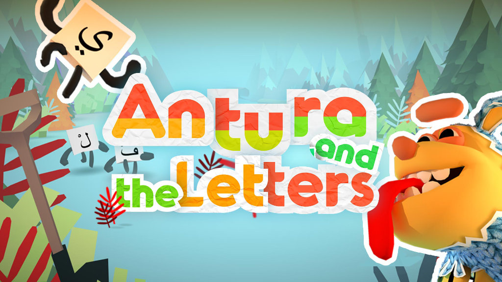
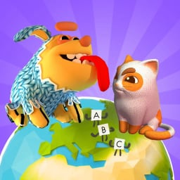

## Antura existe en deux éditions :

<a class="version-card" href="/fr/about/antura-and-the-letters">
  
  

    
🎮 La version originale primée

    <h2>Antura and the Letters</h2>
    
Parcourez <strong>6 mondes</strong> pour apprendre l'alphabet, plus de 250 mots et vos premières phrases à travers des mini-jeux ludiques. Créé pour les enfants réfugiés syriens et lauréat du prix EduApp4Syria et du UNHCR Innovation Award.

    Découvrir Antura and the Letters →
  

</a>

<a class="version-card" href="/fr/about/learn-with-antura">
  
  

    
🌍 La nouvelle édition 2026

    <h2>Learn with Antura</h2>
    
Explorez les quêtes <strong>Discover Cultures</strong> avec votre chat compagnon, collectionnez des cartes de connaissances et apprenez une nouvelle langue en chemin. Conçu pour les enfants migrants et réfugiés, à l'école comme à la maison, le jeu est actuellement testé en France et en Pologne dans le cadre de notre projet Erasmus+.

    Découvrir Learn with Antura →
  

</a>

## Explorer la documentation

<a class="audience-card" href="/fr/manual/">
  <h3>📕 Guide de l'enseignant</h3>
  
Conseils pour préparer la classe et recommandations pratiques pour utiliser Antura avec les élèves.

</a>
<a class="audience-card" href="/fr/content/">
  <h3>📘 Contenu du jeu</h3>
  
Parcourez les quêtes, dialogues, activités, mots de vocabulaire et ressources pédagogiques du jeu.

</a>
<a class="audience-card" href="/en/dev/">
  <h3>Developer Docs</h3>
  
Documentation en anglais sur l'architecture du jeu et la conception des quêtes.

</a>

