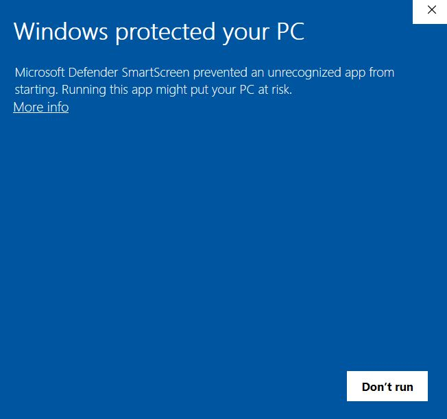
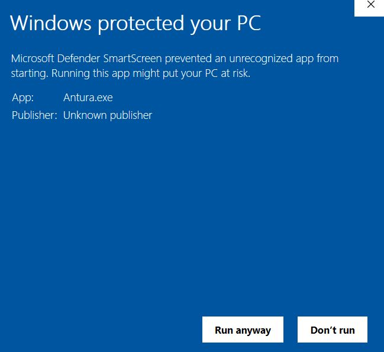

# Installer la Bêta

> [!note]
> Depuis cette page, vous pouvez télécharger la nouvelle version **3.0** de *Learn with Antura*.  
> Si vous cherchez la version actuelle **2.0** (incluant les modules *Apprendre à Lire* et *Apprendre une Langue*), veuillez consulter la [page de téléchargement](../download.md).

Le jeu est compatible avec **iOS**, **Android** et **Windows**, il peut donc être utilisé sur smartphones, tablettes et PC.  
**Une fois installé, aucune connexion Internet n’est nécessaire pour jouer.**

> [!TIP]
> **Nous recommandons l’utilisation de tablettes** comme dispositif le plus simple pour la classe.

## iOS

**Prérequis** : iOS 13  

👉 Ouvrez ce lien **depuis votre appareil iOS** : [https://testflight.apple.com/join/Qm77iXFA](https://testflight.apple.com/join/Qm77iXFA)  

(TestFlight est un service qui permet de tester des applications iOS encore en développement : ouvrez le lien ci-dessus depuis l’appareil sur lequel vous voulez installer le jeu. Une fois installé via TestFlight, Antura peut être utilisé comme n’importe quelle autre application.)

> [!note]
> En cas de problème lors du téléchargement ou de l’installation de l’application, merci d’envoyer un message sur le forum : [https://github.com/vgwb/Antura/discussions/](https://github.com/vgwb/Antura/discussions/)

## Android

La version bêta 3.0 pour Android sera disponible prochainement.  

## Windows

**Prérequis** : Windows 10/11  

La dernière version Windows peut être téléchargée ici :

<WindowsDownloadLink />

Téléchargez le fichier ZIP, décompressez-le dans un dossier puis lancez **Antura.exe**.

Windows Defender peut détecter la nouvelle application et afficher l'avertissement suivant :

Si cela se produit, cliquez sur « Plus d'informations », puis sur « Exécuter quand même ».

## Linux et macOS

Comme le jeu est open source et que le moteur utilisé est multiplateforme, des versions Linux et macOS peuvent être compilées si nécessaire.  
Merci de poser la question sur le forum : [https://github.com/vgwb/Antura/discussions/](https://github.com/vgwb/Antura/discussions/).
