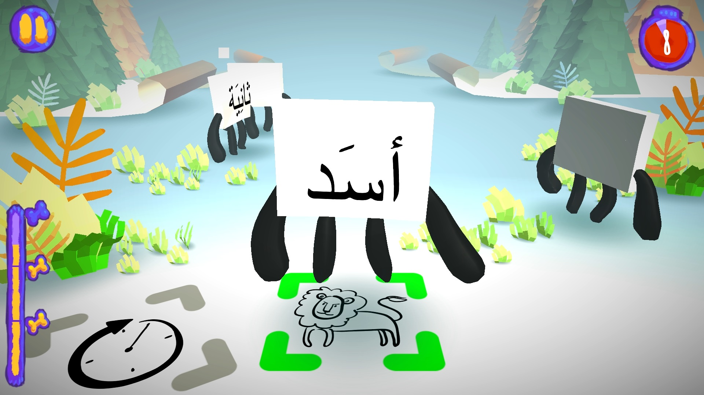
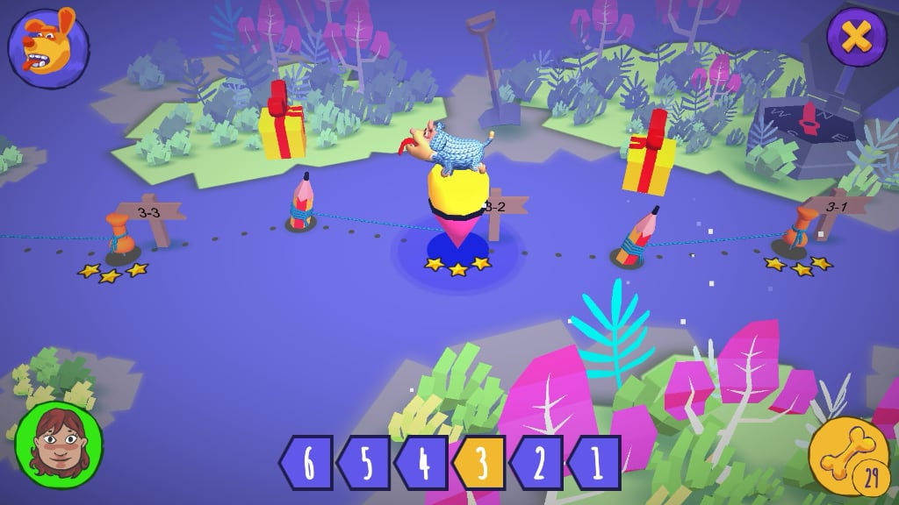
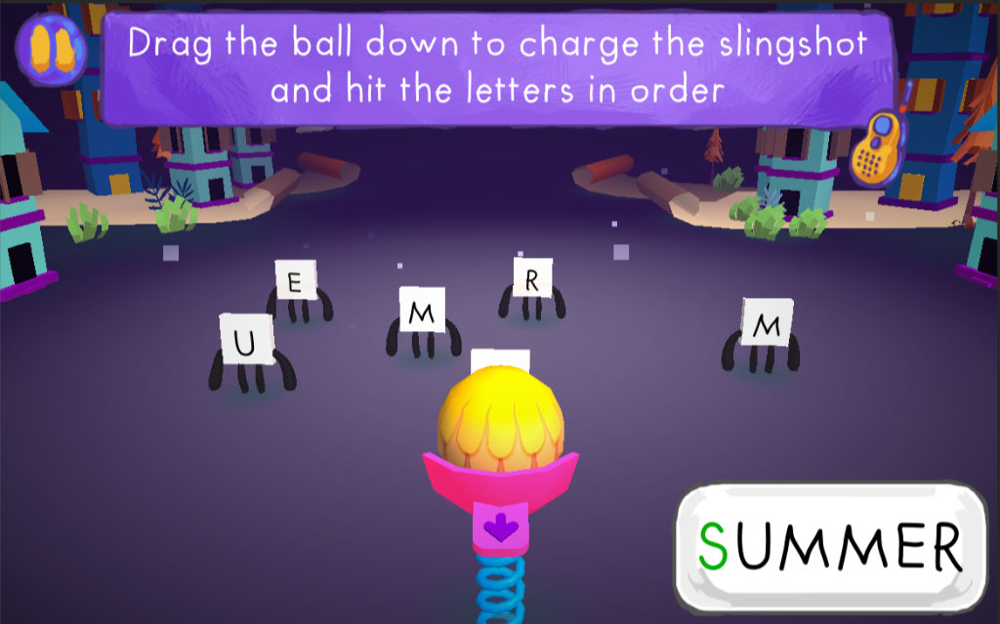
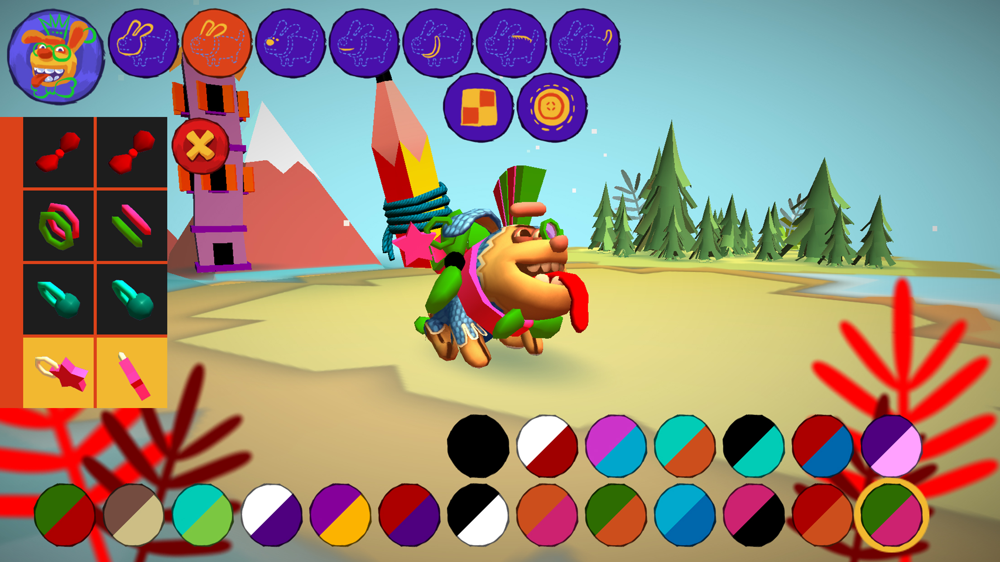

# Antura and the Letters

**Imparare a leggere gratuitamente, per tutti.** Antura and the Letters è un pluripremiato gioco open source che trasforma la lettura e l'esercizio linguistico in un'avventura divertente.

[Scarica il gioco](/it/download) · [Modulo Learn Languages](../manual/learnlanguage_module.md)

## Imparare giocando

I bambini si esercitano con lettere, parole e lettura attraverso minigiochi, viaggiando in sei mondi. Scopri i [moduli di apprendimento delle lingue](../manual/learnlanguage_module.md) e [come giocare](../manual/learnlanguage_how_to_play.md).

## Imparare a leggere e una nuova lingua

- **Leggere nella propria lingua:** supporto all'alfabetizzazione in arabo e dari persiano; pashto e ucraino sono in fase di sviluppo.
- **Imparare una nuova lingua:** corsi di inglese, francese, tedesco, ungherese, italiano, polacco, rumeno e spagnolo, dal livello Pre-A1.

Consulta i moduli attuali nella [panoramica Learn Languages](../manual/learnlanguage_module.md#current-learning-modules).

## Un progetto umanitario pluripremiato

Creato per i bambini rifugiati siriani, il gioco ha vinto il concorso internazionale EduApp4Syria. Ha inoltre ricevuto l'[UNHCR NGO Innovation Award, riconoscimenti da Techfugees e altri premi](./awards.md). Il progetto è cresciuto grazie a una comunità internazionale di volontari, università e ONG; leggi la sua [storia](./history.md).

## Gratuito e accessibile

Il gioco è gratuito, senza pubblicità e aperto ai contributi della comunità. Funziona su PC e dispositivi mobili e si può usare offline dopo l'installazione. Scopri il [progetto open source](./open-source.md) o [scarica il gioco](../download.md).

## Scopri il gioco

<YouTubeVideo id="HDM7a1i_kIw" title="Trailer di Antura" />

