# Learn with Antura

**Gioca. Scopri. Impara.** Learn with Antura è un pluripremiato gioco educativo open source che unisce lettura, apprendimento delle lingue e scoperta culturale attraverso esplorazione, interazione e storie.

[Scarica il gioco](/it/download) · [Sostieni il progetto](./support-us.md)

## In breve

- **Destinatari:** soprattutto bambini dai 6 ai 12 anni, a casa o in classe
- **Formato:** sessioni brevi; le missioni Discover durano in genere da 5 a 15 minuti
- **Modalità di apprendimento:** minigiochi linguistici e missioni di esplorazione culturale
- **Piattaforme:** PC e dispositivi mobili; giocabile offline dopo l'installazione
- **Lingue:** il gioco è disponibile in 11 lingue
- **Aperto e modulare:** i contenuti possono essere consultati e adattati senza riscrivere i sistemi principali

Per l'uso in classe, consulta il [manuale per insegnanti](../manual/index.md) e la [guida per la classe](../manual/classroom_guide.md).

## Imparare e scoprire

Learn with Antura riunisce due moduli complementari:

- **Learn Languages:** minigiochi per imparare lettere, parole e vocaboli. Consulta la [panoramica del modulo](../manual/learnlanguage_module.md) e il [programma linguistico](../content/language-curriculum/index.md).
- **Discover Cultures:** brevi missioni invitano i bambini a esplorare luoghi, tradizioni e vita quotidiana attraverso storie, attività e carte di conoscenza. Leggi l'[introduzione](../manual/discover_introduction.md), la [panoramica delle funzionalità](../manual/discover_module.md) e [come giocare](../manual/discover_how_to_play.md).

## Il Discover Framework

Il Discover Framework separa i sistemi del gioco dai contenuti educativi, così i partner possono creare nuove esperienze senza ricostruire il gioco. I suoi elementi principali sono mondi e luoghi 3D, missioni narrative, attività riutilizzabili, carte e argomenti collegati, personaggi e dialoghi multilingue.

Consulta la [guida alla progettazione delle missioni](/en/dev/quest-design/) per scoprire come creare contenuti con questo framework.

## Contenuti aperti e consultabili

Missioni, carte di conoscenza, dialoghi e traduzioni sono disponibili nella [biblioteca dei contenuti](../content/). Insegnanti e partner possono consultarli, verificare le traduzioni e adattare i contenuti culturali senza creare una build di Unity.

Esplora [missioni](../content/quests/index.md), [argomenti](../content/topics/index.md), [carte](../content/cards/index.md), [parole](../content/words/index.md), [attività](../content/activities/index.md), [luoghi](../content/locations/index.md) e [minigiochi linguistici](../content/language-minigames/index.md).

## Per insegnanti, creatori e partner

Gli insegnanti possono esplorare i contenuti, usare le attività in classe e guidare discussioni dopo il gioco. Sviluppatori e designer possono creare missioni e attività; ricercatori e scuole possono sperimentare e valutare l'esperienza di apprendimento. Consulta il [manuale per insegnanti](../manual/index.md), la [guida alla progettazione delle missioni](/en/dev/quest-design/) e il [progetto Erasmus+](./erasmus.md).

## Open source e riconoscimenti

Learn with Antura è gratuito, senza pubblicità e aperto ai contributi della comunità. Nasce da un'iniziativa umanitaria per bambini in contesti fragili e ha ricevuto riconoscimenti internazionali, tra cui il premio EduApp4Syria. Scopri la [storia del progetto](./history.md), i [premi](./awards.md), la [valutazione d'impatto](./impact.md) e il progetto [open source](./open-source.md).

## Scopri il gioco

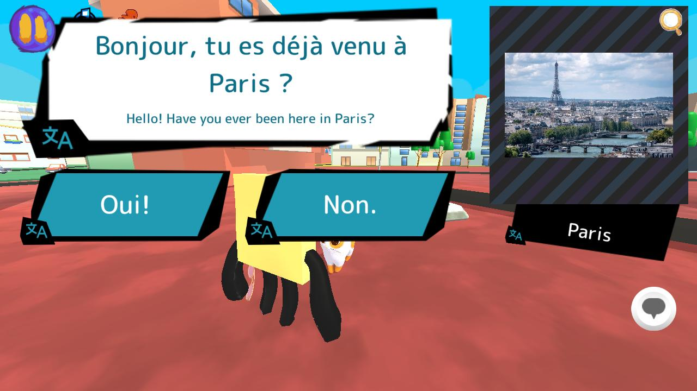
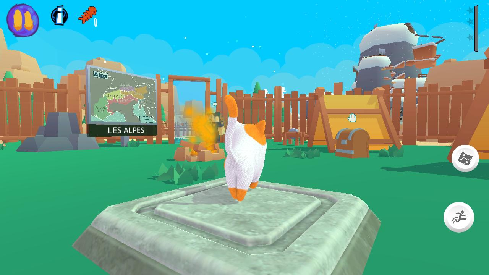
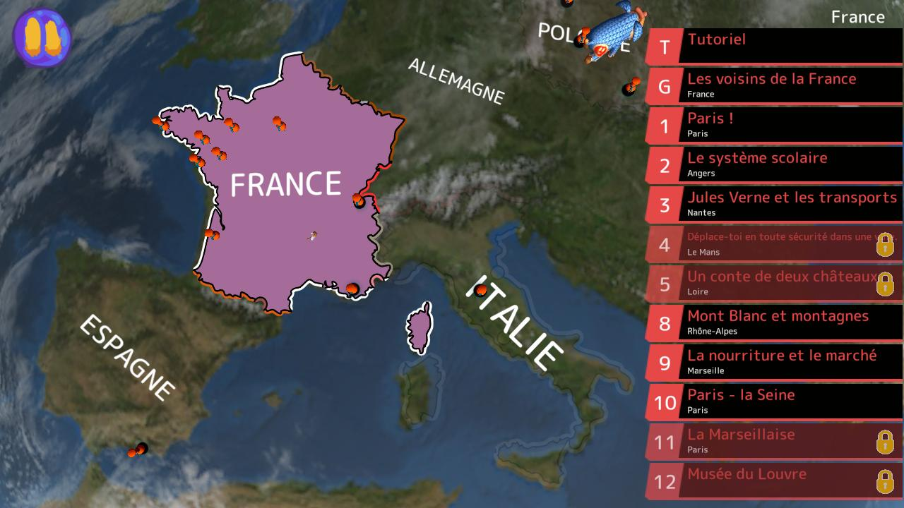
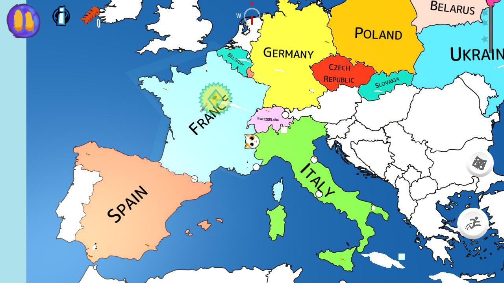

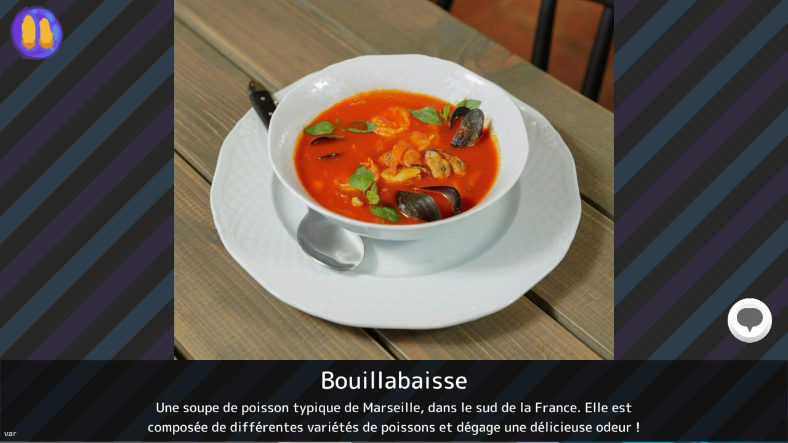
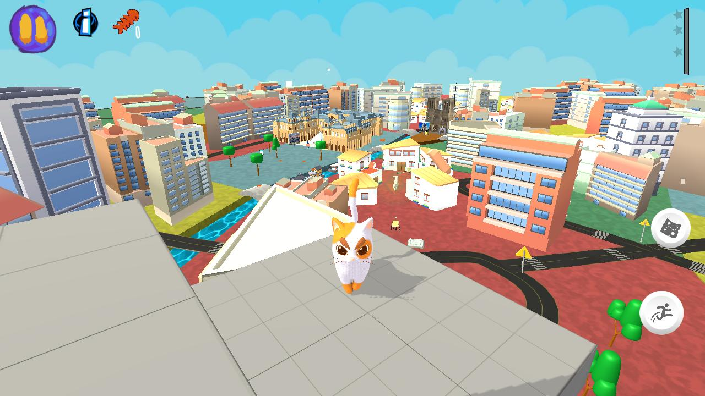
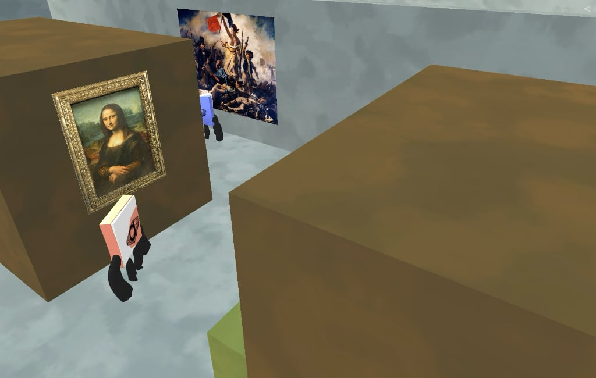
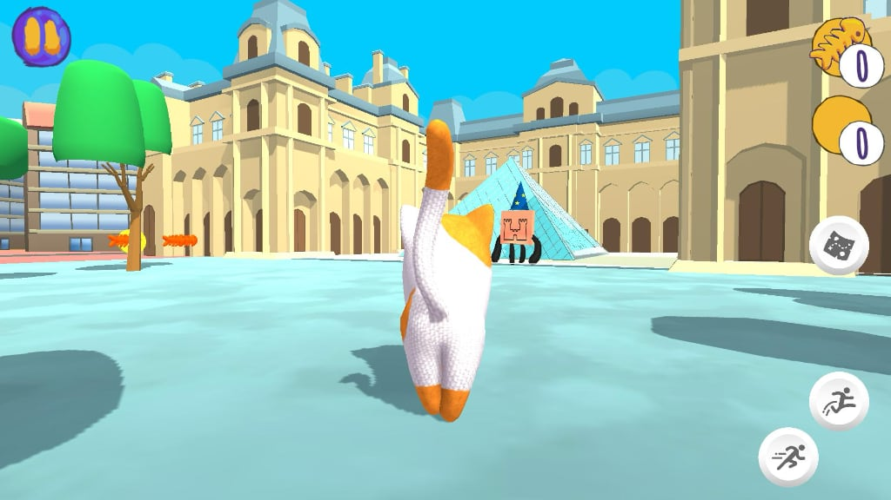
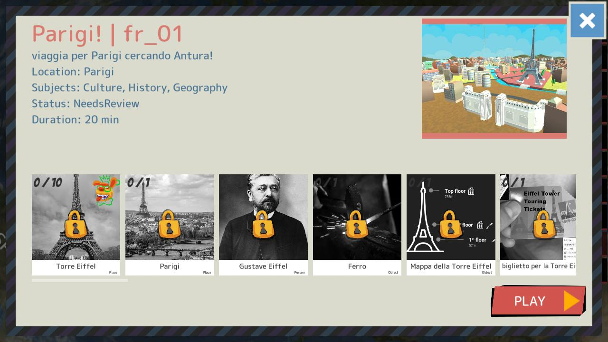
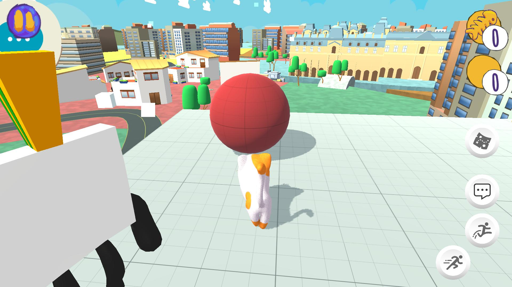
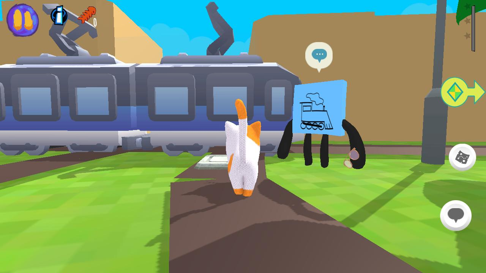
, in Polonia")
