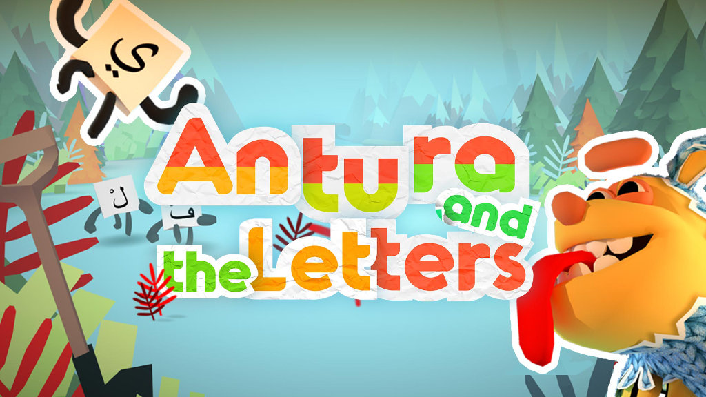
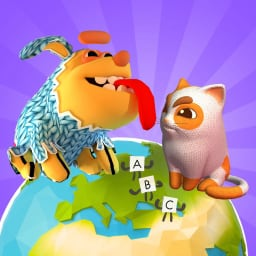

## Antura esiste in due edizioni:

<a class="version-card" href="/it/about/antura-and-the-letters">
  
  

    
🎮 La versione originale premiata

    <h2>Antura and the Letters</h2>
    
Viaggia attraverso <strong>6 mondi</strong> per imparare l'alfabeto, oltre 250 parole e le tue prime frasi con minigiochi divertenti. Creato per i bambini rifugiati siriani, vincitore di EduApp4Syria e dell'UNHCR Innovation Award.

    Scopri Antura and the Letters →
  

</a>

<a class="version-card" href="/it/about/learn-with-antura">
  
  

    
🌍 La nuova edizione 2026

    <h2>Learn with Antura</h2>
    
Esplora le missioni <strong>Discover Cultures</strong> insieme al tuo gatto compagno, colleziona carte di conoscenza e impara una nuova lingua lungo il percorso. Pensato per bambini migranti e rifugiati, a scuola e a casa, il gioco è attualmente in fase pilota in Francia e Polonia nell'ambito del nostro progetto Erasmus+.

    Scopri Learn with Antura →
  

</a>

## Esplora la documentazione

<a class="audience-card" href="/it/manual/">
  <h3>📕 Manuale per insegnanti</h3>
  
Indicazioni per preparare la classe e consigli pratici per usare Antura con gli studenti.

</a>
<a class="audience-card" href="/it/content/">
  <h3>📘 Contenuti del gioco</h3>
  
Scopri missioni, dialoghi, attività, vocaboli e materiali didattici del gioco.

</a>
<a class="audience-card" href="/en/dev/">
  <h3>Developer Docs</h3>
  
Documentazione in inglese sull'architettura del gioco e sulla progettazione delle missioni.

</a>

