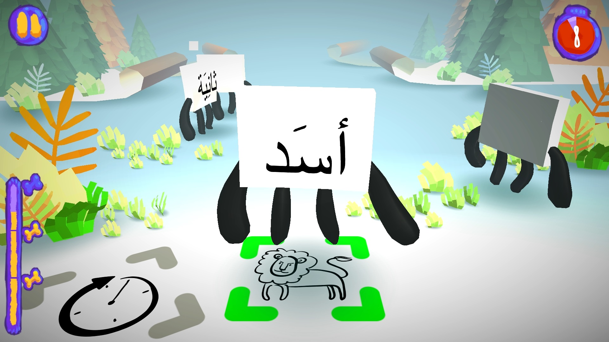
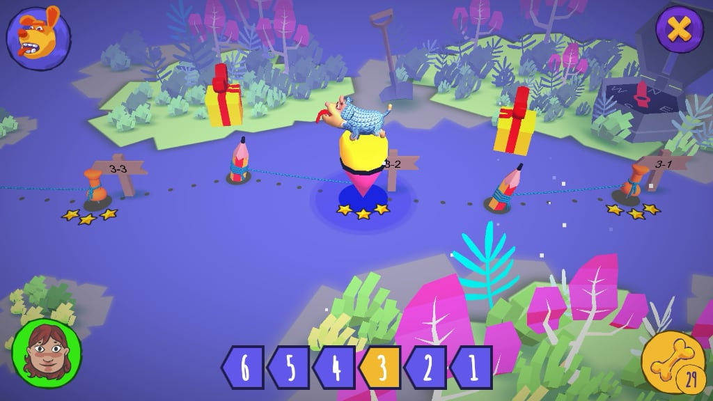
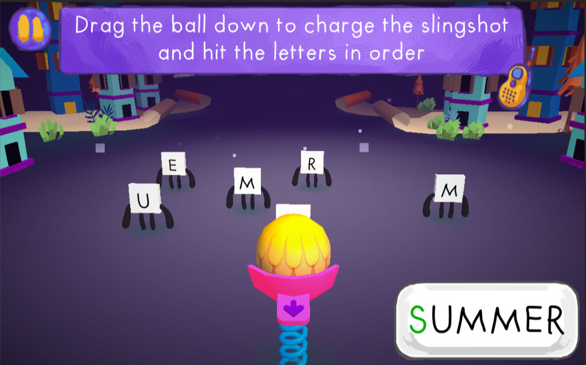
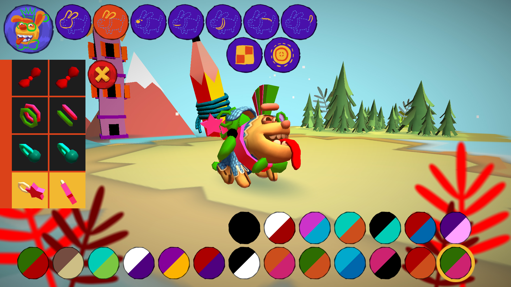

# Antura and the Letters

**Darmowa nauka czytania dla wszystkich.** Antura and the Letters to wielokrotnie nagradzana gra open source, która zmienia naukę czytania i języka w pełną przygód zabawę.

[Pobierz grę](/pl/download) · [Moduł Learn Languages](../manual/learnlanguage_module.md)

## Nauka przez zabawę

Dzieci ćwiczą litery, słowa i czytanie w minigrach podczas podróży przez sześć światów. Poznaj [moduły nauki języków](../manual/learnlanguage_module.md) i [zasady gry](../manual/learnlanguage_how_to_play.md).

## Nauka czytania i nowego języka

- **Czytanie w swoim języku:** wsparcie nauki czytania po arabsku i persku dari; paszto i ukraiński są w przygotowaniu.
- **Nauka nowego języka:** kursy angielskiego, francuskiego, niemieckiego, węgierskiego, włoskiego, polskiego, rumuńskiego i hiszpańskiego od poziomu Pre-A1.

Aktualne moduły znajdziesz w [opisie Learn Languages](../manual/learnlanguage_module.md#current-learning-modules).

## Nagradzany projekt humanitarny

Gra powstała z myślą o syryjskich dzieciach uchodźczych i wygrała międzynarodowy konkurs EduApp4Syria. Otrzymała także [UNHCR NGO Innovation Award, wyróżnienie Techfugees i inne nagrody](./awards.md). Projekt rozwijał się dzięki międzynarodowej społeczności wolontariuszy, uczelni i organizacji pozarządowych; poznaj jego [historię](./history.md).

## Darmowa i dostępna

Gra jest darmowa, nie zawiera reklam i jest otwarta na wkład społeczności. Działa na komputerach i urządzeniach mobilnych, a po instalacji można grać offline. Poznaj [projekt open source](./open-source.md) lub [pobierz grę](../download.md).

## Zobacz grę

<YouTubeVideo id="HDM7a1i_kIw" title="Zwiastun Antura" />

