# Learn with Antura

**Graj. Odkrywaj. Ucz się.** Learn with Antura to wielokrotnie nagradzana, otwarta gra edukacyjna, która łączy czytanie, naukę języków i poznawanie kultur poprzez eksplorację, interakcję i opowieści.

[Pobierz grę](/pl/download) · [Wesprzyj projekt](./support-us.md)

## W skrócie

- **Odbiorcy:** przede wszystkim dzieci w wieku 6–12 lat, w domu i w klasie
- **Format:** krótkie sesje gry; zadania Discover zwykle trwają od 5 do 15 minut
- **Sposoby nauki:** minigry językowe i zadania związane z odkrywaniem kultury
- **Platformy:** komputery i urządzenia mobilne; gra działa offline po instalacji
- **Języki:** gra jest dostępna w 11 językach
- **Otwarta i modułowa:** treści można przeglądać i dostosowywać bez przebudowy głównych systemów

Do pracy w klasie zajrzyj do [podręcznika dla nauczycieli](../manual/index.md) i [przewodnika po pracy w klasie](../manual/classroom_guide.md).

## Nauka i odkrywanie

Learn with Antura łączy dwa uzupełniające się moduły:

- **Learn Languages:** minigry uczą liter, słów i słownictwa. Zobacz [opis modułu](../manual/learnlanguage_module.md) i [program nauczania języków](../content/language-curriculum/index.md).
- **Discover Cultures:** krótkie zadania zapraszają dzieci do poznawania miejsc, tradycji i codziennego życia poprzez opowieści, aktywności i karty wiedzy. Zacznij od [wprowadzenia](../manual/discover_introduction.md), [opisu funkcji](../manual/discover_module.md) lub [zasad gry](../manual/discover_how_to_play.md).

## Discover Framework

Discover Framework oddziela systemy gry od treści edukacyjnych, dzięki czemu partnerzy mogą tworzyć nowe doświadczenia bez przebudowy gry. Obejmuje światy i miejsca 3D, zadania fabularne, wielokrotnego użytku aktywności, połączone karty wiedzy i tematy oraz wielojęzyczne postacie i dialogi.

Zobacz [przewodnik projektowania zadań](/en/dev/quest-design/), aby dowiedzieć się, jak tworzyć treści z użyciem tego frameworka.

## Otwarte treści

Zadania, karty wiedzy, dialogi i tłumaczenia są dostępne w [bibliotece treści](../content/). Nauczyciele i partnerzy mogą przeglądać materiały, sprawdzać tłumaczenia i dostosowywać treści kulturowe bez tworzenia kompilacji w Unity.

Przeglądaj [zadania](../content/quests/index.md), [tematy](../content/topics/index.md), [karty](../content/cards/index.md), [słowa](../content/words/index.md), [aktywności](../content/activities/index.md), [miejsca](../content/locations/index.md) i [minigry językowe](../content/language-minigames/index.md).

## Dla nauczycieli, twórców i partnerów

Nauczyciele mogą przeglądać treści, korzystać z aktywności klasowych i prowadzić rozmowy po grze. Programiści i projektanci mogą tworzyć zadania i aktywności, a badacze i szkoły testować oraz oceniać doświadczenie edukacyjne. Zobacz [podręcznik dla nauczycieli](../manual/index.md), [przewodnik projektowania zadań](/en/dev/quest-design/) i [projekt Erasmus+](./erasmus.md).

## Open source i wyróżnienia

Learn with Antura jest darmowa, nie zawiera reklam i jest otwarta na wkład społeczności. Gra wywodzi się z inicjatywy humanitarnej dla dzieci w trudnych sytuacjach i zdobyła międzynarodowe uznanie, w tym nagrodę EduApp4Syria. Poznaj [historię projektu](./history.md), [nagrody](./awards.md), [ocenę wpływu](./impact.md) i informacje o [open source](./open-source.md).

## Zobacz grę

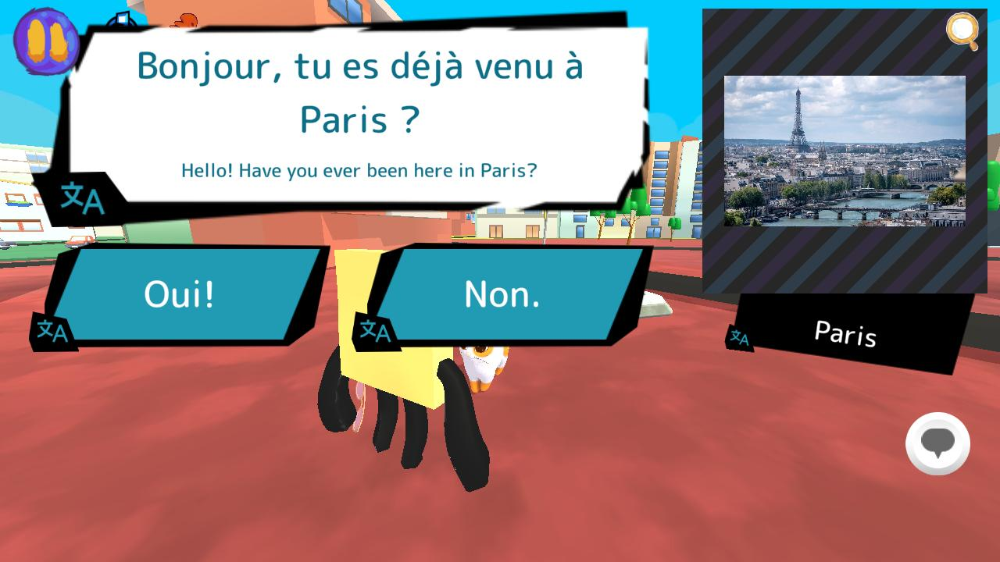
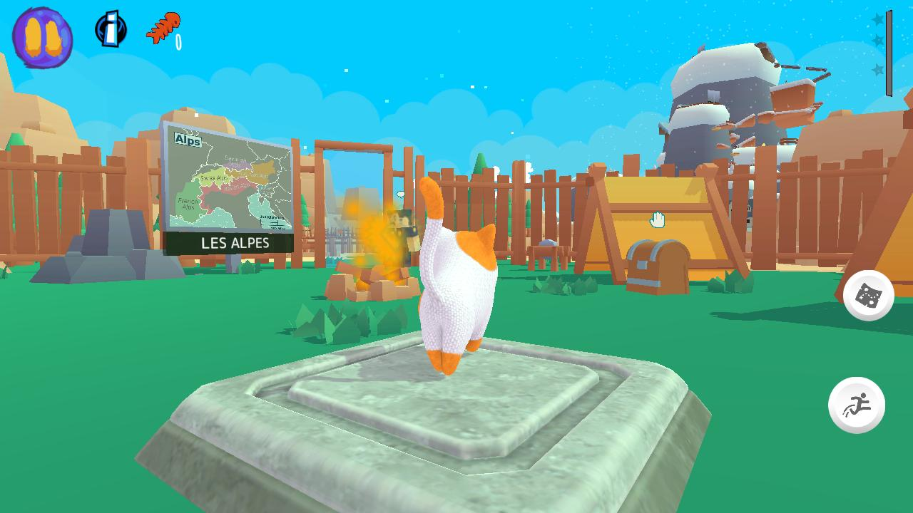
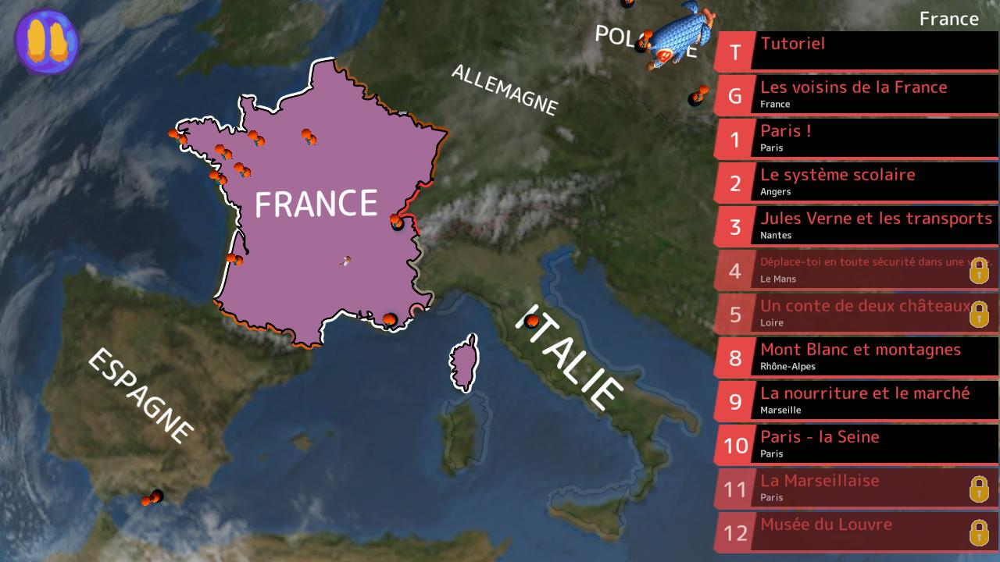
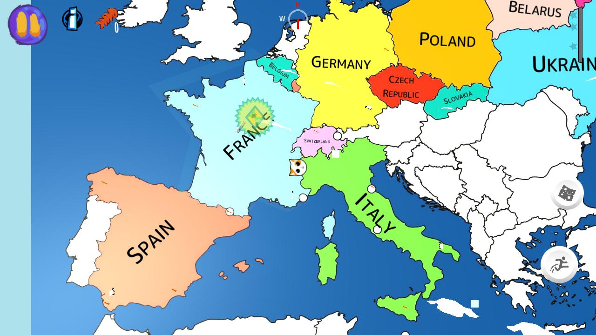

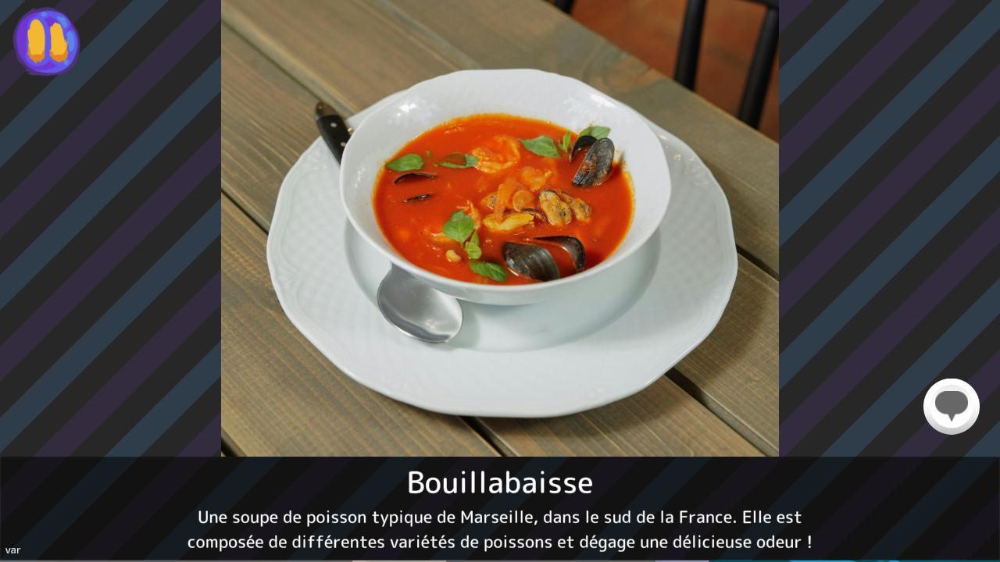
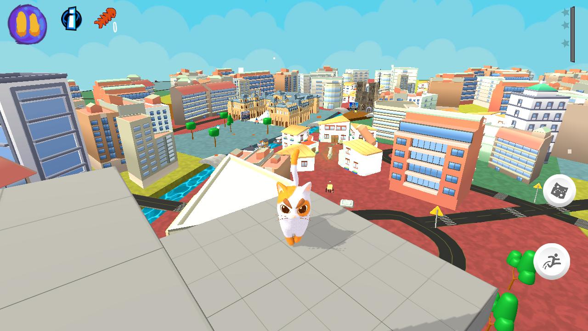
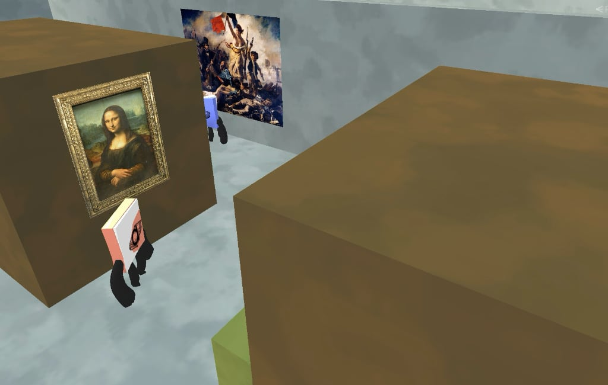
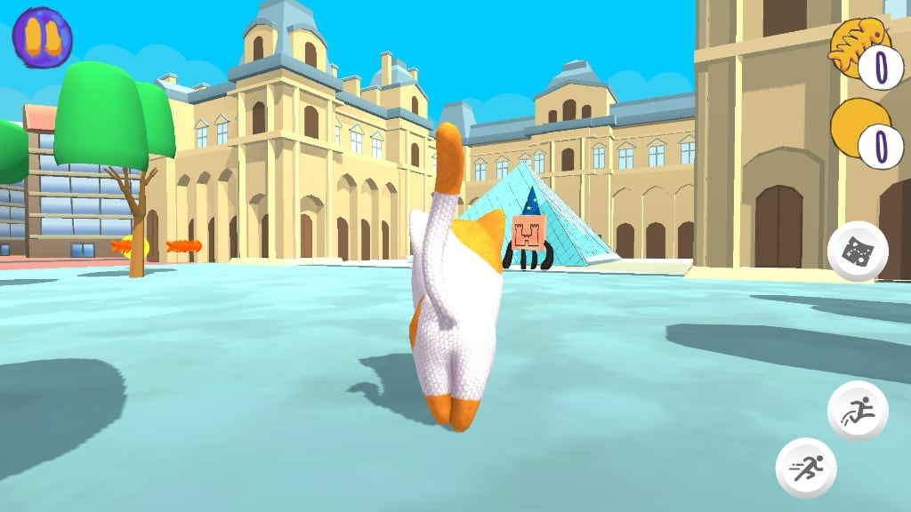
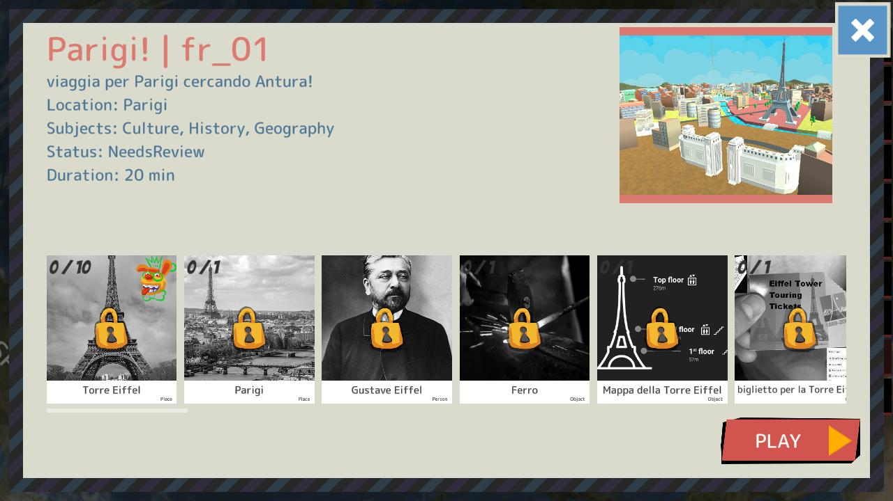
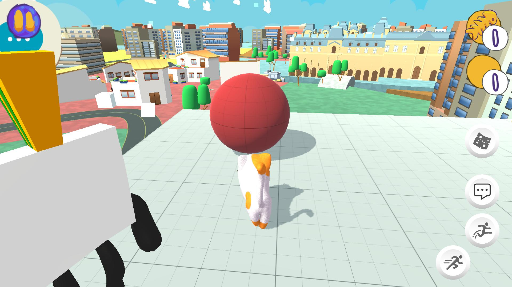
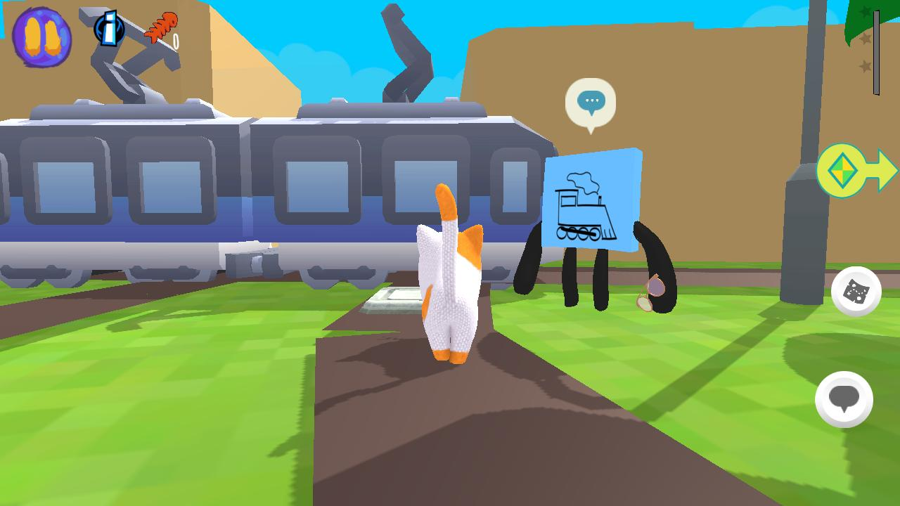
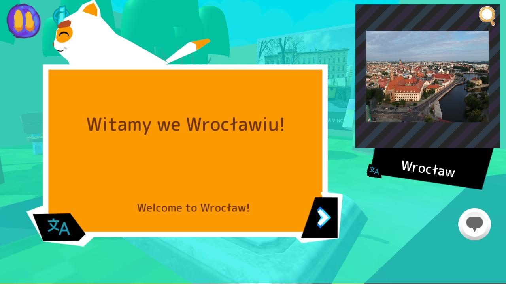
