# System edukacji (fr_02)
> [!note] Educators & Designers: help improving this quest!
> **Comments and feedback**: [discuss in the Forum](https://github.com/vgwb/Antura/discussions/629)  
> **Improve script translations**: [comment the Google Sheet](https://docs.google.com/spreadsheets/d/1FPFOy8CHor5ArSg57xMuPAG7WM27-ecDOiU-OmtHgjw/edit?gid=1873232287#gid=1873232287)  
> **Improve Cards translations**: [comment the Google Sheet](https://docs.google.com/spreadsheets/d/1M3uOeqkbE4uyDs5us5vO-nAFT8Aq0LGBxjjT_CSScWw/edit?gid=415931977#gid=415931977)  
> **Improve the script**: [propose an edit here](https://github.com/vgwb/Antura/blob/main/Assets/_discover/_quests/FR_02%20Angers%20School/FR_02%20Angers%20School%20-%20Yarn%20Script.yarn)  

- Version: 1.00
- Status: Production
- Location: France - Angers

- Difficulty: Normal
- Duration (min): 20
- Description: Odkryj szkołę we Francji. Odwiedź szkołę i poznaj jej różne części (plac zabaw, stołówkę, salę lekcyjną itp.). Naucz się nazw poszczególnych szkół i poziomów nauczania (przedszkole, szkoła podstawowa, gimnazjum i liceum). I żeby być gotowym, spakuj plecak!

## Game Design Notes

The cat goes to different places until he finds his school. Then he visits the school and finds his class.

### Content
School system : the cats goes a lycée (16-18 ans), to a collège (11-15 ans), to a école maternelle (3-5 ans) and finally goes to an école primaire (6-10 ans), that corresponds to his age, called Jules Verne

A typical day at school

- Morning childcare = garderie du matin
- arrival at the school gate = le portail
- work in class with different subjects/matières : maths, reading & writing
- morning playtime (récréation) on the playground (la cour) 
- lunch at the canteen (la cantine) or at home (à la maison)
- school work with different subjects/matières : PE = EPS (éducation physique et - sportive),  hist/geog = histoire/géographie,  science = sciences, arts= art
- evening childcare = garderie du soir / homework support = aide aux devoirs

School levels with level names and age (CP–6 ans / CE1-7 ans / CE2-8 ans /CM1-9 ans / CM2–10 ans).

### Knowledge content
The French School System: Kids learn the names, age groups, and order of the main schools:

- École Maternelle (3-5 years old)
- École Primaire (6-10 years old) - 5 years total.
- Collège (11-15 years old)
- Lycée (16-18 years old)

**The Baccalauréat**: Kids learn that the Lycée prepares you for a final diploma called le Baccalauréat, which is needed for university.

**Classroom Life**: Kids learn that French students learn to write in cursive, have playtime (la récréation) in the morning and afternoon, and study things like geometry.

**Cultural Values**: Introduction to the principles of French public schools via the national motto and the Charter of Secularism.

## Quest Script
[See the full script here](./fr_02-script.md)

## Topics
### French School {#frenchschool}
[Open topic page](../../topics/index.md#frenchschool)  

- Importance: High  
- Country: France  
- Target age: Ages6to10  
- Subjects: Education

#### Core Card - Szkoły francuskie
We Francji nauka w szkole dzieli się na cztery główne etapy. Maternelle jest dla dzieci w wieku od 3 do 5 lat. École élémentaire jest dla dzieci w wieku od 6 do 10 lat. Ma pięć klas: CP, CE1, CE2, CM1 i CM2. Collège jest dla uczniów w wieku od 11 do 14 lat. Ma cztery klasy: 6ème, 5ème, 4ème i 3ème. Lycée jest dla młodzieży w wieku od 15 do 18 lat. Ma trzy klasy: 2nde, 1ère i terminale.

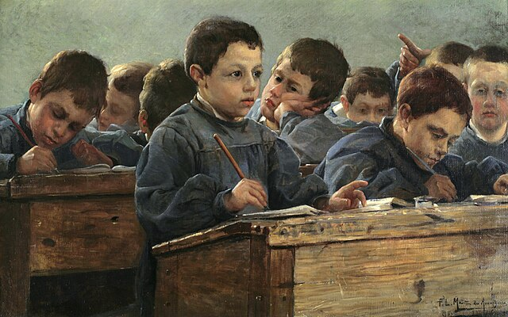{ width="200" }
- Type: Concept
- Subjects: Education, Civics, Culture

#### Connection (PartOf) - Przedszkole
Szkoła we Francji dla dzieci w wieku od 3 do 5 lat. Dzieci uczą się, odkrywając świat i bawiąc się.

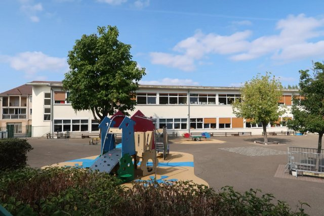{ width="200" }
- Type: Concept
- Subjects: Education, Culture
- Year: 1975

#### Connection (PartOf) - Szkoła podstawowa we Francji
Szkoła we Francji dla dzieci w wieku od 6 do 10 lat. Dzieci uczą się czytać, pisać i liczyć.

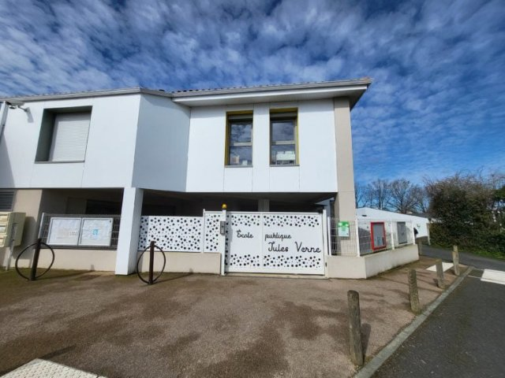{ width="200" }
- Type: Concept
- Subjects: Education, Culture
- Year: 1975

#### Connection (PartOf) - Liceum we Francji
Szkoła we Francji dla młodzieży w wieku od 14 do 18 lat. Uczniowie mają różnych nauczycieli i uczą się różnych przedmiotów, takich jak matematyka, angielski, przyroda, sport i historia. Przygotowują się do egzaminu końcowego zwanego maturą.

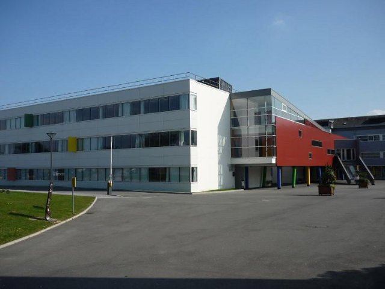{ width="200" }
- Rationale: The Lycée system shows kids the path to higher education in France
- Type: Concept
- Subjects: Education, Culture
- Year: 1975

#### Connection (PartOf) - Collège we Francji
Szkoła we Francji dla uczniów w wieku od 11 do 14 lat. Mają różnych nauczycieli i uczą się takich przedmiotów jak matematyka, angielski, przyroda, sport i historia.

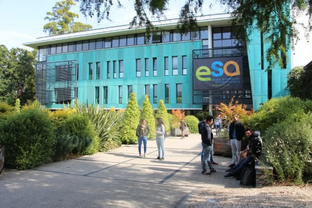{ width="200" }
- Rationale: Understanding the French school system helps kids compare education across countries
- Type: Concept
- Subjects: Education, Culture
- Year: 1975

#### Connection (Purpose) - Menu stołówki
Lista dań, które możesz wybrać na szkolny obiad.

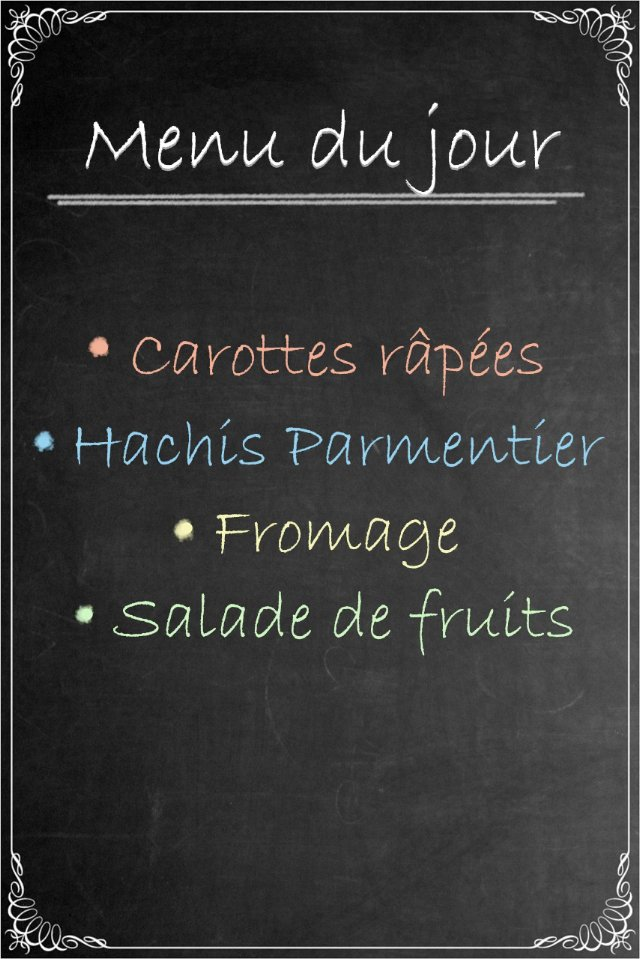{ width="200" }
- Type: Object
- Subjects: Community, Culture

### Elementary Math {#elementary-maths}
[Open topic page](../../topics/index.md#elementary-maths)  

Numbers and shapes for everyday life: counting, adding and subtracting, simple fractions, measuring, telling time, and using money.

- Importance: Medium  
- Country: International  
- Target age: Ages6to10  
- Subjects: Math

#### Core Card - Matematyka podstawowa
Liczby i kształty potrzebne w codziennym życiu: liczenie, dodawanie, odejmowanie, proste ułamki, mierzenie, określanie czasu i korzystanie z pieniędzy.

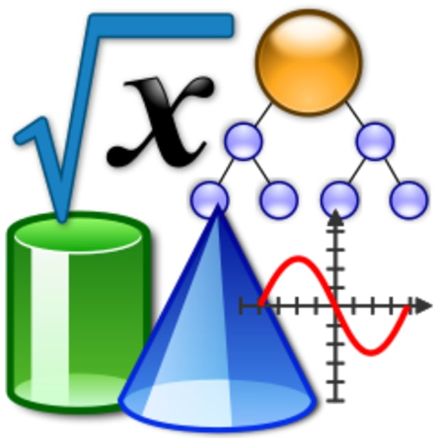{ width="200" }
- Type: None

#### Connection (PartOf): curriculum element - Linia
Linia prosta, która prowadzi z jednego punktu do drugiego. Linie mogą być długie lub krótkie.

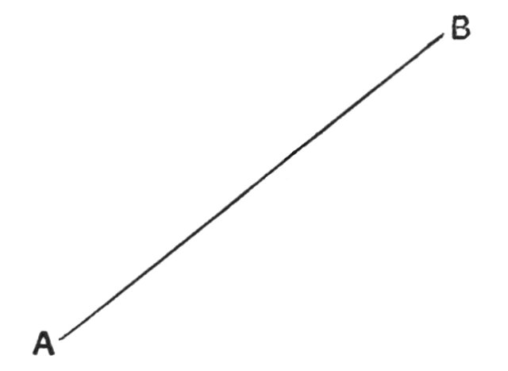{ width="200" }
- Type: Concept
- Subjects: Math

#### Connection (PartOf): curriculum element - Trójkąt
Ma trzy boki i trzy kąty. Trójkąty wyglądają jak kawałki pizzy.

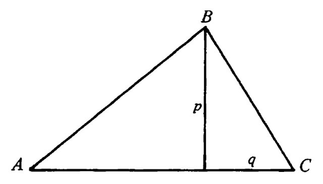{ width="200" }
- Type: Concept
- Subjects: Math

#### Connection (Purpose): tool used for math - Cyrkiel
Narzędzie, które pomaga rysować idealne okręgi. Ma dwie nogi jak nożyczki.

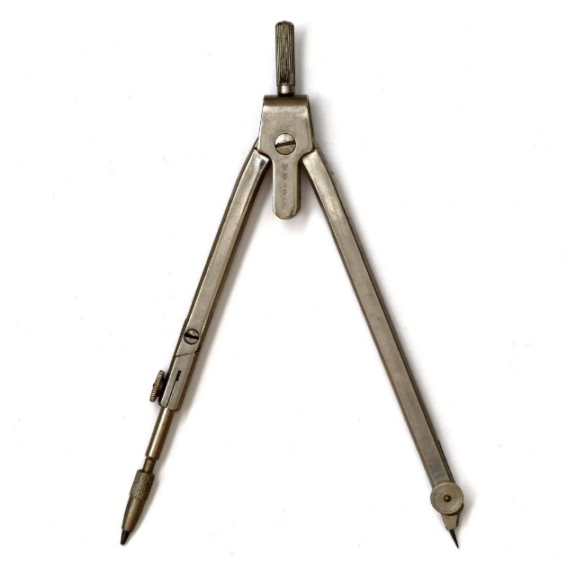{ width="200" }
- Type: Object
- Subjects: Math

#### Connection (Purpose): tool used for math - Linijka
Proste narzędzie do pomiaru długości przedmiotów. Linijki mają cyfry i linie.

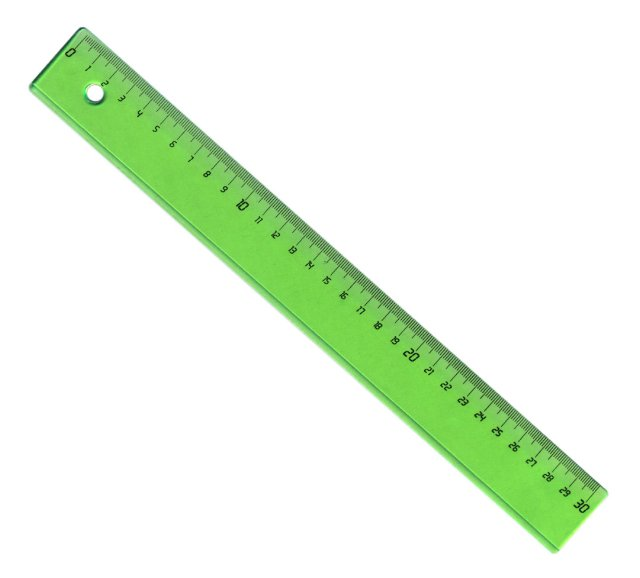{ width="200" }
- Type: Object
- Subjects: Math

#### Connection (Purpose): tool used for math - Ekierka
Narzędzie w kształcie trójkąta, służące do rysowania linii prostych i kątów prostych w matematyce.

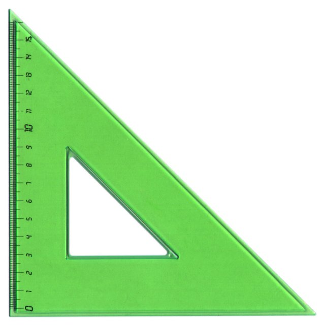{ width="200" }
- Type: Object
- Subjects: Math

#### Connection (PartOf): Previous core card - Koło
Okrągły kształt, bez rogów. Koła wyglądają jak koła samochodu, piłki i monety!

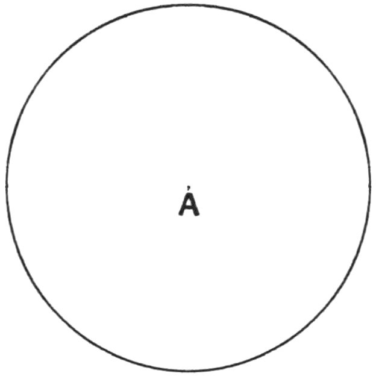{ width="200" }
- Type: Concept
- Subjects: Math

## Additional Cards
#### Plecak szkolny
Plecak, w którym uczniowie noszą książki, ołówki i prace domowe.

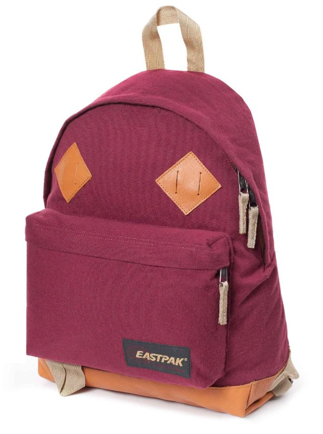{ width="200" }
- Type: Object
- Subjects: Science

#### Klasa
Pomieszczenie w szkole, w którym uczniowie uczą się nowych rzeczy.

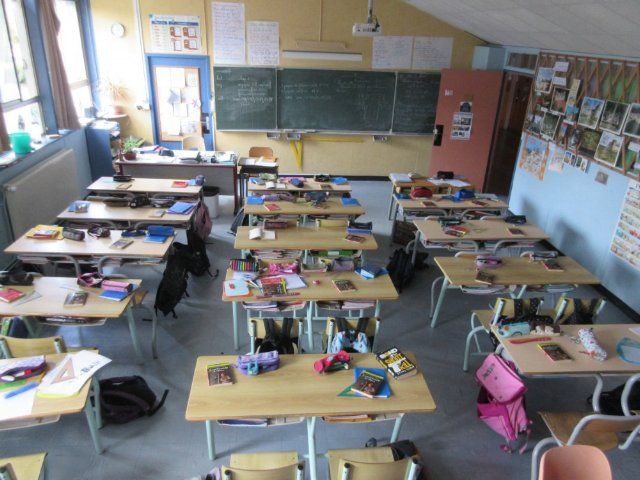{ width="200" }
- Type: Place
- Subjects: Education, Community

## Words
- water
## Activities
- [Match](../../activities/index.md#Match)
- [Order](../../activities/index.md#Order)

## Tasks
- [Interact] TASK_SCHOOL
- [Collect] TASK_BACKPACK
- [Interact] TASK_CLASSROOM
## Credits
- Anne (France) (content)
- Lucie Paillat (France) (content, design)
- [Stefano Cecere](https://stefanocecere.com) (Italy) (development)
- Valeria Passarella (Italy) (design)
