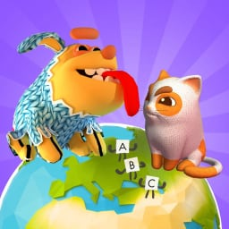
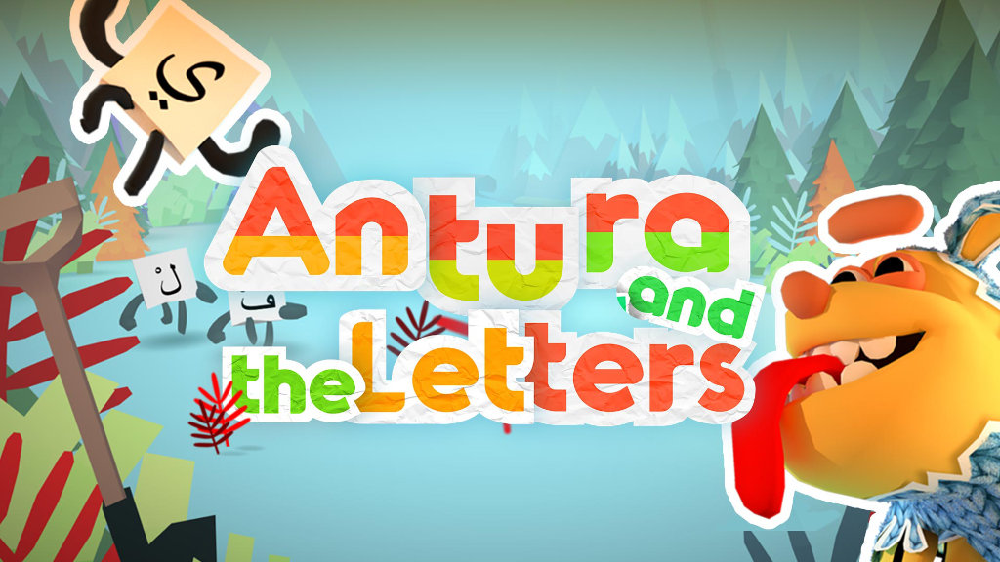

## Antura występuje w dwóch edycjach:

<a class="version-card" href="/pl/about/learn-with-antura">
  
  

    
🌍 Nowa edycja 2026

    <h2>Learn with Antura</h2>
    
Odkrywaj zadania <strong>Discover Cultures</strong> razem ze swoim kotem-towarzyszem, zbieraj karty wiedzy i ucz się nowego języka po drodze. Gra jest przeznaczona dla dzieci z doświadczeniem migracji i uchodźstwa, w szkole i w domu, a obecnie jest pilotażowo wdrażana we Francji i Polsce w ramach projektu Erasmus+.

    Odkryj Learn with Antura →
  

</a>

<a class="version-card" href="/pl/about/antura-and-the-letters">
  
  

    
🎮 Wielokrotnie nagradzana oryginalna wersja

    <h2>Antura and the Letters</h2>
    
Podróżuj przez <strong>6 światów</strong>, aby nauczyć się alfabetu, ponad 250 słów i pierwszych zdań dzięki zabawnym minigrom. Stworzona dla dzieci uchodźców z Syrii, zdobywczyni nagrody EduApp4Syria i UNHCR Innovation Award.

    Odkryj Antura and the Letters →
  

</a>

## Poznaj dokumentację

<a class="audience-card" href="/pl/manual/">
  <h3>📕 Podręcznik dla nauczycieli</h3>
  
Wskazówki dotyczące przygotowania zajęć i praktyczne porady, jak korzystać z Antury z uczniami.

</a>
<a class="audience-card" href="/pl/content/">
  <h3>📘 Zawartość gry</h3>
  
Przeglądaj zadania, dialogi, aktywności, słownictwo i materiały edukacyjne z gry.

</a>
<a class="audience-card" href="/en/dev/">
  <h3>Developer Docs</h3>
  
Dokumentacja po angielsku o architekturze gry oraz projektowaniu zadań.

</a>

